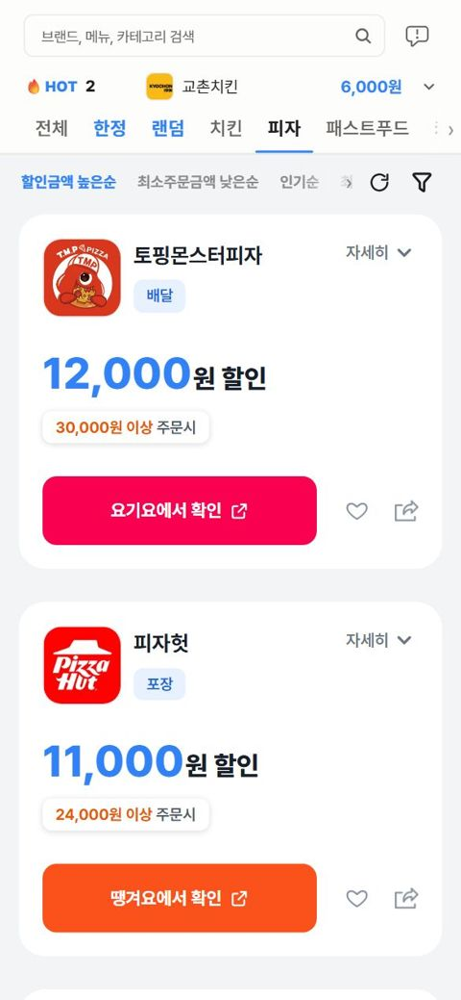
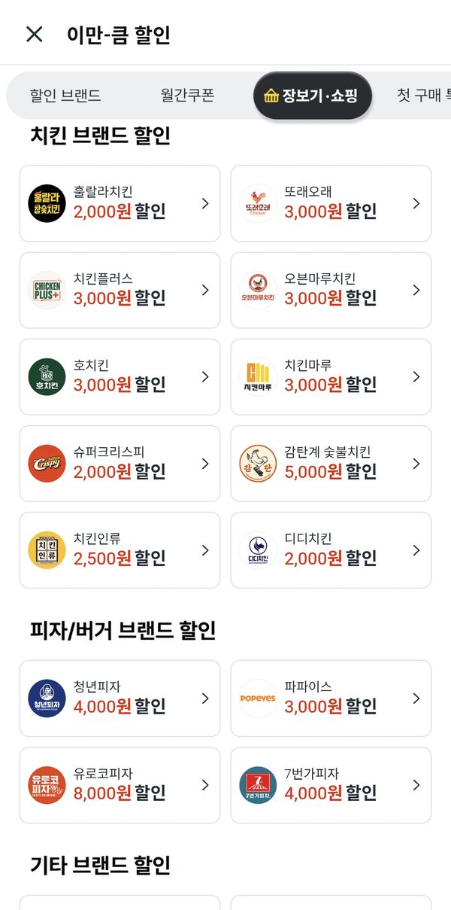
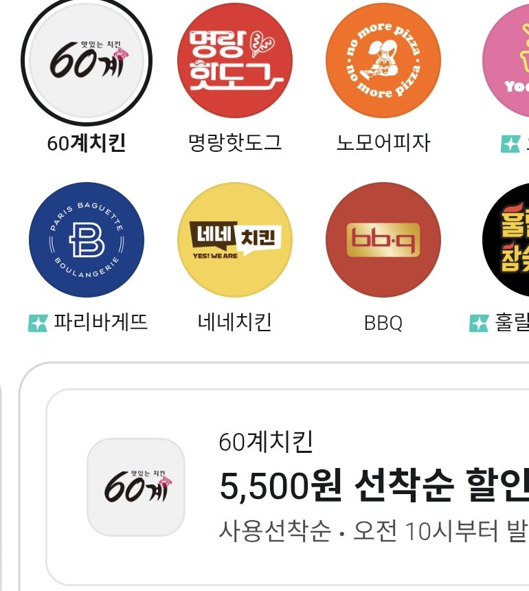
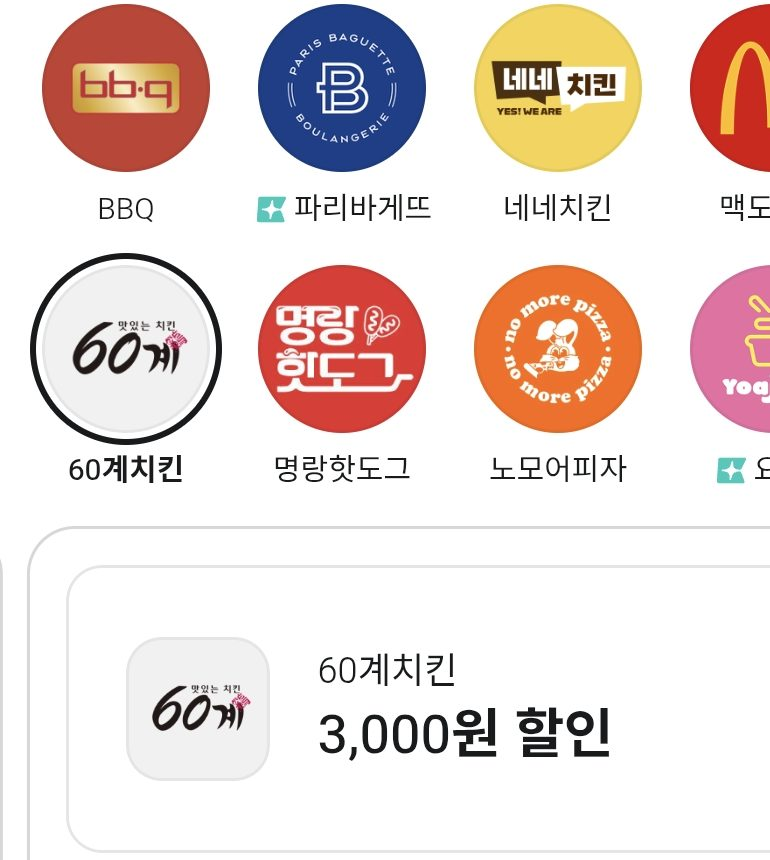
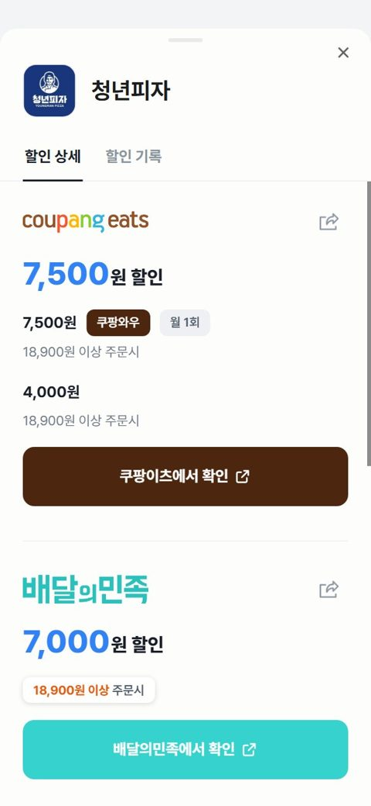
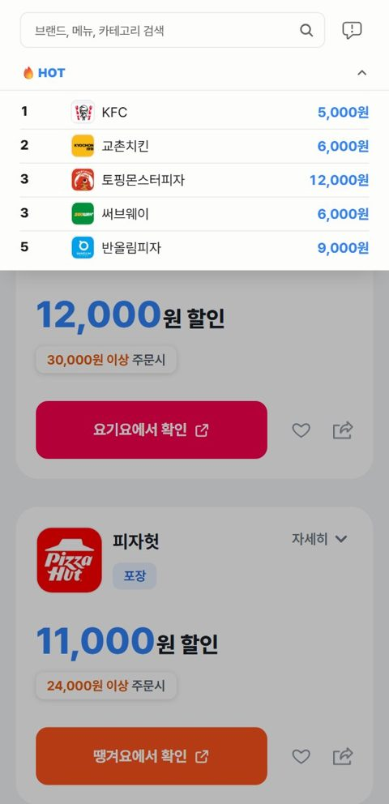
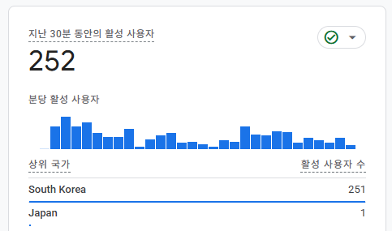

# SaveEats

# 배달앱 할인, 한 눈에 보기

오늘의 할인을 확인하세요.

[바로가기](https://beggars-five.vercel.app/?home=b)

   

## 4개 배달앱의 할인 정보 비교

배달앱의 할인 정보를 비교하고, 가장 큰 할인을 찾아요.

## 할인 조건 명확하게 확인하기

숨겨진 조건, 최소주문, 멤버십, 한정 조건을 먼저 확인해서 보여드려요.

**쿠팡이츠 멤버십 전용 쿠폰**

| 멤버십 화면 | 비회원 화면 |
|:---:|:---:|
|  |  |

**배달의민족**

| 멤버십 화면 | 비회원 화면 |
|:---:|:---:|
|  |  |

## 개인 맞춤 필터 설정

사용하는 앱, 원하는 조건에 맞는 할인 정보만 볼 수 있어요.

## 실시간 인기 브랜드

사용자들의 실시간 인기 순위를 보여드려요.

## 빠르고 저렴하게, 한 눈에 보는 오늘의 할인

지금 받을 수 있는 할인, 바로 확인해 보세요

[바로가기](https://beggars-five.vercel.app/?home=b)

각 배달앱의 공식 서비스가 아니며, 모든 상표는 각 권리자에게 있습니다.

[개인정보처리방침](https://beggars-five.vercel.app/privacy)

---

우아한테크코스 8기 팀 오늘의 할인

# SaveEats

여러 배달앱의 할인을 한곳에서 비교합니다.

[서비스 체험하기](https://beggars-five.vercel.app/) · [GitHub](https://github.com/woowacourse-teams/2026-to-discount) · [페이지 모음](https://beggars-five.vercel.app/pages/)

**14,280명** 누적 고유 방문자 2026-07-29 ~ 2026-11-19, PostHog, 봇 제외

 이 페이지 바로 보기 · QR을 스캔하세요

## 배달앱 네 곳의 할인, 한 화면 비교

앱 네 곳의 할인을 실제 폰 화면에서 읽어 한 화면에 모읍니다.

혼자 · 레벨3 스프린트 1~5 · 레벨4 스프린트 1~4

07-26 첫 배포 · 08-03 팀 결성 · 09-14 레벨4 · 데모데이 ×3 · 11-13

- **글렌** 기획, 수집, 인프라, 제품 실험
- **고래** 수집 환경, 온보딩, 디자인 시스템
- **피온** 분석 계측, 알림, 운영 안정화

| **16주** | **4곳** | **7대** | **하루 3회** |
|:---:|:---:|:---:|:---:|
| 개발과 운영 | 비교하는 배달앱 | 수집하는 실제 폰 | 할인 갱신 |

**성과**

## 늘어난 방문, 다시 찾아오는 사용자

커뮤니티 공유와 검색으로 들어온 사용자입니다.

| 값 | 지표 | 설명 |
|---|---|---|
| 14,280명 | 누적 방문자 | 09-12 5천 돌파, 10-12 1만 돌파 |
| 11,661명 | 누적 활성 사용자 | GA4, 07-29 ~ 11-19 |
| 7.9% | W+2 유효 리텐션 | 첫 주에 행동한 6,753명 중 2주 뒤 다시 행동, 일반 6.7% |
| 947명 | 최대 DAU | 09-11 카페 공유일, GA4 (PostHog 1,090) |
| 1,819명 | 최대 WAU | 09-27 주, GA4 (PostHog 2,212) |
| 4,437명 | 최대 MAU | 10월, GA4 (PostHog 5,651) |
| 36.4% | 방문자 중 할인 클릭 | 스프린트 1, 3,401명 중 1,238명 |
| 79% | 7일 안 재방문 | 설문 응답자 29명, 30일 안 97% |
| 520명 | 핵심 단골 | 5일 이상, 2주 이상 방문하고 3번 이상 클릭. 전체 클릭의 45% |

| 30분 동안 252명 | 토요일 오후, 30분 동안 127명 |
|:---:|:---:|
|  |  |
| 2026-09-11 18:42, 네이버 카페 공유 직후 | 2026-10-03 17:10, 전국 접속 |

### 스프린트별 할인 선택 도달률

목표 34% · 할인을 누른 사람 ÷ 방문자

| 스프린트 | 기간 | 도달률 |
|---|---|---|
| 스프린트 1 | 09-21 ~ 10-04 | 36.40% |
| 스프린트 2 | 10-05 ~ 10-18 | 35.07% |
| 스프린트 3 | 10-19 ~ 11-01 | 25.62% |
| 스프린트 4 | 11-02 ~ 11-11 | 30.96% |

### 방문에서 재방문까지

| 단계 | 사람 수 | |
|---|---|---|
| 방문 | 14,247명 | 고유 방문자 |
| 할인을 눌러 배달앱으로 이동 | 4,228명 | 방문자의 29.7% |
| 이틀 이상 다시 방문 | 1,744명 | 할인을 누른 사람의 41.2% |

이틀 이상 방문한 사람은 전체 방문자 중 2,933명(20.6%)입니다. 할인을 누른 사람의 재방문율이 2.0배입니다. 2026-07-29 ~ 2026-11-18, PostHog, 봇 제외.

### 앱을 많이 쓸수록 오래 남습니다

### 할인 링크를 누른 배달앱 수별 재방문

할인 링크를 한 번 이상 누른 4,215명. 2026-07-29 ~ 2026-11-19, PostHog, 봇 제외

|  | 모든 앱(4개) 178명 | 복수 앱(2~3개) 1,118명 | 단일 앱(1개) 2,919명 |
|---|---|---|---|
| 이틀 이상 방문 | 93.8% | 63.8% | 28.7% |
| 첫 방문 30일 뒤 이후 재방문 | 77.5% | 34.3% | 11.1% |
| 첫 방문 60일 뒤 이후 재방문 | 63.6% | 23.3% | 6.7% |
| 활동일 중앙값 | 12일 | 2일 | 1일 |

N일 뒤 재방문은 첫 방문 뒤 N일이 지난 사람 중 N일째 이후 다시 온 비율입니다. 여러 번 온 사람이 더 많은 앱을 눌렀을 수 있어 인과는 아닙니다.

### 앱별 반응

| 앱 | 할인 카드를 본 사람 중 누른 사람 | 누른 할인의 평균 금액 |
|---|---|---|
| 쿠팡이츠 | 2,019명 19.8% | 7,666원 |
| 배민 | 1,306명 12.7% | 6,947원 |
| 요기요 | 1,052명 10.5% | 8,149원 |
| 땡겨요 | 448명 4.5% | 6,532원 |

2026-08-27 ~ 2026-11-17, PostHog

### 커뮤니티 반응

아카라이브 핫딜 채널의 서비스 홍보글과 관련 글 24개, 댓글 676개(작성자 답글 제외), AI 분류.

| 값 | 지표 | 설명 |
|---|---|---|
| 138 : 315 | 긍정 : 부정 댓글 | |
| 68.8% | 앱을 언급한 댓글의 부정 비율 | |
| 448개 | 할인 방식을 두고 말한 댓글 | 선착순, 타겟 쿠폰, 배달비 조건 등 |
| 48.7% | 브랜드를 언급한 댓글의 부정 비율 | |
| 18시 | 조회와 서비스 이동이 가장 많은 시간 | 댓글은 11시에 가장 많습니다 |
| 71.2% | 외부 유입 5,721세션 중 더쿠 | 링크가 가장 많은 곳 dealbago.com 978개 |

### 앱별 부정 비율

앱마다 언급 댓글이 17~35개로 적습니다

| 쿠팡이츠 | 요기요 | 배민 | 땡겨요 |
|---|---|---|---|
| 88.2% | 88.2% | 65.4% | 60% |

자세한 분석은 [댓글로 보는 사용자 반응](https://claude.ai/artifact/7p2D5wphetLQuVUmuXuJHB)에 있습니다.

### 사용자가 우리 서비스에서 찾는 가치

다시 찾아오는 사용자 29명. 7일 안 재방문 79%, 30일 안 97%.

| 질문 | 응답 |
|---|---|
| 쓰는 목적 (29명 응답) | 앱 비교 10명, 새 할인 정보 9명, 돈 아끼기 9명, 기능 1명 |
| 언제 여나 (28명 응답) | 가장 싼 곳 찾을 때 17명, 메뉴 못 정했을 때 7명, 매주 습관처럼 3명, 다른 데 찾을 때 1명 |
| 무엇을 먼저 보나 (28명 응답) | 할인 금액 16명, 조건 5명, 한정 수량 4명, 앱 3명 |
| 부족한 점 (27명 응답) | 찾기 어려움 11명, 정보 늦음 7명, 브랜드 적음 6명, 할인 별로 2명, 기타 1명 |
| 바라는 기능 (27명 응답) | 멤버십 반영 8명, 지역 필터 8명, 할인 알림 6명, 할인 기록 5명 |
| 못 쓰게 되면 (8명 응답 만족도 설문(PMF), 매우 실망 37.5%) | 매우 실망 3명, 약간 실망 3명, 더 이상 안 씀 2명, 실망 안 함 0명 |

**기능**

## 찾고, 비교하고, 바로 열기

가장 큰 할인과 조건을 보고, 누르면 그 배달앱 화면으로 이동합니다.

| 브랜드별 최대 할인 | 조건까지 비교 | 필터와 정렬 | 실시간 인기 |
|:---:|:---:|:---:|:---:|
|  |  |  |  |
| 가장 큰 할인을 맨 앞에 | 최소주문, 멤버십, 선착순 | 쓰는 앱과 멤버십만 | 지금 많이 누르는 할인 |

검색 자동완성 · 한정 할인 배너 · 할인 공유 링크 · 새 할인 웹 알림 · 앱 바로가기 링크

**실험과 검증**

## 가설 13개, 기각 6개

성공 기준을 먼저 적고, 기각된 기능은 지웠습니다.

| 13 | 4 | 6 | 29 |
|:---:|:---:|:---:|:---:|
| 세운 가설 | 채택하거나 검증 | 기각 | 설문에 답한 사용자 |

### 화면 개편 실험: 가장 큰 할인을 앞세운 카드

기존 화면 623명 · 쿠폰 카드 화면 661명

| | 변화 | 기존 화면 | 쿠폰 카드 화면 |
|---|---|---|---|
| 링크 클릭 | +21% | 22.5% | 27.2% |
| 전환 | +17% | 25.2% | 29.5% |
| 무동작 방문 | -12% | 41.3% | 36.3% |
| 검색 사용 | +137% | 4.7% | 11.0% |

진 쪽 코드 732줄 삭제

| 실험 | 기준 | 결과 | 판정 |
|---|---|---|---|
| 화면 개편: 가장 큰 할인을 앞세운 카드 | 핵심 지표 8% 이상 개선 | 링크 클릭 +21%, 검색 +137% | 채택 |
| 검색 자동완성 | 검색 성공률 +5%p | 33.3% → 39.5%, 성공 검색의 62% | 채택 |
| 필터 위치: 상단 메뉴바와 아래 시트 | 필터 탐색과 할인 클릭 | 클릭은 같고 탐색은 메뉴바가 높음 | 채택 |
| 첫 방문 튜토리얼 | 이탈이 5% 넘게 늘면 검증 | 바로 떠나는 사람 20% 증가, 이틀 만에 제거 | 검증 |
| 새 할인을 인기 영역 위로 | 클릭률 +3%p | 클릭과 이동 감소, 되돌림 | 기각 |
| 알림 안내 문구 개선 | 알림 켜기 5% | 4.51% (29/643) | 기각 |
| 할인 하나 공유 링크 | 활성 사용자 5% 사용 | 3.73% (9/241) | 기각 |
| 한정 할인 배너 | 배너 클릭 유의미 | 효과가 일정하지 않아 노출 축소 | 기각 |
| 검수 도구로 오류 찾기 | 미발견 오류 50% 감소 | 14% 감소, 검수 시간은 19% 증가 | 기각 |
| 큰 할인 하나만 홍보 | 모음 홍보보다 큰 반응 | 반응 저조, 브랜드 인지도가 더 컸음 | 기각 |
| 배달 외 브랜드(카페 등) 할인 | 배달 배너보다 높은 클릭률 | 1.02% 대 1.72%, 표본과 위치 영향으로 보류 | 판단 불가 |
| 새 할인 웹 알림 | 활성화 5% | 0.17% (6/3,499) | 판단 불가 |
| 만족도 설문: 못 쓰게 되면 매우 실망 | 40% 이상 | 37.5% (3/8), 응답 부족 | 진행 중 |

**기술 구조**

## 폰 화면에서 웹까지, 사람 손 없는 수집

공개 API가 없어 누구나 보는 화면만 읽습니다.

| 실제 폰 | → | 수집 PC | → | 서버 | → | 웹 |
|:---:|:---:|:---:|:---:|:---:|:---:|:---:|
| **7대** | | **하루 3회** | | **28,630줄** | | **4개 앱** |
| USB로 연결한 폰이 배달앱 네 곳을 돕니다. | | 화면을 읽어 덧붙이기만 하는 원장에 쌓습니다. | | 원장 기록입니다. 빠진 값이 없는지 검사한 뒤 배포합니다. | | 브랜드마다 가장 큰 할인과 조건을 보여 줍니다. |

| 수집 | 서버 | 웹 | 분석과 운영 |
|---|---|---|---|
| Python, ADB, 테스트 2,200건 이상 | Spring Boot 4.1, JSON 파일, Oracle Cloud | React 18, Vite, Vercel 서버 렌더링 | PostHog, GA4, Slack 알림, 3분 외부 점검 |

**기술 과제**

## 운영 중 만난 문제와 측정 결과

| 문제 | 측정 결과 | 설명 |
|---|---|---|
| 방문당 요청 수 | 700 → 25 | 로고 캐시로 한도 93% 위기 해소 |
| 응답 크기 | -91% | 압축 없던 154KB 응답, p95 555ms |
| 이벤트 기록 읽기 | 1,900 → 16ms | 전체 읽기에서 증분 읽기로 |
| 백업 복원 시간 | 17.64초 | 격리 환경 실제 복원, 지문 전부 일치 |
| 조용한 데이터 손실 | 98 → 21건 | 6시간 52분 누락, 배포 전 검사 9단계 추가 |
| 무중단 배포 | 30초 | 응답 없으면 이전 버전으로 자동 복구 |

**과정**

## 결정과 실패, 기록으로 남기기

| 값 | 기록 | 설명 |
|---|---|---|
| 3,729 | 커밋 | 서비스 1,950, 수집기 1,779 |
| 486 | 병합한 변경 요청(PR) | 서비스 247, 수집기 239 |
| 59 | 결정 기록(ADR) | 버린 대안까지 기록 |
| 97 | 작업 카드 | 스프린트 9회 |
| 49 | 회의록 | 데모데이, 코치, 회고 |
| 7 | 공개 장애 회고 | 원인과 재발 방지 장치 |

---

## 문서

| 문서 | 내용 |
|---|---|
| [온보딩](ONBOARDING.md) | 개발 환경 구성과 실행. **처음이면 여기부터** |
| [작업 가이드](docs/WORKFLOW.md) | 저장소 넷의 역할, 진실이 있는 자리, 일의 종류별 길(수집, API, 웹 프리뷰, 데이터 반영, 설계→계획→ADR) |
| [기술 선택과 근거](docs/TECH-CHOICES.md) | 무엇을 골랐고, 무엇이 아쉽고, 플랜 B는 무엇인지 |
| [오케스트레이션 계약](docs/ORCHESTRATION.md) | 층을 가로지를 때 지켜야 하는 것과 실제 사고 사례 |
| [프로젝트 구조](docs/PROJECT-STRUCTURE.md) | 코드에서 자동 생성되는 구조, 데이터 흐름, 배포 경계 |
| [수집 데이터 명세](docs/ANALYTICS.md) | 무엇을 모으고 어떻게 가르나. **분석 전에 읽는다** |
| [컨벤션](docs/CONVENTIONS.md) | 커밋, 주석, 문서, 데이터 규칙 |
| [의사결정기록](docs/decisions/) | 되돌리기 어려운 판단과 근거 |

앱별 ADR: [저장소 공통](docs/decisions/) 2건, [api](api/docs/decisions/) 13건, [web](web/docs/decisions/) 4건 (2026-11-19 기준). 장애와 개선 회고는 [docs/incidents/](docs/incidents/), 실험 판정은 [docs/metrics/](docs/metrics/)에 있다.

## 유의사항

- 할인 정보는 수집 시점에 따라 달라질 수 있다.
- 일부 할인 정보는 확인이 진행 중이라 화면에서 미확인 또는 보류 상태로 표시될 수 있다.
- 비영리 정보 제공 서비스이며, 배달 플랫폼과 제휴하거나 수수료를 받지 않는다.
- 로그인 없이 누구나 보는 화면만 수집한다. 자동 접근을 거부하는 곳은 우회하지 않는다 (tracker 저장소(비공개) ADR-015).

### 개인정보

방문 통계를 자체 서버에 수집한다. 제3자에게 넘기지 않는다.

- **IP는 원본을 저장하지 않는다.** 날짜별 솔트로 해시해 재식별할 수 없게 한다.
- **User-Agent 문자열을 수집하지 않는다.** 모바일/데스크톱 구분만 남긴다.
- **DNT와 GPC를 존중한다.** 브라우저에서 켜져 있으면 수집 자체를 하지 않는다.

근거: [api ADR-005](api/docs/decisions/ADR-005-first-party-analytics.md).
