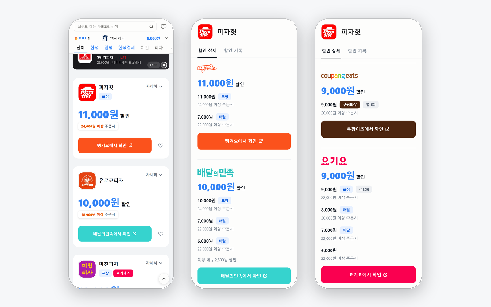
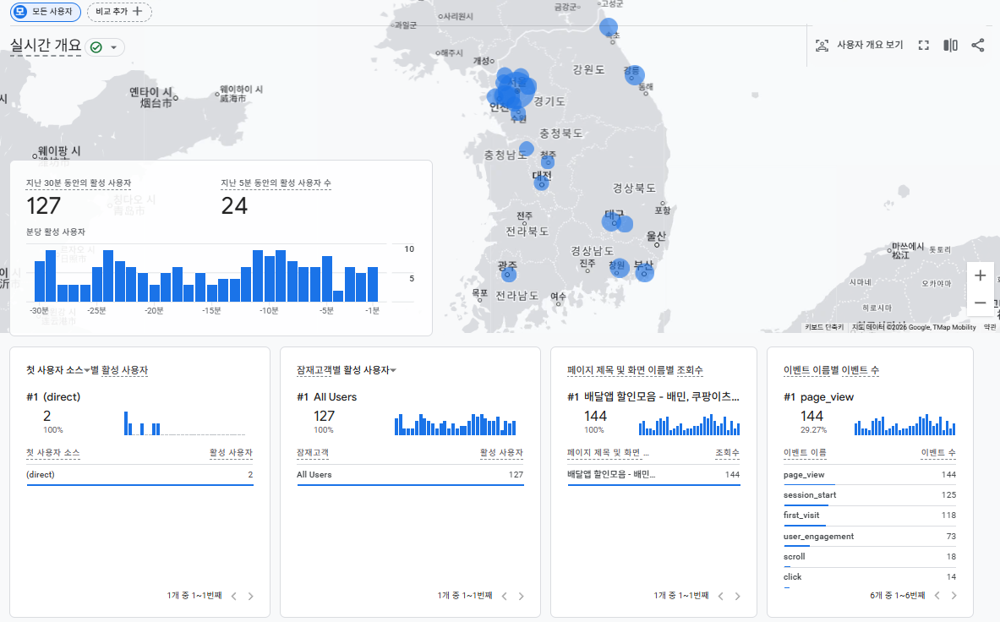
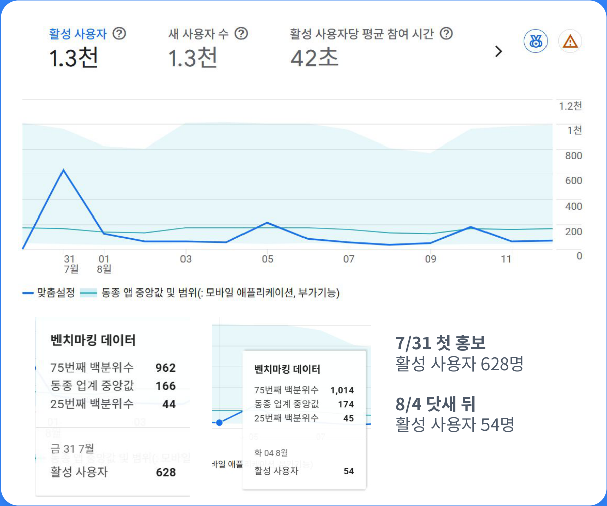
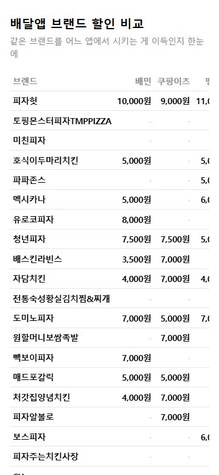
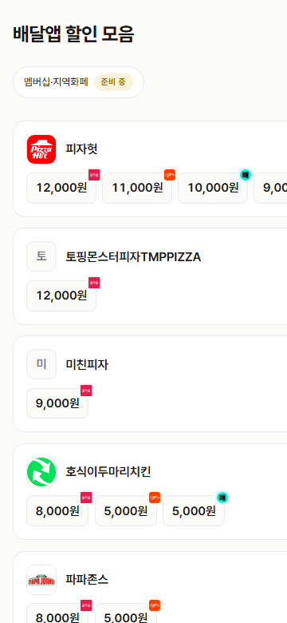
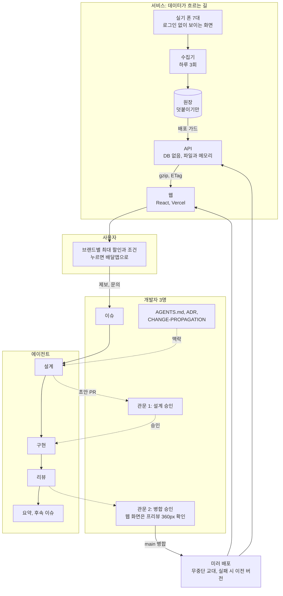

2026-11-27 기준 실제 화면

<h2>배달앱 할인, 한 눈에 보기</h2>

&nbsp;&nbsp;
&nbsp;&nbsp;
&nbsp;&nbsp;

<b><i>오늘의 최대 할인 정보 한 눈에 보기</i></b>

https://github.com/user-attachments/assets/765c7667-1192-48e2-bb08-6710d5101d85

<a href="https://beggars-five.vercel.app/"><picture><source media="(prefers-color-scheme: dark)" srcset="docs/readme/btn-service-dark.svg"></picture></a>&nbsp;
<a href="https://beggars-five.vercel.app/about"><picture><source media="(prefers-color-scheme: dark)" srcset="docs/readme/btn-intro-dark.svg"></picture></a>
 
<a href="https://claude.ai/artifact/7p2D5wphetLQuVUmuXuJHB"><picture><source media="(prefers-color-scheme: dark)" srcset="docs/readme/btn-reaction-dark.svg"></picture></a>&nbsp;
<a href="https://claude.ai/artifact/XboDRuRCr8J7qby2L2TLc8"><picture><source media="(prefers-color-scheme: dark)" srcset="docs/readme/btn-survey-dark.svg"></picture></a>

<a href="https://beggars-five.vercel.app/overview/"><picture><source media="(prefers-color-scheme: dark)" srcset="docs/readme/btn-overview-dark.svg"></picture></a>&nbsp;
<a href="https://claude.ai/artifact/82DyokxssS2V9cFkPEFGSM"><picture><source media="(prefers-color-scheme: dark)" srcset="docs/readme/btn-detail-dark.svg"></picture></a>

SaveEats(사이트 이름 beggars)는 배민, 쿠팡이츠, 요기요, 땡겨요의 브랜드 할인을 하루 여러 번 모아 `얼마 주문에 얼마 할인`으로 한 화면에 보여 주는 서비스입니다. 우아한테크코스(우테코) 8기 팀 "오늘의 할인"(글렌, 고래, 피온) 3인이 07-28 첫 배포부터 운영하고 있습니다. 11-26까지 누적 방문자는 14,676명이고, 할인을 누른 사람의 41.7%가 이틀 이상 다시 찾았습니다.

앱 로고와 상표는 각 회사의 것이며, 이 서비스는 각 앱과 관계가 없습니다.

### 성과
# 누적되는 사용자와 유지되는 재방문

커뮤니티 공유로 들어온 사용자가 쌓였습니다. 할인을 눌러 본 사람은 두 배 자주 돌아왔습니다.

<table>
<tr>
<td align="center" width="25%"><b>14,676명</b> 누적 방문자</td>
<td align="center" width="25%"><b>{{GA4:누적 활성 사용자 07-29~11-26}}명</b> 누적 활성 사용자</td>
<td align="center" width="25%"><b>30.0%</b> 방문자 중 할인 클릭(4,410명)</td>
<td align="center" width="25%"><b>41.7%</b> 할인 누른 사람 중 이틀 이상 재방문(전체 20.8%의 2.0배)</td>
</tr>
<tr>
<td align="center"><b>{{GA4:최대 DAU}}명</b> 최대 일일 활성 사용자(DAU), 09-11 카페 공유일</td>
<td align="center"><b>{{GA4:최대 MAU}}명</b> 최대 월간 활성 사용자(MAU), 10월</td>
<td align="center"><b>563명</b> 핵심 단골, 전체 클릭의 46%</td>
<td align="center"><b>6.8%</b> 2주 뒤 재방문율(W+2 리텐션), 첫 주 방문자 중 2주 뒤 재방문</td>
</tr>
</table>

기간은 2026-07-29 ~ 2026-11-26(한국 표준시, KST)입니다. 방문자, 할인 클릭, 재방문, 핵심 단골, 2주 뒤 재방문율은 PostHog(봇 제외) 기준입니다. 누적 활성 사용자, DAU, MAU는 GA4(구글 애널리틱스) 기준입니다. 두 도구는 정의가 달라 값이 다릅니다. PostHog로는 최대 DAU 1,090명(09-11), 최대 WAU 2,212명(09-28 주), 최대 MAU 5,651명(10월)입니다. 핵심 단골은 5일 이상 활동, 첫날과 끝날 14일 이상 간격, 할인과 배너 3번 이상 클릭을 모두 채운 사람입니다. 지표 정의: [docs/metrics/SERVICE-METRICS.md](docs/metrics/SERVICE-METRICS.md)

<table><tr>
<td align="center" width="50%"> 30분 활성 사용자 최대 252명</td>
<td align="center" width="50%"> 접속 위치와 분포</td>
</tr></table>

더 자세한 지표는 [서비스 개요](https://beggars-five.vercel.app/overview/)에서 볼 수 있습니다.

### 발단
# 불편의 식별과 프로토타입

기획자 [글렌](https://github.com/nn98)은 배달 주문 한 번에 앱을 4개 확인하는 구두쇠입니다.
반복되는 확인 과정, 실제 조건 탐색과 비교에 불편을 느꼈고,
자신 같은 수전노들이라면 필요로 할 서비스를 기획했습니다.

타겟을 검증하기 위해 프로토타입 실험을 진행했습니다.
할인이라면 눈에 불을 켜는 핫딜 게시판에 일부러 과장된 값을 넣은 할인 종합 게시글을 올리고,
즉각적인 지적과 활발한 반응을 확인함으로써 검증을 완료했습니다.

농축된 핵심 데이터, 단순하고 원시적인 API, 핵심 정보만 표시하는 클라이언트로 빠르게 배포했습니다.
첫 홍보에서 628명의 활성 사용자를 유치하고 5일 후에도 50명의 사용자가 재방문했습니다.

 07-31 첫 홍보 활성 사용자 628명, 닷새째 54명 (GA4)

<table align="center">
  <tr>
    <td align="center"></td>
    <td align="center"></td>
  </tr>
  <tr>
    <td align="center">07-27 첫 표</td>
    <td align="center">07-28 첫 배포</td>
  </tr>
</table>

더 많은 사용자, 더 넓은 타겟을 목표로 서비스의 직관성, 신속성을 강화했습니다.
복잡한 조건과 비교보단 `얼마 주문에 얼마 할인` 이라는 핵심만 강조하고
해당 할인 페이지 링크를 제공해 빠르게 할인을 확인할 수 있도록 했습니다.

이후에도 서비스의 핵심 지표를 정의하고, 실험을 통해 지표를 개선했습니다.
현재 서비스의 현황과 지표는 [서비스 개요](https://beggars-five.vercel.app/overview/)에서 확인 가능합니다.

### 구조
# 새로운 계층, 사용자-개발자-에이전트

좋은 설계에 집착하기보다 좋아지는 설계, 실패하고 개선하는 설계를 지향했습니다.
이론적인 아키텍처가 아닌, 즉시 필요한 핵심을 뼈대로, 지금껏 경험한 `좋은 코드`를 재료로
우리 서비스만의 구조를 설계했습니다.

사용자에겐 핵심 정보를 빠르고 직관적이게,
개발자에겐 핵심 기능을 맥락과 의도를 명확하게,
에이전트에겐 핵심 요구사항과 워크플로우, 의사결정 기록을 정제해서 제공하고자 했습니다.

실선은 데이터와 코드가 흐르는 길입니다. 점선은 맥락 제공과 승인 대기입니다.

- **사용자**: 실기 폰 7대가 로그인 없이 보이는 화면만 하루 3회 읽습니다. 읽은 값은 원장(수집값을 쌓는 기록 파일)에 덧붙이고, 확정된 값만 내보냅니다. 웹은 `얼마 주문에 얼마 할인`과 배달앱 링크만 보여 줍니다. [ARCHITECTURE](docs/ARCHITECTURE.md)
- **데이터 안전**: 들어오는 파일이 서버 것보다 오래됐거나 서버에 채워져 있던 상세가 비면 배포를 멈춥니다. 정상 만료에도 울리는 건수 기준은 쓰지 않습니다. [WORKFLOW 7절](docs/WORKFLOW.md#7-규칙과-가드-이-문서가-단일-진실), [09-21 회고(배민 98건이 21건으로, 6시간 52분 노출)](docs/incidents/2026-09-21-sweep-loss.md)
- **코드 배포**: main 병합 뒤 미러 저장소로 배포합니다. 새 버전이 뜨지 않으면 이전 버전으로 자동 복구합니다. 10-28부터 무중단 교대로 바꿨습니다. 첫 배포 중 75번 조회에서 실패는 0이었습니다. [배포 회고](docs/incidents/2026-09-03-deploy-rollback-to-zero-downtime.md), [설계 188](docs/design/188-zero-downtime-deploy.md)
- **개발자**: 고칠 자리가 어느 묶음인지, 왜 그렇게 정했는지, 무엇부터 읽는지를 문서로 둡니다. [AGENTS.md](AGENTS.md), [CHANGE-PROPAGATION](docs/CHANGE-PROPAGATION.md)
- **에이전트**: 이슈에서 설계, 구현, 리뷰, 요약까지를 세션이 맡습니다. 사람 관문은 설계 승인과 병합 승인 둘입니다. 세션은 커밋만 하고, push는 워크플로가 브랜치 이름을 검사한 뒤 합니다. 결과물이 있는지도 워크플로가 확인합니다. 세션이 결과물 0개로 "성공"을 보고한 시험 4회차 뒤에 넣은 장치입니다. [설계 119](docs/design/119-dev-workflow-asbuilt.md), [10-21 회고](docs/incidents/2026-10-21-dev-workflow-build.md)

### 제품
# 검증하고 실험한 가설과 배경, 가설, 검증, 기준, 관측, 결론, 학습, 후속

- 가설 13개를 세웠습니다. 채택 4, 기각 6, 판단 불가 1, 진행 중 2입니다(2026-11-27 기준).
- 통과 기준은 결과를 보기 전에 적었습니다. 홈 화면 A/B 실험(방문자를 둘로 나눠 두 안을 비교)은 시작 사흘 전(10-02)에 판정 문장, 지표, 기간을 적었습니다.
- 진 쪽 화면은 코드째 지웠습니다. 쿠폰 카드 A/B 뒤 16파일 732줄을 삭제했습니다.

| # | 가설 | 통과 기준 | 관측 | 판정 |
|---|---|---|---|---|
| 1 | 큰 할인 하나만 홍보하면 모음 홍보보다 반응이 크다 | 모음 홍보보다 큰 반응 | 글 3편(할인, 할인과 쿠폰, 서비스) 반응 저조. 금액보다 브랜드 이미지가 컸음. 홍보일 방문자 평균 349명 대 107명(3.3배), 할인 클릭 31.6% 대 33.4% | 기각 |
| 2 | 한정 할인 배너가 클릭을 부른다 | 배너 클릭이 유의미 | 효과가 일정하지 않아 노출 축소. 방문자 6.3%(924명)가 눌렀고 10-05 하단 도크로 옮긴 뒤 3~4%대. 대조군 없이 운영 | 기각 |
| 3 | 검수 툴이 오류를 더 잡고 더 빠르다 | 미발견 오류 -50%, 검수 시간 -30% | 오류 14.3% 감소, 검수 시간 18.9% 증가(40건) | 기각 |
| 4 | 필터를 펼쳐 두면(a) 시트에 감춘 것(b)보다 쓰인다 | 전환, 필터 탐색 | 전환 30.7% 대 30.6%(z 0.06, 차이 없음). 옵션 설정 34.9% 대 29.3%(z 3.75) ([기록](docs/metrics/AB-TOPBAR-20260915.md)). 채택 뒤 분류 사용 35.9%(10-18 ~ 11-26) | 채택(검색과 시너지로 리뉴얼에 반영), b 삭제 |
| 5 | 검색 자동완성이 검색 성공률을 올린다 | +5%p | 33.3%(12/36) → 55.9%(1,405/2,514, 도입~11-26). 자동완성 선택 388건은 모두 성공. 원래 시험 구간은 +3.9%p였고 직접 입력한 검색은 33.3% → 37.6%로 거의 그대로. 도입 전 13명 36건 | 채택 |
| 6 | 웹 푸시가 재방문을 유지한다 | 활성화 5% | 0.17%(6/3,499) | 판단 불가 |
| 7 | 배달 외 자사 브랜드 할인에도 반응한다 | 배달 배너보다 높은 클릭률 | 1.02% 대 1.72%. 표본과 위치 영향으로 처음 시험은 판단하지 못함. 11-26 혜택 칩(#445)과 현장결제 칩 통합(#446)으로 후속 실험 시작, 첫날 3명 | 진행 중(후속 실험) |
| 8 | 첫 방문 안내가 이탈을 늘린다 | 이탈이 5% 넘게 증가 | 첫 세션 전환 23.0% → 8.0%(z-4.29) → 28.1% ([기록](docs/metrics/FIRST-GUIDE-20261016.md)) | 채택(가설이 맞아 안내 제거) |
| 9 | 큰 할인 금액을 앞세운 쿠폰 카드가 링크 클릭을 올린다 | 재방문율 유지, 클릭 상승, 최소 2주 | 링크 클릭 +17%(z+2.04), 7일 재방문 +12%(z+1.02, 유의하지 않음) ([회고](docs/incidents/2026-10-17-home-ab.md)) | 채택 |
| 10 | 알림 예시 안내가 알림 켜기를 늘린다 | 클릭 5%, 노출 200명 이상 | 4.51%(29/643) | 기각 |
| 11 | 선호 할인을 실시간 인기 상단에 먼저 보인다 | 클릭률 +3%p, 클릭까지 3초 단축 | 개선 없음, 오히려 악화. 상단 노출 제거 | 기각 |
| 12 | 개별 혜택 공유 기능이 쓰인다 | 활성 사용자 5% | 3.73%(9/241). 공유 버튼 15회 클릭 중 11회(73%) 취소 | 기각 |
| 13 | 팀 밖 사용자는 서비스를 못 쓰게 되면 실망한다(제품-시장 적합성, PMF) | "매우 실망" 40% 이상 | 잠정 응답 8명 중 3명(37.5%). 응답이 적어 판정 보류 | 진행 중 |

판정은 2026-11-27 팀이 정리한 공식 판정이고, 관측은 저장소 기록과 원장 재집계, PostHog(11-26 기준) 재집계입니다. 8번 "채택"은 "안내가 해롭다"는 가설이 맞았다는 뜻입니다. z는 두 비율 차이의 z 점수이고, 절댓값이 1.96 이상이면 유의합니다. 판정을 가른 숫자는 [프로젝트 개요 실험 절](https://beggars-five.vercel.app/overview/?s=4)에서 확인할 수 있습니다.

- **자동완성에서 배운 것**: 5%p라는 막연한 기준을 채우는 것이 얼마나 어려운지 알게 됐습니다. 원래 시험 구간은 +3.9%p로 기준에 못 미쳤지만, 도입부터 11-26까지 33.3% → 55.9%로 효과가 확인됐습니다.
- **핫딜 홍보에서 배운 것**: 사용자를 파악하는 일이 얼마나 어려운지 알게 됐습니다. 홍보일 방문은 평소의 3.3배였지만 할인 클릭 전환은 평소와 비슷했습니다.

<b>쿠폰 카드 A/B</b>: 링크 클릭 +17%, 진 쪽 16파일 732줄 삭제

- **배경**: 첫 화면에서 아무것도 안 누르고 나간 세션이 57.3%(7,275세션 중 4,169)였습니다([서비스 지표 §7](docs/metrics/SERVICE-METRICS.md)). 설문 "부족한 점" 1위는 "찾기 어려움" 11명이었습니다([프로젝트 개요 성과 절](https://beggars-five.vercel.app/overview/?s=2)).
- **가설**: 가장 큰 할인 금액을 쿠폰처럼 앞세우면 링크 클릭이 오릅니다.
- **검증**: 방문자 ID 해시로 반반 나눴습니다. 10-05부터 10-17까지 쿠폰 카드 884명, 기존 카드 839명입니다.
- **기준**: 10-02에 적었습니다. 재방문율이 나빠지지 않고 할인 링크 클릭률이 오르면 채택합니다. 최소 2주입니다.
- **관측**: 채택 시점 링크 클릭은 33.1% 대 27.5%(z+2.53)였습니다. 10-26에 개발자 접속을 빼고 방문자 단위로 원장을 다시 셌습니다. 링크 클릭 +17%(32.0% 대 27.4%, z+2.04), 7일 재방문 +12%(31.5% 대 28.2%, z+1.02)입니다. 재방문은 어느 정의로 세도 쿠폰 카드가 높았지만(+6~+12%) 유의하지는 않습니다. 폰만 보면 링크 클릭은 z+1.59로 유의하지 않고, 컴퓨터 방문자 212명의 차이가 전체를 끌어올렸습니다.
- **결론**: 쿠폰 카드를 채택했습니다. 진 쪽 코드 16파일 732줄을 지웠습니다. 채택 때 값 대신 재집계 +17%를 씁니다.
- **학습**: 최소 2주에서 이틀 모자라게 끝냈습니다. 결과를 네 번 이상 들여다봤고, 재방문 지표를 "2일 이상 재방문"으로 바꿔 쟀습니다. 이를 회고에 직접 적었습니다. 판정 문장, 지표, 기간을 먼저 적어 둔 덕에 모자란 점을 숨길 수 없었습니다.
- **후속**: 재방문 표본을 더 모아 크기를 확정합니다. 이어서 홈 시안 v2를 A/B로 돌렸습니다(11-11~11-20, 688명 대 659명). 유의한 차이가 없어 시안 하나로 통일했습니다.
- **출처**: [회고](docs/incidents/2026-10-17-home-ab.md), [실험 기록](docs/metrics/HOME-AB-LOG.md), [중간 보고](docs/metrics/HOME-AB-20261014.md)

<b>첫 방문 안내는 해로웠다</b>: 폰 신규 방문자 첫 세션 전환 23.9% → 5.8%

- **배경**: 처음 온 방문자에게 화면 쓰는 법을 4~5단계로 보이는 안내를 넣었습니다. 떠 있는 동안 스크롤을 잠갔습니다.
- **가설**: 안내가 단계를 늘려 이탈을 키웁니다.
- **검증**: 완전 신규 방문자의 첫 세션을 안내 전(10-07~10-12, 252명), 안내 중(10-12 23:23~10-14 15:44, 200명), 뺀 뒤(~10-16 01:16, 64명)로 견줬습니다. 안내를 안 본 대조군은 없었습니다.
- **기준**: 이탈이 5% 넘게 늘면 가설이 맞는 것으로 봅니다.
- **관측**: 첫 세션 전환 23.0% → 8.0%(z-4.29) → 28.1%(z+0.85), 무동작 42.1% → 59.5%였습니다. 폰 신규는 23.9% → 5.8%(z-4.82)로 떨어졌고 컴퓨터 신규는 19.6% → 22.2%로 그대로였습니다. 안내를 본 190명 중 74명이 첫 단계에서 나갔고, 그중 전환한 사람은 없었습니다.
- **결론**: 가설이 맞았습니다. 10-14 15:44에 안내를 뺐고 다시 넣지 않습니다.
- **학습**: 이 서비스 사용자는 즉시 정보를 원합니다. 원인은 추정입니다. 넣고 뺀 시점에 맞춰 움직였고 컴퓨터는 떨어지지 않았다는 정황이 근거입니다. 10-13 외부 유입 쏠림도 일부 섞였고, 뺀 뒤 표본은 64명입니다.
- **후속**: 안내를 다시 넣자는 안이 나오면 스크롤을 잠그지 않고, 폰과 컴퓨터를 나눠 실험합니다.
- **출처**: [판정 기록](docs/metrics/FIRST-GUIDE-20261016.md)

<b>알림 세 번</b>: 활성화 0.17%, 안내 4.51%, 공유 3.73%

- **배경**: 방문자 82.8%가 하루만 오고 돌아오지 않았습니다([서비스 지표](docs/metrics/SERVICE-METRICS.md)). 설문 "바라는 기능"에 할인 알림이 6명 있었습니다. 알림으로 재방문을 붙잡을 수 있는지 봤습니다. 설계는 [웹 푸시 알림](docs/design/35-web-push-notifications.md)에 있습니다.
- **가설**: 알림이 재방문을 유지합니다(6번) → 예시 안내가 알림 켜기를 늘립니다(10번) → 개별 혜택 공유가 쓰입니다(12번).
- **검증**: 기능을 열고 이벤트를 세어 기준과 견줬습니다. 세 가설 모두 기준은 5%였고, 10번은 노출 200명 이상일 때만 판정했습니다.
- **관측**: 알림 활성화 0.17%(6/3,499)였습니다. 안내 노출 이벤트가 없어 안내가 부족했는지 수요가 없었는지 가르지 못했습니다. 예시 안내 뒤 클릭은 4.51%(29/643)였고 거부나 닫기가 494명(명시 거부 177, X 288, 배경 29)이었습니다. 공유는 활성 사용자 241명 중 9명(3.73%)이 썼고, 공유 버튼 15회 클릭 중 11회(73%)가 공유창에서 취소됐습니다.
- **결론**: 알림은 판단 불가, 예시 안내와 공유는 기각입니다. 판단 불가도 결과로 남겼습니다.
- **학습**: 버튼 클릭과 실제 행동은 다른 단계였습니다([프로젝트 이야기](docs/archive/web-pages/project-story.html)). 원인을 가를 이벤트는 실험 전에 심어야 합니다.
- **후속**: 닫기 유형별 행동을 분석하고, 공유 버튼 위치를 사용성 테스트로 확인합니다.
- **출처**: [프로젝트 개요 실험 절](https://beggars-five.vercel.app/overview/?s=4)

- 13개 가설의 원문과 나머지 카드: https://claude.ai/artifact/82DyokxssS2V9cFkPEFGSM
- 기각 조건을 먼저 적는 방식: [협업 문서 "가설과 기각 조건을 먼저"](docs/team/COLLABORATION.md)

### 기술
# 도입 배경과 고려, 대안, 트레이드오프, 결정, 근거, 결과

- 할인은 틀리기보다 조용히 사라졌습니다.
- 그래서 원장은 덧붙이기만 하고, 사라지는 것을 배포 전에 막고, 배포가 실패해도 이전 버전으로 돌아가게 했습니다.
- 각 결정은 대안과 대가를 결정 기록(ADR)과 사고 회고로 남겼습니다.

| 문제 | 결정 | 결과 |
|---|---|---|
| 할인이 조용히 사라짐(배민 98 → 21건, 6시간 52분) | 원장은 덧붙이기만, 소실 가드, 반영 결과와 묶은 전수 기록 | 같은 계열을 막아 온 장치 9번(회고 표 9행). 검증 5층 |
| 서버와 웹이 같은 할인에 다른 답을 냄 | 판정표 한 파일을 서버, 웹, 콘솔, 수집기 테스트가 읽음 | 판정표 8 → 40행. 빠진 조합까지 테스트 |
| 새 버전이 안 뜨면 돌아갈 원본이 없음 | 링크 교체 → 자동 롤백 → 무중단 교대([#188](docs/design/188-zero-downtime-deploy.md)) | 실패 주입 시험에서 GET 450건, POST 450건 응답 실패 0. 61초 만에 이전 jar 복구 |
| 이벤트 원장 전체 읽기로 `/api/survey` 1.9초 | 새로 붙은 줄만 증분 읽기([ADR-011](api/docs/decisions/ADR-011-event-log-incremental-read.md), 대안 4개) | 1.9초 → 8~16ms |
| Vercel Edge Requests 한도 97.5%(09-13) | 경로별 캐시, 없는 로고는 요청 안 함 | 세션당 89 → 43 → 25건. `/api/brands` 응답 운영 실측 -86~88% |

<b>T1. 원장은 덧붙이기만, 손실은 장치로 막는다</b>: 같은 계열을 막아 온 9번

- **배경과 고려**: 수집과 표시는 틀린 값을 내기보다 값을 조용히 잃었습니다. 사고는 네 번이었습니다.
  - 08-05: 배포 때 로컬 사본이 서버와 같다고 가정하고 표본 3~4건만 대조해, 서버에만 있던 편집을 덮어썼습니다.
  - 08-06: `expiresAt` 하나만 보고 레코드를 통째로 지웠습니다(쿠폰이 둘이었습니다).
  - 08-16: 손으로 몇 건 넣은 날을 전수일로 쳐서 배민 할인 69개가 사라졌습니다.
  - 09-21: 거부 2건 때문에 관측 153건이 보류됐는데 "전수 완료" 기록은 남았습니다. 배민 할인이 98건에서 21건으로 내려간 채 01:06부터 07:58까지 6시간 52분 노출됐습니다.
- **대안**: 배포 가드를 건수로 둘지, 상세 필드와 `capturedAt` 역전으로 둘지 비교했습니다. 경고만 찍던 장치는 무인 배포에서 아무도 읽지 않아 쓸모가 없었습니다.
- **트레이드오프**: 건수 가드는 정상 만료마다 오탐을 뱉어 결국 꺼집니다. 상세 필드와 `capturedAt`을 보는 가드는 사라지는 것을 막지만, 막힌 배포는 사람이 `--accept-loss`로 소실을 확인해야 풀립니다. 회고 시점에 "거부 하나면 출처 전부 보류" 규칙과 절반 넘게 사라질 때 멈출지는 정하지 못했습니다.
- **결정**: 원장은 덧붙이기만 합니다. 정정은 삭제 대신 더 최신 시각의 새 관측으로 합니다. 전수 기록 함수가 반영 결과를 인자로 받아, 반영이 보류되면 기록을 남길 수 없습니다. 배포 가드는 들어오는 파일의 최신 `capturedAt`이 서버보다 이르거나 서버에 채워진 상세가 비면 멈춥니다. 파괴적 작업 전에는 현재 상태를 스냅샷으로 받아 둡니다.
- **근거**: 사고마다 장치를 더한 흐름이 회고 표 9행입니다(08-10부터 10-22~23까지). 규칙, 코드와 테스트, 도메인 모델(날짜별 하루 상태), 검증 자동화 순으로 옮겨 갔습니다. 장치도 사람도 이 장애를 못 잡았고, 다른 증상을 고치던 AI 에이전트가 03:46에 처음 알아챘습니다. 그래서 값 자체를 대조하는 검증을 따로 세웠습니다.
- **결과**: 복구는 07:58에 127건 반영, 배민 62건으로 끝났습니다. 검증은 정합, 링크, 화면 금액, 선착순 상태, 쿠폰함 대조 다섯 층이고 허브, 쿠폰함, 서버 세 곳을 교차 확인합니다. 백업을 격리 환경에 실제로 복원해 17.64초에 걸렸고 파일 지문이 전부 일치했습니다. 이 장애를 막은 줄에는 아직 테스트가 없어 이슈로 올렸습니다(10-23).
- **배운 것**: "없다", "0", "통과"가 관측인지 미관측인지 구분합니다. 이 문장이 [AGENTS.md](AGENTS.md) 첫머리가 됐습니다.
- **출처**: [사고 회고](docs/incidents/2026-09-21-sweep-loss.md), [ORCHESTRATION](docs/ORCHESTRATION.md), [프로젝트 이야기](docs/archive/web-pages/project-story.html)

<b>T2. 같은 질문에는 한 곳이 답한다</b>: 판정표 8 → 30 → 40행

- **배경과 고려**: "최고 할인 후보인가, 정렬에 얼마로 기여하나" 규칙이 서버(Java)와 웹(JavaScript)에 두 벌이어서 이미 다른 답을 냈습니다. 겹쳐 쓰는 쿠폰은 사람이 손으로 더하면 틀렸습니다. 요기요 굽네치킨은 17,000원 이상 4,000원, 25,000원 이상 4,000 + 1,250 = 5,250원인데, 설계 논의 중에도 25,000원 문턱을 7,000원으로 한 번 잘못 읽었습니다. 종료일이 지난 할인 5건(종료일 있는 47건 중, 08-06)은 화면에 그대로 떠 있었습니다.
- **대안**: 대표 금액은 원장 `amount`를 계속 믿을지, 계산을 도메인으로 옮길지 따졌습니다. 만료는 적재 시점에 계산해 굳히기, 응답에 `expired` 필드 추가, 요청 시점 판정을 견줬습니다. 적재 시점 계산은 자정이 지나도 반영되지 않고, `expired` 필드는 프론트가 받아야 효과가 있었습니다.
- **트레이드오프**: 도메인이 계산하면 원장 `amount`와 이중이 됩니다. 이를 수집 저장소(tracker)의 테스트가 "모든 cumulative 레코드에서 원장 amount가 사다리 최저값과 같다"로 검증합니다. 만료를 앞에서 거르면 중복 정리 때 상세 병합 기회를 일부 잃지만, 실측 손실은 0건이었습니다.
- **결정**: 겹치는 쿠폰(`cumulative`)만 `DiscountLadder`가 대표 금액을 계산하고, `exclusive`는 그대로 둡니다. 만료는 요청마다 `Asia/Seoul` 날짜로 판정합니다. 종료일을 모르면 만료로 보지 않습니다("모른다"와 "끝났다"는 다릅니다). 판정표 `certainty-cases.json` 하나를 서버, 웹, 운영 콘솔, 수집기 테스트가 같이 읽습니다.
- **근거**: 처음 테스트는 `cases.size() >= 8`로 행 수만 세서 22행을 지워도 통과했습니다. 열거형 값의 교차곱 테스트로 바꿔 빠진 조합과 남는 조합을 모두 잡습니다. `exclusive`를 건드리지 않아 기존 170건 동작이 보존됩니다.
- **결과**: 판정표가 계획한 8행에서 빠짐없는 30행으로, 1+1 묶음 행사를 받으며 40행이 됐습니다. 만료 판정 테스트가 15건 늘었고 응답 스키마는 그대로입니다. 웹 테스트는 아직 표의 행 수만 세므로, 빠짐없음 검사는 서버 쪽에만 있습니다.
- **배운 것**: 행 수만 세는 테스트는 중복 한 줄과 누락 한 줄이 서로 상쇄됩니다.
- **출처**: [ADR-010](api/docs/decisions/ADR-010-domain-judges-representative-amount.md), [ADR-008](api/docs/decisions/ADR-008-drop-expired-offers-at-request-time.md), [사고 회고](docs/incidents/2026-09-22-decision-table.md)

<b>T3. 덮어쓰기 배포에서 무중단 교대로</b>: 실패 주입 시험 61초 복구

- **배경과 고려**: API 배포는 jar를 같은 이름으로 덮어써서, 새 버전이 안 뜨면 돌아갈 원본이 없었습니다. 재시작 중에는 약 5초 502가 났습니다.
- **대안**: 09-03에 덮어쓰기 유지, 이전 jar를 `.bak`으로 복사, 블루그린, 컨테이너 태그를 견줬습니다. `.bak`은 한 세대만 남고 복사 중 실패 위험이 있었고, 블루그린은 서버 한 대에 과했고, 컨테이너는 당시 Docker를 안 썼습니다. 10-27에는 두 인스턴스를 번갈아 쓰는 안이 서비스 이름과 포트를 하나로 가정한 곳 열 군데 넘게 깨져 접었습니다.
- **트레이드오프**: 10-14에는 사용자 수와 비용 대비 5초 끊김을 유지했고, 사용자가 늘어 비용이 된 10-28에 없앴습니다. 임시 인스턴스를 띄우면 10~20초 동안 두 인스턴스가 같은 `data/`를 씁니다. 그래서 푸시 상태와 기프티콘 파일에 OS 파일 락을 걸었습니다([ADR-013](api/docs/decisions/ADR-013-inter-process-file-lock.md)). 되돌리는 것은 jar뿐이고, 1초보다 짧은 끊김은 재지 못했습니다.
- **결정**: 새 jar를 커밋 해시 이름으로 두고 링크만 옮깁니다. 배포 중에만 임시 인스턴스가 받습니다. 종료 코드는 셋입니다.
  - 1: 임시가 안 뜸. 본 인스턴스는 그대로입니다.
  - 2: 본 인스턴스가 30초 안에 안 뜸. 이전 jar로 복구합니다.
  - 3: 복구도 실패. 임시를 켜 둔 채 수동으로 처리합니다.
- **근거**: 09-03~09-15 배포 33번 중 실패 3번이었고, 그중 하나가 09-14 첫 롤백이었습니다. 앱은 4.3초에 떴는데 헬스체크가 5초 뒤 한 번만 확인한 오탐이어서, 1초마다 최대 30초 확인으로 고쳤습니다.
- **결과**: 10-28 첫 무중단 배포에서 공개 API를 약 1초 간격으로 75번 조회해 200이 아닌 응답이 0번이었습니다. 10-29에는 본 인스턴스만 시작에 실패하는 jar를 일부러 배포했습니다. 61초 만에 이전 jar로 복구됐고 종료 코드 2와 Slack 알림이 찍혔으며, 그동안 GET 450건, POST 450건이 응답 코드 기준 실패 0이었습니다. POST가 원장에 몇 건 저장됐는지는 확인하지 못했습니다([#215](docs/design/188-zero-downtime-deploy.md)).
- **배운 것**: 복구 경로는 일부러 밟아 봐야 믿을 수 있습니다.
- **출처**: [사고 회고](docs/incidents/2026-09-03-deploy-rollback-to-zero-downtime.md), [설계 188](docs/design/188-zero-downtime-deploy.md), [ADR-013](api/docs/decisions/ADR-013-inter-process-file-lock.md)

<b>T4. 새로 붙은 줄만 읽는다</b>: <code>/api/survey</code> 1.9초 → 8~16ms

- **배경과 고려**: 설문 판정은 요청마다, 브랜드 인기 집계는 10분마다 `events.jsonl` 전체를 다시 읽었습니다. 08-29에는 38,791줄이라 1초가 안 걸려 코드 주석에 근거만 적고 뒀습니다. 하루 약 5천 줄씩 늘어 10-14에 177MB, 34만 줄이 됐고 `/api/survey`가 1.9초 걸렸습니다. 경보는 없었고, 백엔드를 점검하다 바깥에서 직접 재서 알았습니다.
- **대안(4개)**:
  - 원장에 쓸 때 집계도 같이 고칩니다. 서버 밖에서 원장을 바꾸면 집계가 어긋납니다.
  - 날짜별로 파일을 나눕니다. 원장을 읽는 다른 도구(`jq`, 분석 스크립트)가 모두 바뀝니다.
  - SQLite에 넣습니다. 이 규모에 저장소가 하나 더 늘어납니다.
  - 설문 웹 호출을 끕니다. 인기 쪽 2초 지연이 남습니다.
- **트레이드오프**: 집계가 프로세스 메모리에 있어 재시작하면 처음부터 다시 읽습니다. 두 집계가 원장을 따로 읽어 첫 읽기가 두 번 듭니다. 같은 크기 이상의 다른 파일로 갈아끼우면 알아채지 못합니다.
- **결정**: 마지막으로 읽은 바이트 위치부터 새로 붙은 줄만 읽어 메모리 집계에 더합니다. 파일이 위치보다 짧아지면 처음부터 읽습니다. 다른 도구는 건드리지 않습니다.
- **근거**: 운영 서버 밖에서 잰 값입니다. `/api/survey` 한 번이 1.9초 → 8~16ms가 됐고, `/api/brands` 50번(12분)에서 2,058ms 한 번이 가장 느린 698ms로 줄어 2초대가 없어졌습니다. 바꾼 뒤 가운데 값이 53ms 높게 나온 것은 응답 시간을 연결, TLS, 첫 바이트, 본문으로 나눠 다시 재어 네트워크 변동으로 판정했습니다.
- **결과**: 10-16에 요약 스냅샷을 더했습니다. 합성 100만 줄(397MB)에서 전체 읽기 인기 5.2~8.6초, 설문 5.8~7.0초가 스냅샷 기동 0.46초, 0.96초가 됐습니다.
- **배운 것**: 규모 가정은 숫자로 적는 것만으로 부족하고, 그 숫자를 재는 장치가 같이 있어야 합니다.
- **출처**: [ADR-011](api/docs/decisions/ADR-011-event-log-incremental-read.md), [사고 회고](docs/incidents/2026-10-14-event-log-full-read.md)

<b>T5. 요청 수를 줄였다</b>: 세션당 89 → 25건

- **배경과 고려**: 09-07에 Vercel 무료 한도 75% 경고가 왔고 09-13에 97.5%(974,695 / 1,000,000)가 됐습니다. 한도는 요청 건수로 셉니다(바이트는 무관합니다). `public/` 파일의 기본 `max-age=0, must-revalidate` 때문에 로고를 페이지 이동마다 재검증했고, 304도 한 건으로 셌습니다(DAU 50에 약 75만 건). 09-11 카페 공유로 방문자가 74명에서 1,074명/일이 되면서 총계가 다시 찼습니다. 요청 수 문제는 우리 잘못이었고 트래픽 폭증은 아니어서 둘을 나눠 적었습니다.
- **대안**: 이미지 축소(2084px → 45px)는 대역폭만 줄이고 요청 수를 안 줄여 접었습니다. 로고 168장(3.6MB)을 base64로 인라인하면 첫 화면 전에 3.6MB를 받아 접었습니다. 상위 25장만 인라인하면 하루 약 4,800건(11%)만 줄어 보류했습니다.
- **트레이드오프**: `immutable`은 회수할 수 없는 약속입니다. 404도 캐시되어, 09-11에 올린 빽다방 로고가 30일 동안 첫 글자 대체 표시로 보였습니다. 로고를 한 장 추가하면 매니페스트가 메인 번들에 들어가 번들 해시가 바뀌고, 모든 방문자가 229KB를 다시 받습니다. 로고 추가는 어차피 코드 배포와 함께라 감수했습니다.
- **결정**: 경로별로 캐시 수명을 다르게 줬습니다(HTML은 브라우저 0초, `/brand` 10분, `/logos` 1년 immutable, `/platform-icons` 30일, `/assets` 1년). 로고는 빌드 때 내용 해시 앞 8자를 주소에 붙이고, 없는 로고는 요청 자체를 하지 않습니다. 요청이 없으니 캐시될 404도 없습니다. API는 gzip과 ETag를 씁니다.
- **근거**: 세션당 Edge Requests가 89건(09-11, 찬 캐시) → 43건(09-12, API 프록시 제거) → 25건(09-13, 캐시가 데워진 상태, 부분 집계)으로 내려갔습니다. 일별 요청은 121,122건 → 44,965건이었습니다.
- **결과**: `/api/brands` 응답은 운영 실측으로 91.7KB → 12.7KB(09-29, -86%), 190,910B → 23,718B(11-12, -88%)가 됐습니다. 응답 지연(p95, 요청의 95%가 이 시간 안에 끝남) 개선은 전후 측정 조건이 달라 검증하지 못했습니다. 세션당 43건 중 설명되는 것은 12~15건뿐이고 나머지 65%는 Vercel 대시보드 분해를 못 봐서 풀지 못했습니다.
- **배운 것**: 한도를 늘리기 전에 무엇이 한 건으로 세어지는지부터 확인했습니다. 모르는 것은 아는 것처럼 적지 않았습니다.
- **출처**: [캐시와 자산](docs/CACHING-AND-ASSETS.md), [서비스 지표 §9.1](docs/metrics/SERVICE-METRICS.md)

그 밖의 결정은 아래에 있습니다.

- [ADR 목록(저장소 공통)](docs/decisions/)
- [ADR 목록(api)](api/docs/decisions/)
- [기술 선택 이유](docs/TECH-CHOICES.md)
- [Spring Boot 4와 Jackson 3 전환(ADR-012)](api/docs/decisions/ADR-012-spring-boot-4-jackson-3.md)
- [에이전트 개발 워크플로](docs/design/119-dev-workflow-asbuilt.md)

### 운영
# 사용자 지표와 성공 지표, 그 배경과 설정 이유, 근거, 관측, 결과, 학습, 후속

로그인이 없는 서비스라 주문은 볼 수 없습니다. 그래서 성공을 "할인 링크를 눌러 배달앱으로 이동"까지로 정했습니다. 봇과 개발자는 빼고, 사람 단위와 날 단위로 셉니다. 수치는 2026-11-26 기준입니다.

| 지표 | 정의 | 이렇게 정한 이유 | 관측 |
| --- | --- | --- | --- |
| 방문자 | 고유 방문자, 봇 제외 | 크롤러는 스스로 봇이라고 밝힌 것만 걸러지므로 하한입니다 | 14,676명 |
| 할인 클릭 | `offer_link_click`을 한 번 이상 한 사람 ÷ 방문자 | 주문은 못 보니 이동까지가 전환입니다 | 30.0% (4,410명) |
| 재방문 | 활동일 2일 이상 | 새로고침 스무 번은 스무 날이 아닙니다 | 할인 누른 사람 41.7%, 전체 20.8% (2.0배) |
| 2주 뒤 재방문율 | 첫 방문 주에 온 방문자 묶음(코호트)이 2주 뒤 주에 다시 방문 | 시켜 먹을 때만 여는 도구라 DAU/MAU가 맞지 않고, 2주 쉬고 온 사람은 이탈이 아닙니다 | 6.8% |
| 핵심 단골 | 활동 5일 이상, 14일 간격 이상, 클릭 3회 이상 | 소수가 클릭의 절반 가까이를 만듭니다 | 563명, 클릭의 46% |
| 스프린트 목표 | 할인 선택 도달률(할인 누른 사람 ÷ 방문자), 목표 34%(지금까지 12주 분포의 75퍼센타일 34.30%를 반올림) | 스프린트마다 같은 자로 잽니다 | 36.4 / 35.1 / 25.7 / 31.3% |

- 목표는 두 주 스프린트마다 "두 주 모두 34% 이상"인지로 봅니다. 12주(08-03 ~ 10-25) 중 최솟값은 19.36%, 중앙값은 30.86%, 최댓값은 48.72%였습니다.
- "1인당 평균 클릭"은 쓰지 않습니다. 중앙값은 1~2회인데 한 명이 73회를 눌렀습니다.
- 가장 큰 손실은 첫 화면입니다. 세션의 57.3%가 아무 동작 없이 끝났고, 설문의 "찾기 어렵다"와 같은 방향입니다. 82.8%는 하루만 옵니다.
- **학습**: 분석 도구 숫자는 자체 이벤트 원장과 나란히 세어야 합니다. 도구만 보다가 세 번 잘못 읽었습니다(아래).
- **후속**: 첫 화면 이탈 개선, 만료로 빠지는 할인 건수 관측, API 응답 시간 경보.

지표를 잘못 읽은 세 번

- 배너 클릭은 도입(08-19) 전에는 구조적으로 0입니다. 그 0을 보고 "08-19 개편이 재방문자의 경로를 막았다"고 읽었습니다.
- 분석 도구로 옮길 때 `variant`가 없는 이벤트가 섞여 전환율이 38.1%여야 하는데 32.9%로 나왔습니다. 원장과 나란히 세지 않았다면 몰랐을 값입니다.
- A/B 결과를 네 번 이상 들여다봤습니다. 기준을 넘는 순간 멈추면 차이가 없어도 "유의"가 나올 확률이 커집니다. 그래서 채택 때 +20%를 원장 재집계 +17%로 고쳐 적었고, 재방문 +12%는 유의하지 않아 같은 방향이라고만 씁니다([회고](docs/incidents/2026-10-17-home-ab.md)).

정의와 근거는 [SERVICE-METRICS](docs/metrics/SERVICE-METRICS.md)에 있습니다. 스프린트 3, 4는 현재 조회값입니다. 개요 페이지의 당시 값(25.62%, 30.96%)과 조금 다릅니다.

장애와 어떻게 알았는가

공개 회고는 7편입니다. 장애 5편, 개선 회고 2편(A/B 판정, 워크플로 구축)입니다.

| 날짜 | 무엇 | 어떻게 알았나 | 조치 |
| --- | --- | --- | --- |
| 09-03 ~ 10-30 | 덮어쓰기 배포라 새 버전이 안 뜨면 돌아갈 원본이 없었습니다 | 첫 실제 롤백(09-14)이 오탐이어서 헬스체크를 고쳤고, 09-17에 무인 배포 실패를 사람이 못 봐 슬랙 알림을 더했습니다 | 링크 교체와 자동 롤백, 이후 무중단 교대 ([회고](docs/incidents/2026-09-03-deploy-rollback-to-zero-downtime.md)) |
| 09-21 | 배민 할인 98건이 21건으로 6시간 52분 노출됐습니다 | 개발자가 반대 증상을 짚었고, 그 증상을 고치던 에이전트가 운영도 21건이라고 보고했습니다. 장치는 못 잡았습니다 | 같은 계열 9단계 방어 ([회고](docs/incidents/2026-09-21-sweep-loss.md)) |
| 09-22 | 정렬에서 뺀 할인이 다시 올라왔습니다 | 이슈를 보다 관찰했습니다 | 서버와 웹 두 벌 규칙을 판정표 하나로, 8행에서 40행 ([회고](docs/incidents/2026-09-22-decision-table.md)) |
| 10-14 | `/api/survey`가 1.9초까지 느려졌습니다 | 경보는 없었습니다. 구조 점검 중 바깥에서 직접 호출해 찾았습니다 | 새 줄만 읽어 8~16ms ([회고](docs/incidents/2026-10-14-event-log-full-read.md)) |
| 11-12 | `/api/` 429가 440건 났습니다 | 경보는 없었습니다. 운영 점검에서 서버 nginx 로그를 이틀치(11-11 ~ 11-12) 거슬러 읽다가 찾았습니다 | 설문 재조회를 5, 10, 20, 40초 간격으로 늦췄고 한도는 올리지 않았습니다 ([회고](docs/incidents/2026-11-12-api-429-survey-polling.md)) |

알림은 슬랙 채널 하나로 모읍니다. 09-16에 구조 검사가 7번 연속 실패했는데 소유자가 이튿날에야 알았기 때문입니다. 채널마다 따로 보면 아무도 안 봅니다([설계](docs/design/32-ops-monitoring.md)). 지금은 세 가지를 봅니다.

- 서버의 새 5xx를 30초마다 봅니다([설계](docs/design/65-fast-api-failure-detection.md)).
- 외부에서 3분마다 점검합니다.
- 웹 성능을 매일 검사합니다.

아직 없는 것은 API 응답 시간 경보입니다.

#### 제보와 문의

전용 문의 채널은 따로 두지 않았습니다. 화면 안에서 바로 남기게 했습니다.

| 채널 | 흐름 | 사용자가 받는 것 |
| --- | --- | --- |
| 잘못된 정보 제보 (10-19) | 종류 4개(할인 금액, 할인 여부, 화면 오류, 그 외), 플랫폼, 브랜드, 500자 이내 → `POST /api/reports` → 슬랙과 파일 보관 | "제보해주셔서 감사합니다. 빠르게 처리하겠습니다!" |
| 내 제보 | `GET /api/reports/mine`, 상태는 접수, 검토, 반영, 반려 | 처리 상태를 직접 확인 |
| 설문 | 기프티콘 설문(접속 7일, 전환 5회), 이후 PMF 설문 | 응답 29명, 7일 안 재방문 79% |

- 원칙은 "제보는 잃지 않는 게 먼저"입니다. 슬랙 전송이 실패해도 파일에 저장하고, 사용자에게는 성공으로 답합니다. 남용을 막으려고 분당 3건, 하루 20건으로 제한했습니다([`ReportController`](api/src/main/java/com/discounttracker/analytics/ReportController.java), [`ReportButton`](web/src/ReportButton.jsx)).
- 상태를 보여 주는 이유는 "보냈는데 어떻게 됐는지 모른다"를 없애기 위해서입니다([설계](docs/design/311-my-reports-status.md), [API](docs/design/393-my-reports-api.md)).
- 설문 응답과 반응은 헤더의 `사용자 반응`, `사용자 설문`에서 볼 수 있습니다.
- 11-10 백업 복원 시험에서 확인한 제보 원장은 10건이었습니다. 문의 채널은 따로 두지 않았고, 제보와 문의 알림은 10-20에 전용 채널로 분리했습니다.
- 내 제보는 사용자 화면까지 운영에 반영돼 있습니다. 운영자가 상태를 바꾸는 콘솔 화면은 후속입니다.
- `{{확인: 제보 반영 건수, 대표 사례 1건}}`

### 협업
# 소프트스킬과 그라운드 룰, 회의, 협업, 의사결정, 토의, 의견충돌, 협력

| 이름 | GitHub | 맡은 것 |
| --- | --- | --- |
| 글렌 | [nn98](https://github.com/nn98) | 기획, 수집, 인프라, 제품 실험 |
| 고래 | [miniminjae92](https://github.com/miniminjae92) | 수집 환경, 온보딩, 디자인 시스템 |
| 피온 | [everypine](https://github.com/everypine) | 분석 계측, 알림, 운영 안정화 |

공통 목표는 셋입니다.

- 최종 목표: "사용자가 있는 서비스를 만들고 유지, 보수, 운영한다"
- 1차: 가설, 실험, 관찰, 반영
- 2차: 실제 사용자

스프린트 목표가 꼭 새 기능일 필요는 없다고 합의했습니다. 개발 환경과 팀 규칙도 목표가 됩니다.

그라운드 룰은 적게 정했고 스프린트마다 다시 세웠습니다. 08-03 첫 주 룰은 시험판이었고 그 뒤로 세 번 고쳤습니다. 판단 기준은 하나입니다. 지켜지지 않으면 "룰이 틀렸나, 룰은 맞는데 안 지켰나"로 가릅니다.

| 날짜 | 계기 | 바뀐 것 |
| --- | --- | --- |
| 09-21 | 레벨3 룰 점검 | 손들고 말하기, 감사 표현, 주 1회 감정 회고, 소집자가 안건을 칠판에 적기, 답변에 부정 감정 싣지 않기 |
| 10-08 | 협업 카드 회고 | "일단 시도하고 결과 공유하기"를 도입했습니다 |
| 10-23 | 룰마다 최근 실제 상황을 적어 세 갈래로 나눔 | 지켜진 룰 둘(감사, 안건)을 유지했고 회의록 담당은 없앴습니다. 타임키퍼는 순번을 돌리고 룰마다 확인 시점을 붙였습니다 |

10-23에는 "시도는 했는데 공유가 약했다"가 드러났습니다. 그래서 칸반에 `리뷰 대기` 칸을 만들었습니다. 공유한 작업은 다른 팀원이 확인한 뒤에만 완료로 옮깁니다.

의사결정은 세 가지로 정했습니다.

- 사람의 승인은 두 곳입니다. 이슈에 `ready`를 달면 에이전트가 설계, 구현, 리뷰를 하고, 사람은 **설계**와 **병합**에서 승인합니다. 웹 화면은 프리뷰를 보고 승인합니다([WORKFLOW](docs/WORKFLOW.md)).
- 되돌리기 어려운 판단만 ADR로 남깁니다. 고르지 않은 대안과 뒤집을 조건까지 적습니다([결정 기록](docs/decisions/README.md)). 결정 기록은 59건입니다(공개 저장소 19건, 비공개 수집기 40건).
- 실험은 결과를 보기 전에 판정 문장, 지표, 기간을 적습니다. 사례는 제품 절의 홈 A/B입니다.

의견이 갈렸을 때

쟁점은 "먼저 해 보자"와 "설계를 먼저 확인받자"였습니다. 대안은 설계를 먼저 확인받고 시작하는 것과 일단 시도하고 결과를 공유하는 것이었고, 10-08에 후자를 해 보기로 했습니다. 10-23에는 규칙을 버리지 않고 공유가 약했던 부분만 고쳤습니다. 공유한 작업은 다른 팀원이 확인한 뒤에만 완료로 옮깁니다(리뷰 대기 칸). 남은 것은 감정 회고를 정해진 날에 하는 일입니다. 미뤄지면 다음 주 월요일에 합니다.

기술에서도 한 번 갈렸습니다. 같은 계정을 여러 폰에서 동시에 써도 되는지를 두고 코드 주석("세션을 끊는다")과 이슈 기록("3대 병렬 문제 없음")이 어긋났습니다. 말로 다투지 않고 11-18 밤에 6대를 동시에 로그인해 유지되는지 재서 정했습니다. 몇 시간 동시에 주소를 바꿀 때 번지는지는 확인하지 못했습니다.

스프린트 2 회고에서 정한 처방은 셋입니다.

- 의견을 말하기 전에 컨텍스트부터 맞춥니다.
- 부딪힌 직후에는 잠시 떨어져 정리합니다.
- 과제 담당자의 의견을 따르기로 미리 합의하고, 나머지는 피드백으로 남깁니다.

팀이 일한 방식 전문은 [COLLABORATION](docs/team/COLLABORATION.md)에 있습니다.

### 후속
# 고도화, 확장, 스케일 업, 스케일 아웃, 수집 로직의 효율 개선과 구조 보강

수집은 폰 7대가 앱 화면을 직접 읽습니다. 가장 오래 붙잡은 것은 "더 빨리, 덜 잃지 않고"였습니다. 속도 숫자는 언제나 읽은 양과 같이 적습니다. 수집기는 비공개 저장소에 있어 아래 ADR 번호는 그 저장소의 것입니다.

| 과제 | 전 | 후 | 근거 |
| --- | --- | --- | --- |
| 화면 덤프 방식을 (폰, 단계)마다 측정해 켬 | 덤프 한 번 2~3초대(폰에 따라 6~15초) | 0.2초 이하, 단계 시간 0.41~0.83배 | ADR-038, 72칸 214회 측정 |
| 기기 차이를 코드 분기에서 측정 데이터로 | 6단계 43분 46초, 7단계 45분 초과 | 35분, 16분 38초, 4회차 실패 0 | ADR-037 |
| 단계를 일 단위 공용 큐로 (폰 풀) | 4대 중 1대만 일하는 시간이 길었습니다 | 비는 폰이 돌고 있는 큐에 합류합니다 | 폰 풀 전후 효과는 아직 집계하지 못했습니다 |
| 전수조사 죽은 링크 장부 | 한 단계 48분 | 25.5분. 단, 아래 맥락이 필요합니다 | 09-17 |
| API 부하 (개발 서버 2 vCPU) | | 초당 요청 2~60건(RPS)에서 p95 107~109ms, 실패 0 | [부하 테스트](docs/metrics/API-LOAD-TEST-20261014.md) |

<!-- {{확인}} 대기 폴더 경유 업로드의 이유 중 백업 외 요건은 기록이 없어 싣지 않았습니다. -->

덤프 방식: 폰마다, 단계마다 측정해서 켰습니다

- **배경**: 화면 트리를 읽는 덤프가 호출마다 2~3초 걸렸고, 움직이는 화면에서는 빈 트리가 나왔습니다.
- **대안**: 기존 방식, 패치한 uiautomator2, 자체 상주 덤퍼 세 가지를 견줬습니다. 폰마다 하나만 고르는 안도 있었지만, 예약 수집이 단계마다 프로세스를 따로 띄우므로 같은 폰에서도 단계마다 다르게 쓸 수 있었습니다. 선택 단위를 (폰, 단계)로 했습니다.
- **결정**: 켜는 기준은 엄격하게(결과 같음, 단계 시간 기존 이하, 실패 기존 이하), 되돌리는 기준은 넉넉하게(정확성은 즉시, 시간은 2회 연속 1.2배) 잡았습니다.
- **결과**: 5대 × 단계 72칸을 재부팅 뒤 번갈아 214번 쟀습니다. 빠른 방식이 결과를 틀리게 내는 칸(2단계는 기존 26건, 새 방식 1~2건)은 모든 폰에서 금지했습니다.
- **학습**: 덤프 0.1초가 단계 시간을 줄이는 폭은 작았습니다. 대부분이 앱 대기였습니다. 몇 시간 연속 측정한 폰은 느려져서 "같은 날, 재부팅 뒤, 번갈아 3회 이상"을 표본 기준으로 넣었습니다.

폰 풀과 기기 도메인 모델

단계가 폰에 붙은 덩어리라 한 폰이 쉬는 동안 다른 폰이 일을 못 가져갔습니다. 틀(단계와 선행 관계)은 그대로 두고 단위만 브랜드, 배너, 링크로 쪼개 공용 큐에 넣었습니다. 계정 제약(예: 멤버십 폰만)은 단위마다 겁니다. 시험이 실제 스레드의 시간 경합에 기대 간헐적으로 실패했고, 여유 시간을 늘려 우선 넘겼습니다. 가짜 시계로 바꾸는 근본 해결은 남았습니다.

기기마다 다른 값은 코드 상수에 두지 않고, 사람이 정하는 대장 파일과 기계가 재는 측정 저장소 두 곳에만 둡니다. 폰을 더하거나 계정을 바꿀 때 대장 파일 하나만 고칩니다. 이후 폰 두 대를 더할 때 코드는 바뀌지 않았습니다.

25.5분은 성과가 아니었습니다

09-17 전수조사 한 단계가 48분에서 25.5분이 됐습니다. 죽은 링크 장부(링크 오류가 3번 이어지면 주 1회만 재시도) 덕입니다. 그런데 그때 배민 앱이 단축링크를 브랜드 페이지 대신 홈으로 보내고 있었고, 110곳 중 0곳에서 값이 읽혔습니다. 순회는 정상 종료했고 실패 숫자도 거의 없었습니다. 빨라진 것이 아니라 읽지 못한 시간이었습니다.

링크를 풀어서 열자 64곳이 읽혔고 시간은 92분으로 돌아왔습니다. 그 뒤 주기 건너뛰기와 재시도 범위 축소로 09-20까지 2분으로 줄였습니다. "빨라졌다"가 "덜 읽었다"일 수 있다는 것을 배웠습니다. 이 저장소의 첫 원칙([먼저 알 것](AGENTS.md#먼저-알-것))이 여기서 나왔습니다.

확장과 플랜 B

- 지금의 한계: 단일 서버, 단일 인스턴스입니다. 파일 저장이라 동시 쓰기에 약하고(프로세스 간 락으로 일부 완화), 수집은 하루 단위입니다.
- 스케일 아웃(수집): 폰을 더하는 일은 대장 파일에 한 줄 더하는 일입니다. 서버 쪽 한계를 다룬 문서는 아직 없습니다.
- 스케일 업과 아웃(서버): 이중화 전에 콘텐츠 전송망(CDN) 캐시가 먼저입니다(응답이 정적에 가깝습니다). 데이터가 수천 건이 되면 SQLite에서 Postgres로, 쓰기 주체가 늘면 쓰기 API로 갑니다([TECH-CHOICES](docs/TECH-CHOICES.md)).
- 부하 테스트에서 100 RPS는 연결과 TLS 지연으로 중단됐습니다. API 처리 한계의 증거가 아닙니다. 병목 후보는 큰 JSON 전송(응답 본문 수신이 평균 HTTP 시간의 약 46%)이고, 압축을 적용했지만 같은 조건의 재비교는 남았습니다.
- 수집 플랜 B: 특정 앱이 계속 깨지면 그 앱만 수동 캡처와 비전 판독으로 내리고, 빈도를 올려야 하면 상위 N개 브랜드만 돕니다.

배운 것은 셋입니다.

- 속도는 읽은 양과 함께 적습니다.
- 켜는 기준은 엄격하게, 되돌리는 기준은 넉넉하게 잡습니다.
- 기기 차이는 코드에 두지 않고 측정 데이터에 둡니다.

다음 할 일: 폰 풀 효과 집계, 같은 조건의 부하 재비교, 첫 화면 이탈 개선.
