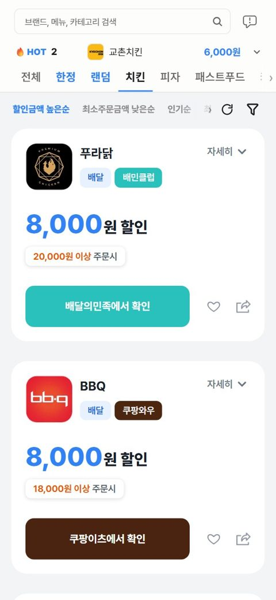
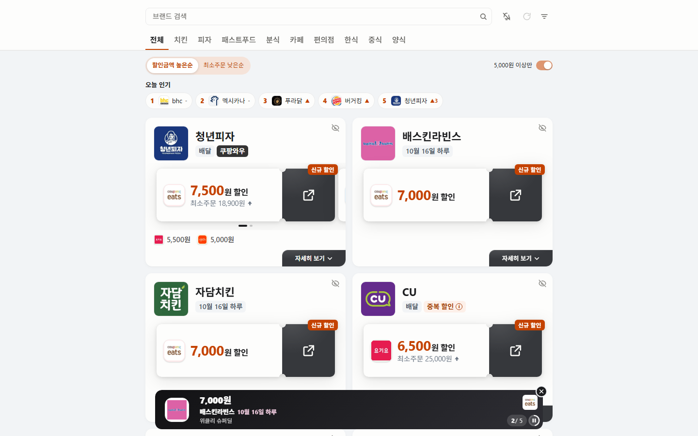
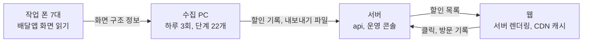

# SaveEats

배달의민족, 쿠팡이츠, 요기요, 땡겨요 네 배달앱의 브랜드별 할인을 한 화면에서 비교하는 서비스다.

**[서비스 바로가기](https://beggars-five.vercel.app)** · [서비스 소개](https://beggars-five.vercel.app/about) · [프로젝트 개요](https://beggars-five.vercel.app/overview)

우아한테크코스 8기 팀 "오늘의 할인"이 만든다. 서비스 이름은 SaveEats이고, 저장소와 운영 주소에는 예전 이름(배거스, beggars)이 남아 있다.



## 목차

1. [문제와 해결](#문제와-해결)
2. [핵심 기능](#핵심-기능)
3. [성과와 지표](#성과와-지표)
4. [시스템 구성](#시스템-구성)
5. [데이터 흐름](#데이터-흐름)
6. [진행 과정과 실험](#진행-과정과-실험)
7. [운영하며 푼 기술 과제](#운영하며-푼-기술-과제)
8. [사용자에게서 배운 점](#사용자에게서-배운-점)
9. [기술 스택](#기술-스택)
10. [저장소 지도](#저장소-지도)
11. [개발과 시험](#개발과-시험)
12. [배포와 운영](#배포와-운영)
13. [팀](#팀)
14. [더 읽을 문서](#더-읽을-문서)
15. [유의사항](#유의사항)

## 문제와 해결

같은 브랜드라도 배달앱마다 할인 금액과 조건이 다르다. "최대 N원"과 실제로 받는 금액이 다를 때도 많다. 그래서 주문 전에 여러 앱을 번갈아 열어 봐야 한다.

SaveEats는 이 비교를 대신한다.

- 배달앱에는 공개 API가 없다. 그래서 실제 폰 7대로 로그인 없이 누구나 보는 할인 화면을 하루 3번 읽는다.
- 읽은 값을 검증해 기록에 쌓고, 브랜드마다 가장 큰 할인과 조건을 보여 준다.
- 할인을 누르면 그 배달앱의 브랜드 화면이나 쿠폰 화면으로 바로 넘어간다.

비영리 정보 제공 서비스다. 어떤 배달 플랫폼과도 제휴하지 않는다.

## 핵심 기능

| 기능 | 설명 |
|---|---|
| 브랜드별 최대 할인 | 가장 큰 할인을 맨 앞에 보여 준다 |
| 조건 비교 | 최소 주문 금액, 멤버십(배민클럽, 쿠팡와우, 요기패스), 선착순과 랜덤 할인을 함께 보여 준다 |
| 할인 상태 구분 | 확정된 금액과 확인 중인 정보를 나눠 보여 준다 |
| 할인 상세 | 브랜드 카드를 열면 앱별 금액, 최소 주문 금액, 조건, 확인일이 나온다 |
| 필터와 정렬 | 쓰는 앱과 멤버십만 골라 본다. 할인 금액 높은 순, 최소 주문 낮은 순으로 정렬한다 |
| 카테고리 | 치킨, 피자, 패스트푸드, 카페, 편의점 등으로 브랜드를 거른다 |
| 검색 | 브랜드, 메뉴, 앱 이름(예: "쿠팡")으로 찾는다. 자동완성을 지원한다 |
| 실시간 인기 | 지금 많이 누르는 할인과 브랜드 순위를 보여 준다 |
| 앱 바로가기 | 지원하는 브랜드는 배달앱 화면으로 바로 연다 |
| 할인 기록 | 브랜드마다 날짜별 최고 할인을 앱별 그래프로 보여 준다 |
| 할인 통계 ([/insight](https://beggars-five.vercel.app/insight)) | 기간을 골라 날짜별, 앱별 할인 수, 최대 할인, 할인 합계, 한정 할인 수를 본다 |
| 공유, 알림, 제보 | 할인 하나를 짧은 링크로 공유하고, 새 할인 웹 알림을 받고, 잘못된 정보를 제보한다 |

| 멤버십 화면과 비회원 화면 비교 | 필터 | 대표 화면(PC) |
|:---:|:---:|:---:|
|  |  |  |

화면이 바뀌어 온 과정은 [화면 변천](docs/screen-history/README.md)에 있다.

## 성과와 지표

출처는 [프로젝트 개요](https://beggars-five.vercel.app/overview) 페이지다. 기간은 2026-07-29 ~ 2026-11-19이고, PostHog 기준이며 봇은 제외했다. 다른 출처는 따로 적었다.

| 지표 | 값 |
|---|---|
| 누적 고유 방문자 | 14,280명 (09-12에 5천 명, 10-12에 1만 명을 넘었다) |
| 누적 활성 사용자 (GA4) | 11,661명 |
| 최대 일간 사용자 (GA4) | 947명 (09-11, 카페 공유일. PostHog로는 1,090명) |
| 최대 주간 사용자 (GA4) | 1,819명 (09-27 주. PostHog로는 2,212명) |
| 최대 월간 사용자 (GA4) | 4,437명 (10월. PostHog로는 5,651명) |
| 2주 뒤 다시 행동한 비율 | 7.9% (첫 주에 행동한 6,753명 기준. 일반 방문자는 6.7%) |
| 할인을 눌러 배달앱으로 이동 | 4,228명 (방문자의 29.7%) |
| 이틀 이상 다시 방문 | 할인을 누른 사람의 41.2%, 전체 방문자의 20.6%. 할인을 누른 사람의 재방문율이 2.0배다 |
| 핵심 단골 | 520명 (5일 이상, 2주 이상 방문하고 3번 이상 클릭). 전체 클릭의 45%를 차지한다 |
| 최대 순간 접속 | 30분 동안 252명 (2026-09-11 18:42, 네이버 카페 공유 직후) |

**스프린트별 할인 선택률** (할인을 누른 사람 ÷ 방문자, 목표 34%)

| 스프린트 | 기간 | 값 |
|---|---|---|
| 1 | 09-21 ~ 10-04 | 36.40% (목표 달성) |
| 2 | 10-05 ~ 10-18 | 35.07% (목표 달성) |
| 3 | 10-19 ~ 11-01 | 25.62% |
| 4 | 11-02 ~ 11-11 | 30.96% |

**쓰는 앱이 많을수록 오래 남는다** (할인 링크를 한 번 이상 누른 4,215명)

| 누른 앱 수 | 사람 수 | 이틀 이상 방문 | 30일 뒤 재방문 | 60일 뒤 재방문 | 활동일 중앙값 |
|---|---|---|---|---|---|
| 4개 모두 | 178명 | 93.8% | 77.5% | 63.6% | 12일 |
| 2~3개 | 1,118명 | 63.8% | 34.3% | 23.3% | 2일 |
| 1개 | 2,919명 | 28.7% | 11.1% | 6.7% | 1일 |

여러 번 온 사람이 더 많은 앱을 눌렀을 수도 있다. 그래서 이 표는 인과 관계를 보여 주지 않는다.

**앱별 반응** (2026-08-27 ~ 2026-11-17)

| 앱 | 할인 카드를 본 사람 중 누른 사람 | 누른 할인의 평균 금액 |
|---|---|---|
| 쿠팡이츠 | 2,019명 (19.8%) | 7,666원 |
| 배민 | 1,306명 (12.7%) | 6,947원 |
| 요기요 | 1,052명 (10.5%) | 8,149원 |
| 땡겨요 | 448명 (4.5%) | 6,532원 |

**서비스 규모** (2026-11-19 기준): 브랜드 116개. 지금 보이는 할인은 192건이다(배민 70, 쿠팡이츠 44, 요기요 40, 땡겨요 38).

## 시스템 구성

전체는 네 층으로 나뉜다. 작업 폰이 화면을 읽고, 수집 PC가 값을 만들고, 서버가 값을 내주고, 웹이 사용자에게 보여 준다.



| 층 | 하는 일 | 만드는 것 |
|---|---|---|
| 작업 폰 | 배달앱을 직접 열어 쿠폰과 할인 화면을 읽는다. 비어 있는 폰이 다음 일을 맡는다. 한 대가 빠지면 다른 폰이 이어받는다 | 화면 구조 정보(글자와 위치) |
| 수집 PC (비공개 tracker 저장소) | 00:01, 08:30, 15:55에 수집을 시작한다. 일을 22개 단계로 나눠 폰에 배정한다. 읽은 화면을 값으로 바꾸고 검증한다 | 할인 기록(덧붙이기만 하는 원장), 내보내기 파일(`export.json`) |
| 서버 (`api/`) | 받은 파일을 순서대로 검증, 백업, 교체한다. 재시작 없이 새 파일을 다시 읽는다. 무중단으로 배포한다 | 할인 목록 JSON |
| 웹 (`web/`) | 서버에서 미리 그린 화면을 보낸다(SSR). CDN이 화면을 5분 동안 보관했다가 바로 내준다 | 사용자 화면, 클릭과 방문 기록 |
| 운영 콘솔 (비공개) | 수집 현황, 폰 상태, 배너 제안 승인, 서버 상태를 보여 준다. 서버는 5분마다 상태를 모은다 | [운영 현황](https://bebeggars.duckdns.org/ops/) (계정은 운영자에게 받는다) |

- 브랜드 페이지를 전부 여는 전수 조사는 00:01 회차와 월요일에만 돈다.
- 앞 회차가 아직 돌고 있으면 새 회차는 시작하지 않는다. 두 회차가 같은 폰을 두고 다투지 않게 하려는 것이다.
- 감시와 보고 기능이 회차 결과와 폰 상태를 Slack과 운영 콘솔로 보낸다. 외부 점검은 3분마다 돈다.

### CI 실행기

| 도는 곳 | 저장소 | 하는 일 |
|---|---|---|
| GitHub 호스트 | 기본 | 먼저 쓴다. 무료 분량이 바닥나면 수집 PC의 자체 실행기로 넘어가고, 매달 1일 다시 돌아온다 |
| 수집 PC | tracker | 시험, 주간 검사, 자동 작업 세션 |
| 운영 서버 | api 배포 저장소 | API 배포 |
| 개발 서버 | 이 저장소 | 개발 API 빌드, 개발용 할인 데이터 동기화 |
| 클라우드 서버 | 운영 콘솔 | 운영 콘솔 시험과 배포 |

## 데이터 흐름

```
폰 화면 읽기 → 판독과 검증 → 할인 기록(원장) → export.json → 서버 대기 폴더 → api(/api/brands) → web
```

1. **화면 읽기**: 폰 화면의 구조 정보(접근성 트리)를 통째로 받아 글자와 위치를 얻는다. 받는 방식은 폰과 단계마다 측정해서 고른다.
2. **판독**: 판독 규칙이 글자와 위치를 기록 한 줄로 바꾼다.
3. **반영**: 검증을 통과한 값만 원장에 덧붙이고 `export.json`을 만든다. 서버에 있던 할인이 갑자기 줄어드는 반영은 "소실 검사"가 막는다. 막힌 반영은 사람이 승인해야 통과한다.
4. **업로드**: 서버 파일을 바로 덮어쓰지 않는다. 서버의 대기 폴더에 먼저 올리면 서버가 받은 순서대로 검증, 백업, 교체한다. 실패한 묶음이 있으면 같은 종류의 뒤 묶음도 멈춘다. 이 동안 화면에는 이전 값이 남는다.
5. **표시**: api가 별칭을 정리하고, 확정과 보류를 판정하고, 만료된 할인을 빼고, 정렬한다. web이 그 결과를 브랜드 카드로 보여 준다.

틀린 값이나 빈 값을 내보내는 것보다 옛 값을 잠시 보여 주는 쪽이 낫다는 원칙이다.

## 진행 과정과 실험

혼자 시작해 07-26에 첫 배포를 했다. 08-03에 팀을 꾸렸고, 레벨3 스프린트 5번과 레벨4 스프린트 4번(09-14 ~ 11-13)을 거쳤다. 레벨4 동안 데모데이를 3번 치렀다. 개발과 운영은 16주 동안 이어졌다.

| 기록 | 수 |
|---|---|
| 커밋 | 3,729개 (서비스 1,950, 수집기 1,779) |
| 병합한 PR | 486개 (서비스 247, 수집기 239) |
| 결정 기록(ADR) | 59개. 버린 대안까지 적는다 |
| 작업 카드 | 97개 (스프린트 9번) |
| 회의록 | 49개 (데모데이, 코치, 회고) |
| 공개 장애 회고 | 7개. 원인과 재발 방지 장치를 적는다 |

### 가설 13개, 기각 6개

성공 기준을 먼저 적고 실험했다. 기각된 기능은 지웠다. 세운 가설은 13개다. 그중 4개를 채택하거나 검증했고, 6개를 기각했다. 설문에는 사용자 29명이 답했다.

**화면 개편 실험: 가장 큰 할인을 앞세운 카드** (기존 화면 623명, 새 화면 661명)

| 지표 | 기존 | 새 화면 | 변화 |
|---|---|---|---|
| 링크 클릭 | 22.5% | 27.2% | +21% |
| 전환 | 25.2% | 29.5% | +17% |
| 아무것도 안 하고 떠난 방문 | 41.3% | 36.3% | -12% |
| 검색 사용 | 4.7% | 11.0% | +137% |

새 화면을 채택하고, 진 쪽 코드 732줄을 지웠다.

| 실험 | 기준 | 결과 | 판정 |
|---|---|---|---|
| 가장 큰 할인을 앞세운 카드 | 핵심 지표 8% 이상 개선 | 링크 클릭 +21%, 검색 +137% | 채택 |
| 검색 자동완성 | 검색 성공률 +5%p | 33.3% → 39.5%. 성공한 검색의 62%가 자동완성을 썼다 | 채택 |
| 필터 위치(상단 메뉴바와 아래 시트) | 필터 탐색과 할인 클릭 | 클릭은 같고 탐색은 메뉴바가 높았다 | 채택 |
| 첫 방문 안내 | 이탈이 5% 넘게 늘면 중단 | 바로 떠나는 사람이 20% 늘어 이틀 만에 뺐다 | 검증 |
| 새 할인을 인기 영역 위로 | 클릭률 +3%p | 클릭과 이동이 줄어 되돌렸다 | 기각 |
| 알림 안내 문구 개선 | 알림 켜기 5% | 4.51% (29/643) | 기각 |
| 할인 하나 공유 링크 | 활성 사용자의 5%가 사용 | 3.73% (9/241) | 기각 |
| 한정 할인 배너 | 배너 클릭이 의미 있게 늚 | 효과가 일정하지 않아 노출을 줄였다 | 기각 |
| 검수 도구로 오류 찾기 | 놓친 오류 50% 감소 | 14% 감소, 검수 시간은 19% 늘었다 | 기각 |
| 큰 할인 하나만 홍보 | 모음 홍보보다 큰 반응 | 반응이 적었다. 할인 크기보다 브랜드 인지도가 컸다 | 기각 |
| 배달 외 브랜드(카페 등) 할인 | 배달 배너보다 높은 클릭률 | 1.02% 대 1.72%. 표본과 위치 영향이 있어 보류 | 판단 불가 |
| 새 할인 웹 알림 | 활성화 5% | 0.17% (6/3,499) | 판단 불가 |
| 만족도 설문(못 쓰게 되면 매우 실망) | 40% 이상 | 37.5% (3/8). 응답이 부족하다 | 진행 중 |

실험 판정 기록은 [docs/metrics/](docs/metrics/)에 있다.

## 운영하며 푼 기술 과제

| 과제 | 결과 |
|---|---|
| 로고 요청이 무료 한도의 93%까지 찼다 | 로고 캐시로 방문당 요청 수를 700에서 25로 줄였다 |
| 압축 없는 154KB 응답 (p95 555ms) | 응답 크기를 91% 줄였다 |
| 이벤트 기록 전체 읽기가 느렸다 | 새로 쌓인 부분만 읽게 바꿔 1,900ms를 16ms로 줄였다 |
| 백업이 실제로 복원되는지 몰랐다 | 격리된 환경에서 실제로 복원했다. 17.64초 걸렸고 지문이 전부 일치했다 |
| 값이 조용히 사라졌다 (6시간 52분 누락) | 배포 전 검사 9단계를 더해 98건을 21건으로 줄였다 |
| 배포 중 서비스 중단 | 무중단 배포를 도입했다. 30초 동안 응답이 없으면 이전 버전으로 자동 복구한다 |

장애와 개선 회고는 [docs/incidents/](docs/incidents/)에 있다.

## 사용자에게서 배운 점

**다시 찾아오는 사용자 설문** (29명. 7일 안 재방문 79%, 30일 안 97%)

| 질문 | 가장 많은 답 |
|---|---|
| 쓰는 목적 | 앱 비교 10명, 새 할인 정보 9명, 돈 아끼기 9명 |
| 언제 여나 | 가장 싼 곳을 찾을 때 17명, 메뉴를 못 정했을 때 7명 |
| 무엇을 먼저 보나 | 할인 금액 16명, 조건 5명, 한정 수량 4명 |
| 부족한 점 | 찾기 어려움 11명, 정보가 늦음 7명, 브랜드가 적음 6명 |
| 바라는 기능 | 멤버십 반영 8명, 지역 필터 8명, 할인 알림 6명, 할인 기록 5명 |

**커뮤니티 반응**: 아카라이브 핫딜 채널의 홍보글과 관련 글 24개에서 댓글 676개를 AI로 분류했다.

- 긍정 댓글 138개, 부정 댓글 315개.
- 할인 방식(선착순, 타겟 쿠폰, 배달비 조건 등)을 두고 말한 댓글이 448개다.
- 앱을 언급한 댓글의 68.8%, 브랜드를 언급한 댓글의 48.7%가 부정적이었다.
- 조회와 서비스 이동은 18시에 가장 많았다. 외부 유입 5,721세션 중 71.2%가 더쿠 링크에서 왔다.

**정리하면** 쓰는 앱이 많을수록 오래 남는다. 사용자는 가장 싼 곳을 찾을 때 서비스를 열고, 할인 금액을 먼저 본다.

## 기술 스택

| 구분 | 기술 |
|---|---|
| 웹 | React 18, Vite, Vercel 서버 렌더링, Node.js, npm |
| 서버 | Java 17, Spring Boot 4.1 (Jackson 3), Gradle, DB 없이 JSON과 JSONL 파일 원장, Oracle Cloud 서버 1대(nginx, systemd, 무중단 교대 배포) |
| 수집 (비공개) | Python, PyYAML, pytest(시험 2,200건 이상), ADB |
| CI와 배포 | GitHub Actions, Vercel |
| 분석과 운영 | 자체 이벤트 원장, PostHog, GA4, Slack 알림, 3분 간격 외부 점검 |

이렇게 고른 이유와 대안은 [기술 선택과 근거](docs/TECH-CHOICES.md)에 있다.

## 저장소 지도

| 폴더 | 역할 |
|---|---|
| [`api/`](api/) | 별칭 정리, 확정과 보류 판정, 만료 제외, 정렬 |
| [`web/`](web/) | 브랜드 카드 비교 화면, 서비스 소개(`/about`)와 프로젝트 개요(`/overview`) 페이지 |
| [`docs/`](docs/) | 공개 문서, 설계, ADR, 장애 회고, 실험 판정, 화면 변천 |
| [`scripts/`](scripts/) | 분석, 스냅숏, 구조 문서 생성 스크립트와 git 훅 |
| `tracker/` | README와 로고만 있다. 수집기 본체는 비공개 저장소에 있다 |
| `.github/workflows/` | 점검(api, web, 구조 문서, 비밀값 검사), 배포 미러, 개발 서버 배포, 이슈에서 병합까지 자동 흐름 |
| `_retired/` | 더 쓰지 않는 옛 코드 |

이 저장소는 수집기를 싣지 않는다. 판독 규칙, 데이터 모델, 원장은 비공개 tracker 저장소에만 있다. 근거는 [ADR-002](docs/decisions/ADR-002-mono-is-the-public-source.md)에 있다.

세 저장소를 `git filter-repo`로 합쳤다. 커밋 223개가 그대로 남아 있고 `git log --follow -- web/src/App.jsx`도 동작한다.

## 개발과 시험

필요한 버전은 Java 17, Node 24, npm 11이다. 자세한 순서는 [온보딩](ONBOARDING.md)에 있다.

```bash
cd api && ./gradlew test                  # api 시험
cd api && ./gradlew bootRun               # localhost:8080
cd web && npm install && npm run dev      # localhost:5173
cd web && npm test && npm run build       # web 시험과 빌드
git config core.hooksPath scripts/githooks   # push 전에 구조 문서를 검사한다
```

web은 기본으로 운영 API를 부른다. 로컬 api를 화면에서 보려면 `web/src/api.js`의 `API_BASE`를 바꾼다. 이 변경은 커밋하지 않는다.

## 배포와 운영

배포는 이 저장소에 push하면 시작된다.

- **웹과 API**: 워크플로 `mirror-deploy-repos.yml`이 `web/`과 `api/`를 배포 저장소로 복사한다. 웹은 Vercel이, API는 운영 서버가 그 저장소에서 배포한다. 배포 저장소는 직접 고치지 않는다.
- **데이터**: 수집 PC가 서버 대기 폴더로 올린다. 이 저장소는 관여하지 않는다.
- **기능과 실험**: 브랜치를 만들고 PR을 올려 점검한 뒤 병합한다.
- **웹 화면**: `preview/<이름>` 브랜치를 push하면 Vercel 미리보기 주소(`beggars-git-preview-<이름>-nn98s-projects.vercel.app`)가 생긴다. 폭 360px 화면으로 확인하고 승인받은 뒤 병합한다.
- **예외와 규칙**: 바로 push해도 되는 예외와 커밋, 가드 규칙은 [WORKFLOW 7절](docs/WORKFLOW.md#7-규칙과-가드-이-문서가-단일-진실)에만 적는다.

운영 대시보드 설계는 [docs/design/32-ops-monitoring.md](docs/design/32-ops-monitoring.md)에 있다.

### 관련 저장소

| 저장소 | 성격 |
|---|---|
| `woowacourse-teams/2026-to-discount` (이 저장소, 공개) | api, web, 공개 문서 |
| `delivery-discount-tracker` (비공개) | 수집 자동화, 예약 실행, 원장, 문서 원본 |
| `nn98/beggars-ops` (비공개) | 운영 콘솔 |
| [`nn98/delivery-discount-web`](https://github.com/nn98/delivery-discount-web) | 웹 배포용 복사본 (Vercel) |
| [`nn98/delivery-discount-api`](https://github.com/nn98/delivery-discount-api) | API 배포용 복사본 (운영 서버) |

## 팀

|  |  |  |
|:---:|:---:|:---:|
| [nn98](https://github.com/nn98) | [everypine](https://github.com/everypine) | [miniminjae92](https://github.com/miniminjae92) |

프로젝트 개요 페이지에 적힌 역할: 글렌(기획, 수집, 인프라, 제품 실험), 고래(수집 환경, 온보딩, 디자인 시스템), 피온(분석 계측, 알림, 운영 안정화).

## 더 읽을 문서

| 문서 | 내용 |
|---|---|
| [온보딩](ONBOARDING.md) | 개발 환경 구성과 실행. **처음이면 여기부터 읽는다** |
| [작업 가이드](docs/WORKFLOW.md) | 저장소별 역할, 원본이 있는 곳, 일의 종류별 순서 |
| [아키텍처](docs/ARCHITECTURE.md) | 구조와 그렇게 정한 이유 |
| [변경 전파](docs/CHANGE-PROPAGATION.md) | 한 곳을 고치면 어디까지 함께 고쳐야 하나 |
| [기술 선택과 근거](docs/TECH-CHOICES.md) | 고른 것, 아쉬운 점, 대안 |
| [층 사이 약속](docs/ORCHESTRATION.md) | 층을 넘나들 때 지킬 것과 실제 사고 사례 |
| [프로젝트 구조](docs/PROJECT-STRUCTURE.md) | 코드에서 자동으로 만드는 구조, 데이터 흐름, 배포 경계 |
| [수집 데이터 명세](docs/ANALYTICS.md) | 무엇을 모으고 어떻게 나누나. **분석 전에 읽는다** |
| [컨벤션](docs/CONVENTIONS.md) | 커밋, 주석, 문서, 데이터 규칙 |
| [결정 기록](docs/decisions/) | 되돌리기 어려운 판단과 근거 |

ADR은 [저장소 공통](docs/decisions/) 2건, [api](api/docs/decisions/) 13건, [web](web/docs/decisions/) 4건이다(2026-11-19 기준).

## 유의사항

- 할인 정보는 수집한 시점에 따라 달라질 수 있다.
- 확인 중인 할인은 화면에 "미확인"이나 "보류"로 표시된다.
- 비영리 정보 제공 서비스다. 배달 플랫폼과 제휴하지 않고 수수료도 받지 않는다.
- 각 배달앱의 공식 서비스가 아니다. 모든 상표는 각 권리자에게 있다.
- 로그인 없이 누구나 보는 화면만 수집한다. 자동 접근을 거부하는 곳은 우회하지 않는다(비공개 tracker 저장소 ADR-015).

### 개인정보

방문 통계는 자체 서버에 모으고 제3자에게 넘기지 않는다.

- **IP 원본을 저장하지 않는다.** 날짜마다 바뀌는 값을 섞어 해시하므로 사람을 다시 알아낼 수 없다.
- **User-Agent 문자열을 모으지 않는다.** 모바일인지 데스크톱인지만 남긴다.
- **DNT와 GPC 설정을 따른다.** 브라우저에서 켜져 있으면 아무것도 모으지 않는다.

근거는 [api ADR-005](api/docs/decisions/ADR-005-first-party-analytics.md)에 있다.
