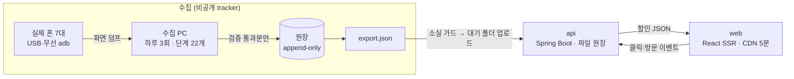
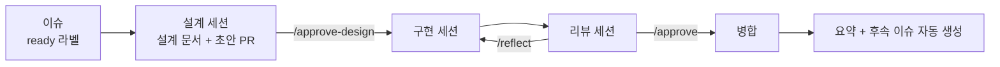

### 배달앱 네 곳의 할인, 한 화면 비교 — SaveEats

배달의민족 · 쿠팡이츠 · 요기요 · 땡겨요의 브랜드별 할인을 실제 폰 화면에서 읽어 한곳에 모으는 서비스

| 누적 고유 방문자 | 방문자 중 할인 클릭 | 수집하는 실제 폰 | 할인 갱신 |
|:---:|:---:|:---:|:---:|
| **14,280명** | **36.4%** (스프린트 1) | **7대** | **하루 3회** |

2026-07-29 ~ 2026-11-19, PostHog, 봇 제외

## 목차

- [아키텍처](#-아키텍처)
- [기술적 도전](#-기술적-도전)
- [운영 중 만난 문제와 측정 결과](#-운영-중-만난-문제와-측정-결과)
- [실험 문화: 가설 13개, 기각 6개](#-실험-문화-가설-13개-기각-6개)
- [기록 문화와 AI 세션 개발 흐름](#-기록-문화와-ai-세션-개발-흐름)
- [기술 스택](#-기술-스택)
- [저장소 구조](#-저장소-구조)
- [팀](#-팀)

## 🧭 아키텍처

공개 API 없음 → 로그인 없이 누구나 보는 화면만 실제 폰으로 읽기.

- 회차: 00:01 · 08:30 · 15:55. 브랜드 페이지 전수 조사는 00:01과 월요일만
- 앞 회차가 돌면 새 회차는 버림 → 폰 쟁탈 없음
- 서버는 받은 묶음을 순서대로 검증 · 백업 · 교체 → 재시작 없이 다시 읽기
- 무중단 교대 배포: 새 버전을 임시 서버에 먼저 띄움, 30초 응답 없으면 이전 버전 자동 복구
- 원장 기록 28,630줄

## 🔧 기술적 도전

### 1. 폰 7대로 앱 4개를 도는 워커 풀

- **문제** 앱마다 계정 등급(멤버십 유무)에 따라 보이는 할인이 다름. 맞지 않는 폰이 읽은 값은 원장에 섞이면 안 됨
- **방법** 단계마다 필요한 계정 등급과 능력을 적고, 자격이 맞는 빈 폰이 다음 단계를 집어 감. 폰마다 미연결 → 준비 → 대기 → 작업 → 반납 → 끝 상태기계
- **결과** 한 대가 빠져도 다른 폰이 이어받음. 사람 손 없는 수집

### 2. 하루 3회, 22단계 파이프라인

- **문제** 앱 4곳 × 허브 · 브랜드 · 쿠폰 화면, 단계 사이 선행 관계가 얽힘
- **방법** 단계 22개를 선행 관계 그물(단계 집합)로 한 곳(catalog)에만 정의. 새 단계 · 선행 · 자격 · 시간 상한을 한 곳만 고침
- **결과** 준비 → 앱별 줄(쿠팡이츠 · 배민 · 땡겨요 · 요기요) → 배너 → 반영 순으로 병렬 실행

### 3. 화면 덤프 방식은 측정으로 고름

- **문제** 앱마다 화면 구조가 다르고, 폰마다 화면 정보를 받는 속도가 다름
- **방법** 접근성 트리를 통째로 받는 방식(폰 안 덤프 서버, uiautomator)을 폰과 단계마다 측정해 선택
- **결과** 한 방식으로 못 박지 않고 측정값으로 교체 가능

### 4. 틀린 값보다 옛 값: 소실 가드와 사람 승인 관문

- **문제** 수집은 틀린 값을 내기보다 값을 조용히 잃음. "0건"이 관측인지 미관측인지 구분 불가
- **방법** 검증 통과 출처만 원장에 덧붙임. 서버 값이 줄어드는 반영은 소실 가드가 차단, 사람 승인 뒤에만 통과(자동 승인 경로 없음). 실패한 업로드 묶음은 같은 종류의 뒤 묶음도 막음
- **결과** 조용한 데이터 손실 98 → 21건. 실패해도 화면은 이전 값 유지

## 📉 운영 중 만난 문제와 측정 결과

| 문제 | 한 방법 | 결과 |
|---|---|---|
| 방문당 요청 수, 한도 93% 위기 | 로고 캐시 | **700 → 25** |
| 압축 없던 154KB 응답, p95 555ms | 응답 압축 | **-91%** |
| 이벤트 기록 읽기 | 전체 읽기 → 증분 읽기 | **1,900 → 16ms** |
| 백업이 진짜 복원되나 | 격리 환경 실제 복원, 지문 전부 일치 | **17.64초** |
| 조용한 데이터 손실(6시간 52분 누락) | 배포 전 검사 9단계 추가 | **98 → 21건** |
| 배포 중 중단 | 무중단 배포, 응답 없으면 자동 복구 | **30초** |

장애 회고는 [docs/incidents/](docs/incidents/).

## 🧪 실험 문화: 가설 13개, 기각 6개

성공 기준을 먼저 적고, 기각된 기능은 지움. 세운 가설 13 · 채택하거나 검증 4 · 기각 6 · 설문 응답 29명.

**화면 개편 실험: 가장 큰 할인을 앞세운 카드** (기존 623명 vs 쿠폰 카드 661명)

| 링크 클릭 | 전환 | 무동작 방문 | 검색 사용 |
|:---:|:---:|:---:|:---:|
| 22.5% → 27.2% (**+21%**) | 25.2% → 29.5% (**+17%**) | 41.3% → 36.3% (**-12%**) | 4.7% → 11.0% (**+137%**) |

→ 채택, 진 쪽 코드 **732줄 삭제**

| 실험 | 기준 | 결과 | 판정 |
|---|---|---|---|
| 검색 자동완성 | 검색 성공률 +5%p | 33.3% → 39.5% | 채택 |
| 첫 방문 튜토리얼 | 이탈 5% 넘게 늘면 검증 | 바로 떠나는 사람 20% 증가, 이틀 만에 제거 | 검증 |
| 새 할인을 인기 영역 위로 | 클릭률 +3%p | 클릭과 이동 감소, 되돌림 | 기각 |
| 할인 하나 공유 링크 | 활성 사용자 5% 사용 | 3.73% (9/241) | 기각 |
| 검수 도구로 오류 찾기 | 미발견 오류 50% 감소 | 14% 감소, 검수 시간 19% 증가 | 기각 |

전체 13건과 판정 근거는 [프로젝트 개요](https://beggars-five.vercel.app/overview)와 [docs/metrics/](docs/metrics/).

**데이터로 본 사용자**: 할인 링크를 누른 앱이 4개인 사람의 60일 뒤 재방문 63.6%, 1개인 사람 6.7%. 활동일 중앙값 12일 vs 1일.

## 📚 기록 문화와 AI 세션 개발 흐름

| 커밋 | 병합한 PR | ADR | 작업 카드 | 회의록 | 공개 장애 회고 |
|:---:|:---:|:---:|:---:|:---:|:---:|
| 3,729 | 486 | 59 | 97 | 49 | 7 |

- ADR은 버린 대안까지 기록 → [docs/decisions/](docs/decisions/), [api](api/docs/decisions/), [web](web/docs/decisions/)
- 이슈 → 병합 자동 흐름 (`.github/workflows/wf-*.yml`)

- 사람 관문은 설계 승인과 병합 승인 두 곳
- 웹 화면은 `preview/<이름>` 브랜치 → Vercel 프리뷰 → 360px 확인 뒤 병합
- 한 곳을 고칠 때 함께 고칠 묶음은 [CHANGE-PROPAGATION](docs/CHANGE-PROPAGATION.md)

## 🛠 기술 스택

| 수집 (비공개) | 서버 | 웹 | 분석과 운영 |
|---|---|---|---|
| Python, ADB, 테스트 2,200건 이상 | Spring Boot 4.1, JSON 파일 (DB 없음), Oracle Cloud | React 18, Vite, Vercel 서버 렌더링 | PostHog, GA4, Slack 알림, 3분 외부 점검 |

선택 근거와 플랜 B는 [TECH-CHOICES](docs/TECH-CHOICES.md).

## 🗂 저장소 구조

| 경로 | 역할 |
|---|---|
| [`api/`](api/) | 별칭 정규화, 확정/보류 판정, 만료 제외, 정렬 |
| [`web/`](web/) | 브랜드 카드 교차 비교 화면 |
| [`docs/`](docs/) | 설계, ADR, 장애 회고, 실험 판정, [화면 변천](docs/screen-history/README.md) |
| `tracker/` | 수집기는 비공개 저장소. 여기에는 README와 로고만 ([ADR-002](docs/decisions/ADR-002-mono-is-the-public-source.md)) |

- `main` push → `web/`, `api/`를 배포 저장소로 미러 → Vercel, 운영 서버가 배포
- 처음이면 [온보딩](ONBOARDING.md) → [작업 가이드](docs/WORKFLOW.md)

## 👥 팀

|  |  |  |
|:---:|:---:|:---:|
| [nn98](https://github.com/nn98) | [everypine](https://github.com/everypine) | [miniminjae92](https://github.com/miniminjae92) |

우아한테크코스 8기 팀 오늘의 할인.

## 유의사항

- 할인 정보는 수집 시점에 따라 달라질 수 있다.
- 일부 할인 정보는 확인이 진행 중이라 화면에서 미확인 또는 보류 상태로 표시될 수 있다.
- 비영리 정보 제공 서비스이며, 배달 플랫폼과 제휴하거나 수수료를 받지 않는다.
- 로그인 없이 누구나 보는 화면만 수집한다. 자동 접근을 거부하는 곳은 우회하지 않는다 (tracker 저장소(비공개) ADR-015).

### 개인정보

방문 통계를 자체 서버에 수집한다. 제3자에게 넘기지 않는다.

- **IP는 원본을 저장하지 않는다.** 날짜별 솔트로 해시해 재식별할 수 없게 한다.
- **User-Agent 문자열을 수집하지 않는다.** 모바일/데스크톱 구분만 남긴다.
- **DNT와 GPC를 존중한다.** 브라우저에서 켜져 있으면 수집 자체를 하지 않는다.

근거: [api ADR-005](api/docs/decisions/ADR-005-first-party-analytics.md).
