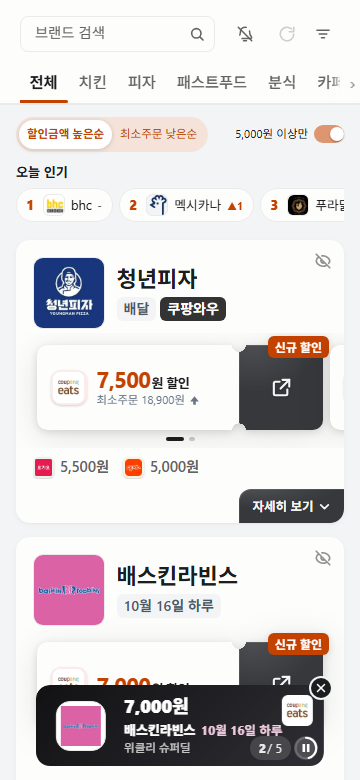
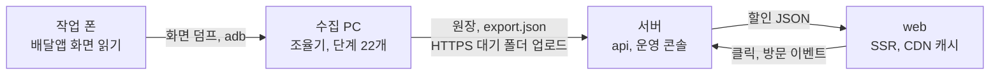

# SaveEats

서비스 이름은 **SaveEats**다. 저장소와 운영 도메인 이름(배거스, beggars)은 그대로다.

> 배민, 쿠팡이츠, 요기요, 땡겨요의 브랜드별 할인 정보를 한곳에서 비교하는 서비스

**[서비스 바로가기](https://beggars-five.vercel.app)**

## 서비스 소개

SaveEats는 브랜드별 할인 정보를 한 화면에서 비교하는 서비스다. 같은 브랜드라도 배달앱마다 할인 금액과 조건이 다르고, "최대 N원"이 실제로 받는 금액과 다를 때가 많다. 여러 배달앱을 번갈아 확인하는 번거로움을 줄이려고 만들었다.

배달의민족, 쿠팡이츠, 땡겨요, 요기요에서 로그인 없이 누구나 보는 할인 화면을 하루 여러 번 확인해 정리한다. 비영리 정보 제공 목적이며, 특정 배달 플랫폼과 제휴 관계가 없다.

| 지표 (2026-11-19) | 값 |
|---|---|
| 다루는 브랜드 | 116개 |
| 지금 보이는 오퍼 | 192건 (배민 70, 쿠팡이츠 44, 요기요 40, 땡겨요 38) |
| 방문자 (2026-08-03 ~ 11-19, 봇 제외) | 약 1.36만 명 |
| 할인을 골라 배달앱으로 이동한 방문자 | 약 29% |

## 핵심 기능

- **브랜드 단위 할인 비교**: 동일 브랜드의 할인 정보를 배달앱별로 한 화면에서 확인한다.
- **카테고리별 탐색**: 치킨, 피자, 패스트푸드, 카페, 편의점 등 카테고리별로 브랜드를 거른다.
- **할인 상태 구분**: 확정된 할인 금액과 확인이 더 필요한 정보를 구분해 표시한다.
- **할인 상세 정보**: 브랜드 카드를 열어 앱별 할인 금액, 최소 주문 금액, 조건, 확인일을 확인한다.
- **배달앱 바로가기**: 지원되는 브랜드는 해당 배달앱의 브랜드 페이지나 쿠폰 페이지로 바로 이동한다.
- **정렬과 필터**: 할인금액 높은순, 최소주문 낮은순, 멤버십(배민클럽, 쿠팡와우, 요기패스), 선착순과 랜덤 할인 칩.
- **검색**: 브랜드 이름, 메뉴, 앱 이름(예: "쿠팡")으로 찾는다. 앱 이름이면 그 앱 할인이 있는 브랜드만 남긴다.
- **할인 기록**: 브랜드마다 날짜별 최고 할인 그래프를 앱별로 나눠 본다.
- **할인 통계** ([/insight](https://beggars-five.vercel.app/insight)): 조회 기간을 골라 날짜별, 앱별 할인 수, 최대 할인, 할인 합계, 한정 할인 수를 본다.
- **실시간 인기, 공유, 제보**: 많이 누른 브랜드 순위, 개별 혜택 짧은 링크 공유, 잘못된 정보 제보와 처리 상태 확인.

## 대표 화면

| 모바일 | PC |
|:---:|:---:|
|  |  |

화면이 바뀌어 온 과정은 [화면 변천](docs/screen-history/README.md)에 있다.

## 팀원

|  |  |  |
|:---:|:---:|:---:|
| [nn98](https://github.com/nn98) | [everypine](https://github.com/everypine) | [miniminjae92](https://github.com/miniminjae92) |

## 기술 스택

| 구분 | 개발 환경 |
|---|---|
| Frontend | React 18, Vite, Node.js, npm |
| Backend | Java 17, Spring Boot 4.1 (Jackson 3), Gradle, DB 없이 파일 원장(JSON, JSONL) |
| Data Tracker | Python, PyYAML, pytest, ADB CLI (비공개 저장소) |
| Infra | GitHub Actions, 서버 1대(nginx, systemd, 무중단 교대 배포), Vercel |
| 분석 | 자체 이벤트 원장, PostHog, GA4(임시) |

---

## 시스템 구성

네 층 구조. 작업 폰(손) → 수집 PC(두뇌) → 서버(창고) → 웹(창구).



| 층 | 하는 일 | 결과물 |
|---|---|---|
| 작업 폰 | 배달앱을 직접 열어 쿠폰과 할인 화면 읽기. 비어 있는 폰이 다음 단계를 맡는 워커 풀 방식 | 화면 덤프(글자와 위치) |
| 수집 PC (tracker, 비공개) | 하루 3번(00:01, 08:30, 15:55) 회차 시작. 단계 22개를 폰에 나눠 주고 판독, 검증 | 원장(덧붙이기만 하는 할인 기록), `export.json` |
| 서버 (`api/`) | 대기 폴더의 묶음을 순서대로 검증, 백업, 교체. 재시작 없이 다시 읽기(`/api/reload`). 무중단 교대 배포 | 할인 목록 JSON |
| 웹 (`web/`) | 서버 렌더링(SSR)과 CDN 캐시(5분)로 브랜드별 할인 화면 제공 | 사용자 화면, 이벤트 |
| 운영 콘솔 (beggars-ops, 비공개) | 수집 현황, 폰 상태, 배너 제안 승인, 서버 상태. 서버가 5분마다 상태 수집 | [운영 현황 대시보드](https://bebeggars.duckdns.org/ops/) (계정은 운영자에게) |

전수조사 계열 단계(브랜드 페이지 전부 열기)는 00:01 회차와 월요일에만 돈다. 서버 값이 줄어드는 반영은 소실 가드가 막고 사람 승인 뒤 통과한다.

### CI 실행기

| 실행기 위치 | 저장소 | 하는 일 |
|---|---|---|
| GitHub 호스트 | 기본 | 먼저 씀. 무료 분량이 바닥나면 수집 PC 자체 실행기로 넘어가고 매달 1일 되돌림 |
| 수집 PC WSL | tracker | tracker 시험, 주간 검사, 자동 세션 |
| 운영 서버 (ARM64) | delivery-discount-api | API 배포 |
| 개발 서버 (ARM64) | mono | 개발 API 빌드, 개발 오퍼 동기화 |
| OCI (X64) | beggars-ops | 운영 콘솔 CI, 배포 |

## 저장소 지도

| 디렉터리 | 역할 |
|---|---|
| `tracker/` | 수집기는 비공개 저장소에 있다. 여기 `tracker/`에는 README와 로고(logos/)만 있다 ([ADR-002](docs/decisions/ADR-002-mono-is-the-public-source.md)) |
| [`api/`](api/) | 별칭 정규화, 확정/보류 판정, 만료 제외, 정렬 |
| [`web/`](web/) | 브랜드 카드 교차 비교 화면 |
| [`docs/`](docs/) | 공개 문서, 설계, ADR, 장애 회고, 실험 판정, 화면 변천 |
| [`scripts/`](scripts/) | 저장소 점검 스크립트와 git 훅(`scripts/githooks`) |
| `.github/workflows/` | 점검(api, web, 구조 문서, 비밀 스캔), 미러 배포, 개발 서버 배포, 이슈→병합 자동 세션 |
| `_retired/` | 쓰지 않는 옛 코드 보관 |

**이 저장소는 수집기를 싣지 않는다.** 판독 계약, 데이터 모델, 원장은 tracker 저장소(비공개)에만 있다. 근거는 [ADR-002](docs/decisions/ADR-002-mono-is-the-public-source.md)에 있다.

## 데이터 흐름

```
수집 PC 판독 → 검증 → 원장(log.jsonl) → export.json → 서버 대기 폴더 → api(/api/brands) → web
```

- 판독: 폰 화면의 구조 정보(접근성 트리)를 받아 글자와 위치를 원장 한 줄로 변환.
- 반영 관문(단계 7, 8): 검증을 통과한 출처만 원장에 덧붙이고 `export.json` 제작. 사라짐 검사 뒤 서버 대기 폴더로 업로드.
- 서버: 묶음을 받은 순서대로 검증, 백업, 교체. 실패한 묶음은 같은 종류의 뒤 묶음을 막고, 화면은 이전 값 유지.

## 개발과 시험

자세한 순서는 [온보딩](ONBOARDING.md).

```bash
cd api && ./gradlew test           # api 시험
cd api && ./gradlew bootRun         # localhost:8080
cd web && npm install && npm run dev                       # localhost:5173
cd web && npm test && npm run build                        # web 시험과 빌드
git config core.hooksPath scripts/githooks                 # push 전 구조 문서 검사
```

web은 기본으로 운영 API를 부른다. 로컬 api를 보려면 `web/src/api.js`의 `API_BASE`를 바꾸고 커밋하지 않는다.

## 배포와 운영

**배포는 이 저장소의 push가 시작한다.**

- 웹과 API: `mirror-deploy-repos.yml`이 `web/`, `api/`를 배포 저장소(`nn98/delivery-discount-web`, `nn98/delivery-discount-api`)로 미러한다. 웹은 Vercel이, API는 운영 서버 self-hosted runner가 그 저장소에서 배포한다. 미러는 직접 고치지 않는다.
- 데이터: 수집 PC가 서버 대기 폴더로 올린다(tracker 저장소). 이 저장소는 관여하지 않는다.
- 기능과 실험: 브랜치, PR, 점검 뒤 병합.
- 웹 화면: mono에 `preview/<이름>` 브랜치 push → Vercel 프리뷰(`beggars-git-preview-<이름>-nn98s-projects.vercel.app`) → 360px 확인과 승인 → 병합.
- 직접 push 예외와 커밋, 가드 규칙: [WORKFLOW 7절](docs/WORKFLOW.md#7-규칙과-가드-이-문서가-단일-진실)이 단일 진실.
- 원본 세 저장소는 수동 폴백만 남아 있다. ADR-001의 "대가" 절 참고.

운영 대시보드 설계는 [docs/design/32-ops-monitoring.md](docs/design/32-ops-monitoring.md).

## 관련 저장소

| 저장소 | 성격 |
|---|---|
| `woowacourse-teams/2026-to-discount` (이 저장소, 공개) | api, web, 공개 문서 |
| `delivery-discount-tracker` (비공개) | 수집 자동화, 예약 실행, 원장, 문서 원본 |
| `nn98/beggars-ops` (비공개) | 운영 콘솔 |
| [`nn98/delivery-discount-web`](https://github.com/nn98/delivery-discount-web) | web 배포 미러 (Vercel) |
| [`nn98/delivery-discount-api`](https://github.com/nn98/delivery-discount-api) | api 배포 미러 (운영 서버) |

## 더 읽을 문서

| 문서 | 내용 |
|---|---|
| [아키텍처](docs/ARCHITECTURE.md) | 구조와 그렇게 정한 이유 |
| [변경 전파](docs/CHANGE-PROPAGATION.md) | 고칠 자리가 어디까지 번지나 |
| [온보딩](ONBOARDING.md) | 개발 환경 구성과 실행. **처음이면 여기부터** |
| [작업 가이드](docs/WORKFLOW.md) | 저장소 넷의 역할, 진실이 있는 자리, 일의 종류별 길(수집, API, 웹 프리뷰, 데이터 반영, 설계→계획→ADR) |
| [기술 선택과 근거](docs/TECH-CHOICES.md) | 무엇을 골랐고, 무엇이 아쉽고, 플랜 B는 무엇인지 |
| [오케스트레이션 계약](docs/ORCHESTRATION.md) | 층을 가로지를 때 지켜야 하는 것과 실제 사고 사례 |
| [프로젝트 구조](docs/PROJECT-STRUCTURE.md) | 코드에서 자동 생성되는 구조, 데이터 흐름, 배포 경계 |
| [수집 데이터 명세](docs/ANALYTICS.md) | 무엇을 모으고 어떻게 가르나. **분석 전에 읽는다** |
| [컨벤션](docs/CONVENTIONS.md) | 커밋, 주석, 문서, 데이터 규칙 |
| [의사결정기록](docs/decisions/) | 되돌리기 어려운 판단과 근거 |

앱별 ADR: [저장소 공통](docs/decisions/) 2건, [api](api/docs/decisions/) 13건, [web](web/docs/decisions/) 4건 (2026-11-19 기준). 장애와 개선 회고는 [docs/incidents/](docs/incidents/), 실험 판정은 [docs/metrics/](docs/metrics/)에 있다.

이력은 `git filter-repo`로 세 저장소를 합쳤다. 커밋 223개가 그대로 살아 있고 `git log --follow -- web/src/App.jsx`도 동작한다.

## 유의사항

- 할인 정보는 수집 시점에 따라 달라질 수 있다.
- 일부 할인 정보는 확인이 진행 중이라 화면에서 미확인 또는 보류 상태로 표시될 수 있다.
- 비영리 정보 제공 서비스이며, 배달 플랫폼과 제휴하거나 수수료를 받지 않는다.
- 로그인 없이 누구나 보는 화면만 수집한다. 자동 접근을 거부하는 곳은 우회하지 않는다 (tracker 저장소(비공개) ADR-015).

### 개인정보

방문 통계를 자체 서버에 수집한다. 제3자에게 넘기지 않는다.

- **IP는 원본을 저장하지 않는다.** 날짜별 솔트로 해시해 재식별할 수 없게 한다.
- **User-Agent 문자열을 수집하지 않는다.** 모바일/데스크톱 구분만 남긴다.
- **DNT와 GPC를 존중한다.** 브라우저에서 켜져 있으면 수집 자체를 하지 않는다.

근거: [api ADR-005](api/docs/decisions/ADR-005-first-party-analytics.md).
