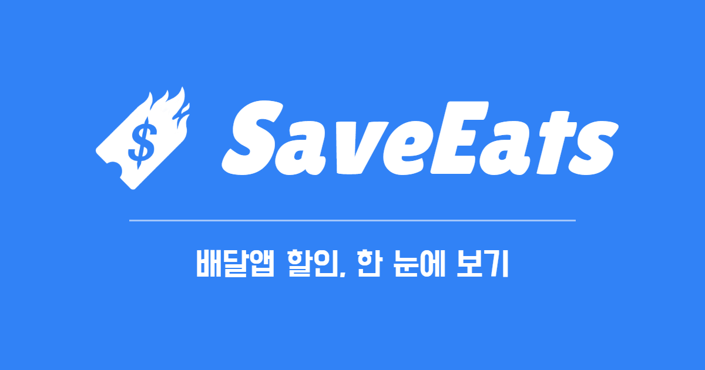
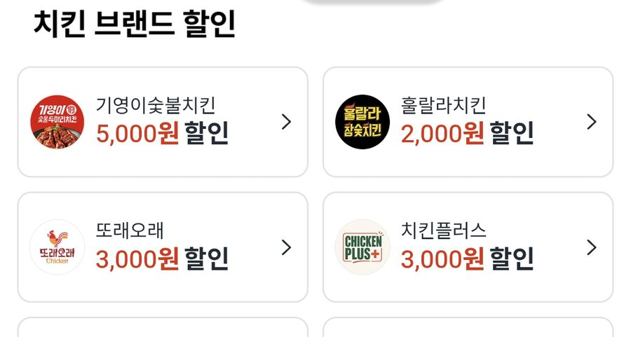
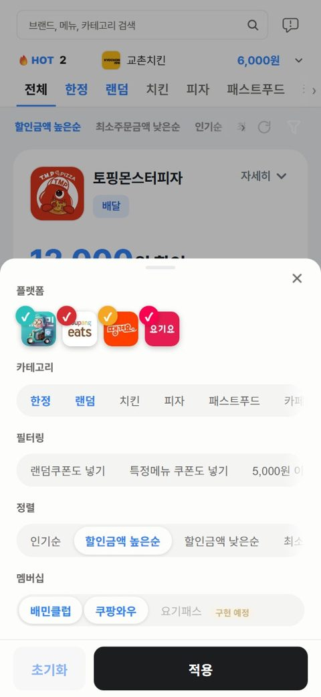
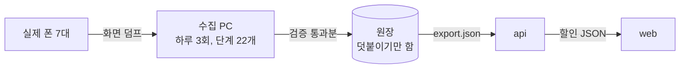

### SaveEats, 배달앱 네 곳의 할인을 한 화면에서 비교

공개 API가 없어 실제 폰 7대로 앱 화면을 읽어 모은다.

   

| 누적 고유 방문자 | 수집하는 실제 폰 | 할인 갱신 | 개발과 운영 |
|:---:|:---:|:---:|:---:|
| **14,280명** | **7대** | **하루 3회** | **16주** |

## 기능

| 브랜드별 최대 할인 | 멤버십별 차이 | 조건 비교 | 필터 | 실시간 인기 |
|:---:|:---:|:---:|:---:|:---:|
|  |  |  |  |  |

자세히 보기: [화면 변천](docs/screen-history/README.md)

## 성과

- 누적 고유 방문자 14,280명
- 네이버 카페 공유 직후(2026-09-11 18:42) 30분 동안 252명 접속

| 2026-09-11 카페 공유일 | 2026-10-03 토요일 오후 |
|:---:|:---:|
|  |  |

자세히 보기: [개요 페이지 성과](https://beggars-five.vercel.app/overview/?s=2)

## 아키텍처

로그인 없이 누구나 보는 화면만 읽는다.

- 원장(할인 기록을 덧붙이기만 하는 파일)은 28,630줄이다.
- 할인 수가 줄어드는 반영은 소실 검사가 막는다. 사람이 승인해야 통과한다.
- 배포 중 30초 동안 응답이 없으면 이전 버전으로 자동 복구한다.

자세히 보기: [개요 페이지 기술 구조](https://beggars-five.vercel.app/overview/?s=5), [ARCHITECTURE](docs/ARCHITECTURE.md)

## 기술 과제

| 방문당 요청 수 | 응답 크기 | 이벤트 기록 읽기 | 모르고 지나간 할인 누락 |
|:---:|:---:|:---:|:---:|
| **700 → 25** | **-91%** | **1,900 → 16ms** | **98 → 21건** |
| 로고 캐시 | 응답 압축 | 증분 읽기 | 배포 전 검사 9단계 |

자세히 보기: [개요 페이지 기술 과제](https://beggars-five.vercel.app/overview/?s=6), [장애 회고](docs/incidents/)

## 실험

가설 13개를 세워 6개를 기각했다. 성공 기준을 먼저 적고, 기각된 기능은 지웠다.

- 가장 큰 할인을 앞세운 카드 화면이 이겼다. 링크 클릭이 21%, 검색 사용이 137% 늘었다.
- 진 쪽 화면의 코드 732줄을 지웠다.

자세히 보기: [개요 페이지 실험과 검증](https://beggars-five.vercel.app/overview/?s=4), [실험 판정](docs/metrics/)

## 개발 방식

| 커밋 | 병합한 PR | 결정 기록(ADR) | 공개 장애 회고 |
|:---:|:---:|:---:|:---:|
| 3,729 | 486 | 59 | 7 |

- 이슈에 `ready` 라벨을 달면 AI 세션이 설계, 구현, 리뷰, 병합 뒤 요약까지 이어 간다. 사람은 설계와 병합 두 곳에서 승인한다.
- 웹 화면은 `preview/<이름>` 브랜치의 미리보기로 확인한 뒤 병합한다.

자세히 보기: [개요 페이지 과정](https://beggars-five.vercel.app/overview/?s=7), [작업 가이드](docs/WORKFLOW.md), [결정 기록](docs/decisions/)

## 기술 스택

Python과 ADB(폰 연결 도구)로 수집하고, Spring Boot, React, Vercel, PostHog 등으로 서비스한다. 선택 근거는 [TECH-CHOICES](docs/TECH-CHOICES.md)에 있다.

## 저장소 구조

| 경로 | 역할 |
|---|---|
| [`api/`](api/) | 할인 판정과 정렬 |
| [`web/`](web/) | 화면 |
| [`docs/`](docs/) | 설계, 결정 기록, 회고 |

수집기는 비공개 저장소에 있다([ADR-002](docs/decisions/ADR-002-mono-is-the-public-source.md)). 처음이면 [온보딩](ONBOARDING.md)부터 읽는다.

## 팀

|  |  |  |
|:---:|:---:|:---:|
| [nn98](https://github.com/nn98) | [everypine](https://github.com/everypine) | [miniminjae92](https://github.com/miniminjae92) |

우아한테크코스 8기 팀 오늘의 할인.
