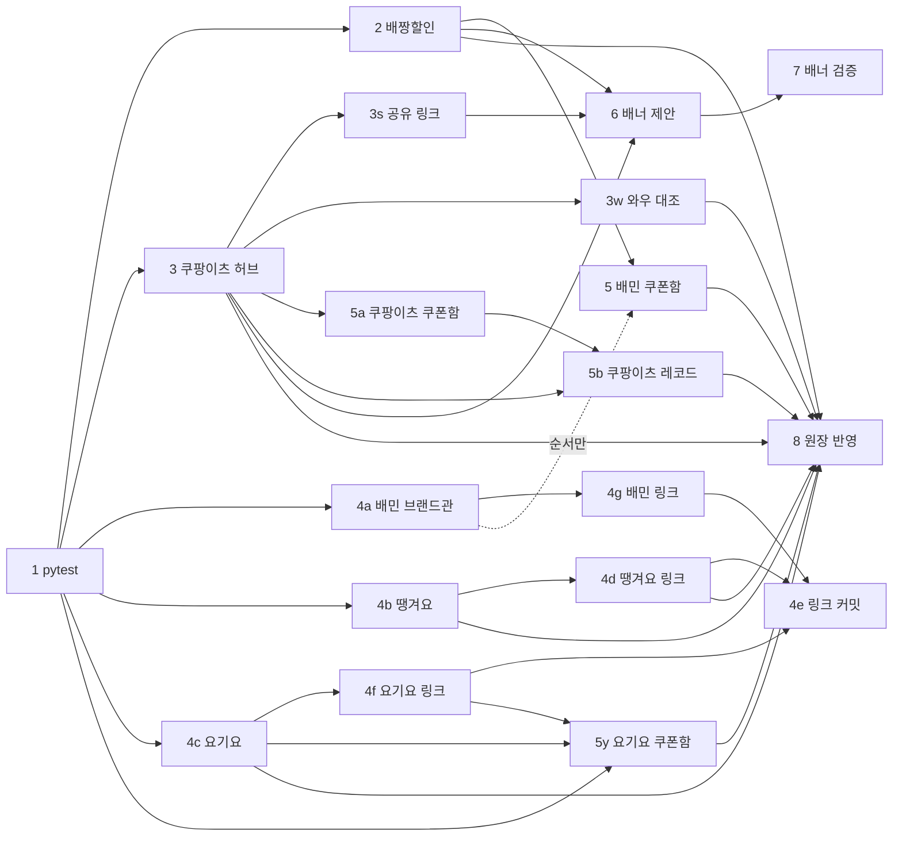

<!-- 원본: tracker docs/setup/ROUTINE-SPEC.md — 여기서 고치지 않는다 -->
# 자동 수집 루틴 명세: 무엇을, 언제, 어떻게 돌리고, 무엇을 보고 성공, 실패를 판정하는가

- 작성: 2026-09-14
- 최신화: 2026-11-09. §1.0(한눈에 보기)을 더하고 스케줄, 단계, 폰 배정, 실측 시간을 코드에 맞췄다
- 대상 독자: 이 프로젝트를 처음 보는 사람, 그리고 이전 대화 기록이 없는 에이전트
- 실행본: [`scripts/check_routine.py`](../../scripts/check_routine.py)가 이 문서의
  판정 기준을 그대로 코드로 들고 있다. 이 문서와 그 스크립트가 어긋나면
  스크립트가 틀린 것이 아니라 **둘 중 하나를 고치지 않은 것**이다.
  `tests/test_check_routine.py`가 둘의 기준 목록이 같은지 검사한다.
- 이 문서는 매 세션 읽는 파일이 아니다. 루틴을 돌리거나, 루틴 결과를
  판정하거나, 루틴이 고장 났을 때 편다. 매 세션 읽는 것은
  [`AGENTS.md`](../../AGENTS.md)다.

이 문서에서 "미니PC"는 폰이 USB로 붙어 있고 Windows 작업 스케줄러에
`discount-*` 작업이 등록된 컴퓨터를 뜻한다(2026-09-14 기준 사용자 이름
`Jaewun`, 저장소 경로 `<사용자 폴더>\_dev\delivery-discount-tracker`).
"노트북"은 폰이 없고 수집을 돌리지 않는 두 번째 컴퓨터를 뜻한다.

---

## 0. 세 문장으로

1. **폰을 잡는 자동 실행은 하루 세 번(00:01, 08:30, 15:55)이고, 셋 다
   같은 "전수 수집"이다.** 모든 플랫폼과 쿠폰함과 배너까지 돈다. 부분 수집
   작업은 2026-09-14에 전부 비활성으로 돌렸다.
2. **각 단계의 성공은 종료 코드 0이 아니라 그 단계가 남겨야 하는 파일과
   로그 문장이 실제로 있는지로 판정한다.** "0건", "실패 0", "통과"는 이
   프로젝트에서 여러 번 거짓이었다([`docs/HARNESS.md`](../HARNESS.md) §0).
3. **실패한 단계는 그 단계만 로그를 읽은 뒤 단독으로 최대 2회 다시 돌리고,
   그래도 실패하면 사람에게 넘긴다.** 폰 잠금은 사람이 푼다. 에이전트가
   잠금 패턴을 입력하는 일은 없다.

---

## 1. 무엇이 언제 도는가: 작업 스케줄러

미니PC의 Windows 작업 스케줄러(`Get-ScheduledTask`)에 아래 작업이 등록돼
있다. **폰을 잡는 작업은 `discount-after-open` 하나뿐이다.** 2026-09-14
사용자 결정: 부분 수집 작업들이 서로 겹쳐 폰을 다투는 구조를 없애고,
전수 수집 하나를 하루 세 번 돌린다. 같은 작업은 `MultipleInstances =
IgnoreNew`라 앞 실행이 아직 돌면 새 실행은 조용히 건너뛴다. 작업이
하나이므로 **이것만으로 겹침이 없다.**

| 시각 | 작업 이름 | 실행 파일 | 하는 일 | 보통 걸리는 시간 |
|---|---|---|---|---|
| **00:01** | `discount-after-open`(전수조사 포함) | `scripts/after_open_daily.cmd` | 전수 수집, §2 전체(배너 반영 포함) | 1시간 10분에서 2시간(§1.0-e) |
| 04:00 (월요일만) | `discount-mono-snapshot` | mono `snapshot_weekly.cmd` | **끔(사용자 결정 2026-11-15, 작업은 Disabled, 코드는 남김)**: 원장 캐시 `.events.jsonl`이 10-15에 얼어 10-19~11-09 문서 4개가 같은 값이었다. 지표 스냅샷 문서. **폰 안 씀** | 1분 |
| **08:30** | `discount-after-open` | (같음) | 09시·11시 선착순 오픈 전(2026-09-21까지 10:55) | 1시간 10분에서 2시간(§1.0-e) |
| **15:55** | `discount-after-open` | (같음) | 오후 선착순(17:00) 전 | 1시간 10분에서 2시간(§1.0-e) |

비활성으로 남겨 둔 작업(되살리지 않는다. 같은 일을 `after-open`이 한다):
`discount-full-audit`(00:10, 16:00, 21:10), `discount-baejjang`(09:00, 17:00, 21:00),
`discount-banner`(09:30), `discount-coupangeats-weekly`(10:30).

2026-09-14 이전에는 이 여섯이 따로 돌았고, 21:00에 배짱과 전수조사가
**같은 초에** 떴다. 폰 한 대를 둘이 잡는 구조가 스케줄러 자체에 박혀
있었다.

### 1.0 한눈에 보기 (2026-11-09 최신화)

이 절은 코드(`scripts/run_routine.py`의 `task_table`, `scripts/after_open_daily.cmd`)와 2026-11-09 실측으로 쓴 요약이다. 단계별 상세는 §2에 있다. 코드와 이 절이 어긋나면 코드가 맞고 이 절을 고친다.

#### 1.0-a 스케줄러에 등록된 작업

| 작업 | 언제 | 하는 일 | 폰 |
|---|---|---|---|
| `discount-after-open` | 매일 00:01, 08:30, 15:55 | 전수 수집(§2 전체). 앞 실행이 돌면 새 실행은 건너뛴다(`IgnoreNew`) | 쓴다 |
| `discount-mono-snapshot` | 월요일 04:00 | **끔(사용자 결정 2026-11-15, 작업은 Disabled, 코드는 남김)**: 원장 캐시 `.events.jsonl`이 10-15에 얼어 10-19~11-09 문서 4개가 같은 값이었다. mono 지표 스냅샷 문서 | 안 쓴다 |
| `discount-device-watch` | 10분마다 | 수집 폰이 adb에서 빠졌거나 배터리가 낮으면 슬랙으로 알린다(`scripts/device_watch.py`) | adb로 상태만 읽는다 |
| `discount-report-relay` | 5분마다 | 사용자 제보(API `reports.jsonl`)를 운영 슬랙으로 옮긴다(`scripts/report_relay.py`) | 안 쓴다 |
| `discount-verify-bot` | 2시간 간격으로 등록(작업 설명에는 30분마다) | 자동 검증 봇(`scripts/verify_bot.py`). 수집 시각과 시험 잠금은 봇이 스스로 비켜선다(§5-b) | §5-b 참고 |

#### 1.0-b 회차 종류

| 회차 | 시각 | 전수조사(4 계열) | 비고 |
|---|---|---|---|
| 평일 00:01 | 00:01 | 돈다 | 시작 시각이 03시 전이면 전수조사를 넣는다(`after_open_daily.cmd`의 `RUN_AUDIT`) |
| 평일 낮 | 08:30, 15:55 | 건너뛴다 | 로그 `-- 4) full_audit 건너뜀 - 낮 실행, 월요일 아님` |
| 월요일 세 번 | 00:01, 08:30, 15:55 | 셋 다 돈다 | 주간 주기(월요일 00시 기준 주)가 새로 열려 대상이 몰린다. 낮 두 번은 그 주기에 아직 안 읽은 곳만 읽는다(`data/last_checked.json`) |

전수조사에 속한 단계는 4a, 4g, 4b, 4c, 4d, 4f, 4e다. 나머지 단계는 모든 회차에서 돈다.

#### 1.0-c 단계, 선후 관계, 폰

폰 칸은 앞이 1순위다. 앞 순위 폰이 놀고 있으면 그 폰 몫이라 뒤 순위 폰은 집지 않는다(`Pool.pick`). 폰이 안 붙어 있으면 건너뛴다. 이 순서는 `devices.json`의 `pool`이 정하고, 2026-11-09 `run_routine.py --dry-run` 출력과 같다.

| 단계 | 하는 일 | 선행 | 폰 | 상한 | 전수조사에만 |
|---|---|---|---|---|---|
| 1 | 회귀 테스트(`pytest`) | 없음 | 안 씀 | 45분 | 아니오 |
| 1b | 수집과 무관한 점검. 실패해도 수집은 계속 | 없음 | 안 씀 | 45분 | 아니오 |
| 2 | 배민 배짱할인 | 1 | A8 스타, V50, 노트20 | 45분 | 아니오 |
| 3 | 쿠팡이츠 허브 순회와 쿠폰 받기 | 1 | 노트20, V30 | 90분 | 아니오 |
| 3s | 쿠팡이츠 허브 공유 링크 | 3 | 노트20, V30 | 45분 | 아니오 |
| 3w | 쿠팡이츠 일반 계정 대조(원장 밖) | 3 | A8 스타만(고정). 없으면 안 돈다 | 45분 | 아니오 |
| 4a | 배민 브랜드관 전수조사 | 1 | V50, 노트20, A8 스타. 놀던 폰이 도중에 합류 | 125분 | 예 |
| 4g | 배민 브랜드관 링크 재수확 | 4a | V50, 노트20, A8 스타 | 90분 | 예 |
| 4b | 땡겨요 전수조사 | 1 | A8 스타, V50, 노트20 | 90분 | 예 |
| 4c | 요기요 전수조사 | 1 | A8 스타, V50, G6, 노트20(V30 제외: 덤프가 3~4배 느림, 2026-11-16). 놀던 폰이 도중에 합류하고 폰들이 저장 주소를 하나씩 꺼내 나눠 읽는다(이슈 #420, 폰이 한 대면 기존 순차) | 90분. 끊기면 남은 곳만 한 번 더(읽은 브랜드는 `captures/_audit_<날짜>/yogiyo/progress.json`에 남고 같은 날 다음 실행은 안 연다, 2026-11-16) | 예 |
| 4d | 땡겨요 행사 링크 수확 | 4b | V50, A8 스타, 노트20 | 90분 | 예 |
| 4f | 요기요 브랜드관 링크 반영 | 4c | A8 스타, V50, 노트20, V30 | 45분 | 예 |
| 4e | 링크 커밋(mono `brands.yml`) | 4d, 4f, 4g | 안 씀 | 45분 | 예 |
| 5 | 배민 쿠폰함 | 2, 4a(순서만 기다림) | A8 스타, 노트20, V50 | 45분 | 아니오 |
| 5a | 쿠팡이츠 쿠폰함 | 3 | 3을 돈 폰만(노트20, V30) | 45분 | 아니오 |
| 5b | 쿠팡이츠 쿠폰함을 원장 레코드로 | 3, 5a | 안 씀 | 45분 | 아니오 |
| 5y | 요기요 쿠폰함 | 1, 4c, 4f | A8 스타, V50, 노트20, V30 | 45분 | 아니오 |
| 6 | 배너 제안(반영은 사람이 승인) | 2, 3, 3s | 노트20만 | 45분 | 아니오 |
| 7 | 배너 검증 | 6 | 노트20, 거드는 폰 | 45분 | 아니오 |
| 8 | 원장 반영과 서버 업로드 | 2, 3, 3w, 5, 5b, 5y, 4b, 4c, 4d. 6과 7은 안 기다림 | 안 씀 | 45분 | 아니오 |

선행은 두 종류다. **후속 강제**(기본)는 선행이 실패하거나 건너뛰어지면 이 단계도 건너뛴다. **후속 권장**(위 표의 "순서만 기다림", 코드의 `SOFT_AFTER`)은 순서만 기다리고 선행이 실패해도 이 단계는 돈다(선행 결과를 안 쓰는 단계에 쓴다). 낮 회차에서는 전수조사 단계가 건너뛰어도 선행이 충족된 것으로 친다. 상한을 넘기면 자식 프로세스까지 끊고 실패로 적는다. 4a의 배민 시간 예산(`BAEMIN_BUDGET_S`)은 따로 100분이다.



1b는 어느 단계와도 이어지지 않는 독립 단계라 그림에서 뺐다.

#### 1.0-d 실측 시간표: 2026-11-09 월요일 08:30 회차

폰 3대(V50, A8 스타, 노트20)로 돌았다. V30은 USB가 끊겨 빠졌다. 가로축은 시각이다.

```mermaid
gantt
  title 2026-11-09 08:30 회차 (총 2시간 2분)
  dateFormat HH:mm:ss
  axisFormat %H:%M
  section 폰 안 씀
  1 pytest :08:31:06, 08:39:39
  1b 무관 점검 :08:39:39, 08:40:24
  4e 링크 커밋 :09:49:44, 09:49:50
  5b 쿠팡이츠 레코드 :09:49:50, 09:49:52
  8 원장 반영 :09:54:24, 09:55:12
  section V50
  4a 배민 브랜드관 :08:40:38, 09:01:43
  5 배민 쿠폰함 :09:01:45, 09:04:24
  4c 요기요 :09:04:25, 09:33:11
  4f 요기요 링크 :09:33:12, 09:42:39
  5y 요기요 쿠폰함 :09:42:54, 09:43:43
  section A8 스타
  2 배짱할인 :08:40:29, 08:53:10
  4b 땡겨요 :08:53:11, 08:56:34
  4d 땡겨요 링크 :08:56:35, 09:49:44
  3w 와우 대조 :09:49:45, 09:54:24
  section 노트20
  3 쿠팡이츠 허브 :08:40:28, 09:00:49
  3s 공유 링크 :09:00:50, 09:03:04
  5a 쿠팡이츠 쿠폰함 :09:03:06, 09:06:20
  6 배너 제안 :09:33:15, 09:52:29
  7 배너 검증 :09:52:30, 10:32:55
```



읽는 법:

- 4c는 V50이 4a와 5를 마친 09:04에 시작했다. 4c 후보 폰(V50, A8 스타, 노트20)이 모두 다른 단계를 도는 중이었고 V30이 빠져서다.
- 4a에는 놀던 폰이 합류하지 않았다. 같은 시각 A8 스타와 노트20은 자기 단계를 돌고 있었다. 합류 규칙은 PR #222에서 고쳤고 실전 확인은 이슈 #230이 맡는다.
- 7단계 2,425초에는 노트20 화면이 꺼져 멈춘 약 15분이 들어 있다(이슈 #228, 어제 00:01은 578초).
- 4d 3,190초는 어제 00:01의 1,549초보다 길다. 원인은 확인하지 못했다(이슈 #229).

#### 1.0-e 회차별 단계 소요(초)

| 단계 | 평일 00:01 (11-08) | 평일 낮 08:30 (11-08) | 월요일 08:30 (11-09) |
|---|---|---|---|
| 1 | 550 | 454 | 512 |
| 1b | 55 | 43 | 45 |
| 2 | 596 | 627 | 762 |
| 3 | 1,509 | 1,365 | 1,221 |
| 3s | 180 | 144 | 135 |
| 3w | 286 | 249 | 279 |
| 4a | 616 | 건너뜀 | 1,265 |
| 4g | 440 | 건너뜀 | 1 |
| 4b | 216 | 건너뜀 | 203 |
| 4c | 2,477 | 건너뜀 | 1,726 |
| 4d | 1,549 | 건너뜀 | 3,190 |
| 4f | 1 | 건너뜀 | 567 |
| 4e | 12 | 건너뜀 | 6 |
| 5 | 167 | 171 | 159 |
| 5a | 205 | 197 | 195 |
| 5b | 2 | 1 | 1 |
| 5y | 62 | 55 | 49 |
| 6 | 1,169 | 1,488 | 1,153 |
| 7 | 578 | 572 | 2,426 |
| 8 | 73 | 43 | 48 |
| 회차 전체 | 1시간 21분 | 1시간 11분 | 2시간 2분 |

월요일 4a의 1,265초는 00:01 회차가 시간 예산(100분)으로 못 본 32곳만 읽은 값이다. 같은 월요일 00:01의 4a는 V50 혼자 6,011초에 158곳 중 133곳을 읽었다(11-02 월요일은 4,524초).

### 1.1 폰은 스케줄러가 배타적으로 소유한다

사용자 결정(2026-09-14): 잠금 파일 같은 코드 장치를 두지 않고, **자동
수집을 작업 하나로 합쳐 스케줄러가 겹침을 보장한다.** 하나가 아직 돌면
다음 트리거는 흡수된다(IgnoreNew). 사람이 낀 겹침만 남는데 그건 아래
규칙으로 막는다.

그러므로 사람이나 에이전트가 폰을 잡는 스크립트(`full_audit.py`,
`baejjang_daily.py`, `banner_routine.py`, `*_couponbox_daily.py`,
`coupangeats_weekly.py`, `open_*.py`)를 손으로 돌리기 전에는 **반드시**
아래를 먼저 실행하고, `Running`이 하나라도 있으면 끝날 때까지 기다린다:

```powershell
Get-ScheduledTask | Where-Object { $_.TaskName -match 'discount' } |
  Select-Object TaskName, State
Get-CimInstance Win32_Process -Filter "Name like '%python%'" |
  Select-Object ProcessId, CreationDate, CommandLine
```

두 번째 명령은 예약이 아닌 경로로 뜬 파이썬(사람이 띄운 것, 노트북에서
원격으로 띄운 것)까지 보여 준다. **시작 시각이 두 시간 넘게 지난 파이썬이
있으면 그것은 돌고 있는 것이 아니라 멈춘 것이다**(§5 사례 A). 무엇을
기다리는지 자식 프로세스로 확인한 뒤 죽인다.

이 규칙을 어겨서 난 사고는 두 건이다. 2026-09-08(사람 수동 캡처 vs 00:10 전수조사),
2026-09-12(멈춘 배너 루틴 둘 + 21:00 전수조사, 셋이 폰을 뺏어 쿠팡이츠
진입이 계속 실패). 둘 다 [`COLLECTION-INCIDENTS.md`](COLLECTION-INCIDENTS.md)에
있다.

### 1.1-b 화면 가드 (2026-09-17)

`run_routine.py`가 기기마다 `capture/guards.Guard` 스레드를 띄운다. 4초마다 포커스
창의 패키지를 보고 **목록에 있는 남의 창**(재난문자 `cellbroadcast`, `com.android.systemui`
대화상자, `com.google.android.gms`)이면 BACK으로 닫고 통합 로그에 `가드[시각]: 남의 창을
닫는다 - <창>`을 남긴다. 모르는 창은 로그만(`폰 앞에 이 가드가 모르는 창이 떠 있다(<창>)` 줄, 아무 버튼도 누르지 않음), 런처는
안 건드린다. **잠든 화면과 잠금 화면에도 BACK을 안 보낸다**(#146): `dumpsys power`의 `mWakefulness=`가 `Awake`가 아니거나 포커스 창(해시로 짚음)의 `ty=`가 `KEYGUARD…`이면 보류하고 상태가 바뀔 때만 `…남의 창을 닫지 않는다` 한 줄을 남긴다. 못 읽은 것은 보류의 근거가 아니라 지금처럼 닫는다. 회차 끝 줄 `가드: 잠든 화면이라 안 닫음 <기기>=N회`가 "가드가 봤고 일부러 안 눌렀다"의 양성 신호다. 09-17 08:00 실기에서 재난문자 "테스트 알림" 대화상자가 떠 있는 동안 VIEW
딥링크가 앞으로 안 왔다. 쿠폰함 "진입점을 못 찾았다" 간헐 실패의 후보다.

2026-11-09 추가(#218): 삼성 USB 연결 안내("주의 / 연결된 디바이스는 이 디바이스의 데이터에 접근할 수 없습니다", 창 이름 `Sys2008:com.samsung.android.MtpApplication/…USBConnection`)가 A8 스타 화면 위에 00:29부터 00:45까지 떠 있어 2단계와 4c를 막았다. 시스템 창 표(`WINDOW_GUARDS`)의 `mtp_usb_notice`로 등록해 BACK으로 닫는다. BACK이 이 창을 실제로 닫는지는 창이 다시 뜬 회차 로그로 확인한다(이슈 없음, 미확인). 단독으로 스크립트를
돌릴 땐 가드가 없다(`python -m capture.guards --serial <s> --once`로 손 검사).

### 1.1-c 현황, 알림: 밖에서 보는 길 (2026-09-17)

`run_routine.py`가 이벤트(run_start, step_start, step_progress, step_end, retry, guard, alert,
run_end)마다 `capture/ops.Ops`를 부른다. Ops는 `logs/state.json`을 통째로 다시 쓰고 같은
이벤트를 싱크에 넘긴다(스레드 하나, 큐를 쓰므로 단계 진행을 안 막는다. 싱크 예외는 로그 한 줄,
수집은 계속). 단계 로그는 이제 줄마다 바로 쓰인다(`logs/steps/<날짜>/<id>.log`, 재시도는
`<id>-retry.log`).

| 소비자 | 어디 | 무엇 |
|---|---|---|
| 슬랙 `capture/slack_notify.py` | `<슬랙 키 파일>` `{token, channel, mode}` | `alert`(기본): 시작, 실패, 재시도, 완료만, 대시보드 링크 첨부, 실패 시 증거 png. `verbose`/`thread`는 배타 선택지. 파일 없으면 싱크 없음 |
| 서버 업로드 `capture/ops_upload.py` | scp → `<콘솔 폴더>/` | `state.json`(이벤트마다, 진행은 15초 스로틀), `steps/<날짜>/<id>.log`(단계 끝), `runs/<run_id>.json` + `runs/index.json`(실행 끝) |
| 대시보드 | `https://bebeggars.duckdns.org/ops/` (Basic Auth, `<콘솔 인증 파일>`) | beggars-ops `web/index.html` 한 장, 5초 폴링. 360px |
| CLI `scripts/status.py` | `--watch`, `--remote`, `--remote --runs`, `--remote --run <id>`, `--remote --log <단계>`, `--history` | 같은 JSON을 표로. `--history`는 통합 로그의 지난 실행(시작, 소요, 판정) |
| 서버 탭 | 서버 cron 5분마다 beggars-ops `ops_collect.py`(서버 사본 `<서버>/ops_collect.py`) → `/ops/server/{api,data,web,server,deploy}.json` | API journal 오류, 데이터 수치, 웹 트래픽 집계, 서버 자원, GitHub Actions 결과. 대시보드 탭에 나온다 |
| 지난 로그 | `/ops/logs/`(통합 로그 날짜별 원문, 단계 끝날 때마다 갱신), `/ops/steps/<날짜>/<id>.log`, `/ops/runs/<run_id>.json`(대시보드 "최근 실행"에서 클릭) | 대시보드 단계 행마다 로그, 재시도 로그 링크 |

슬랙 `alert` 모드는 단계 결과 말고 사고(`alert` 이벤트: 시작 전 폰 빠짐, 실행 중 끊김, 단계 넘겨받음,
조율기 오류)도 바로 보낸다(2026-10-17). 수집 시험(`collect_trial.ps1`)이 예약 회차를 덮거나 예약을 다시
못 켜도 보낸다. 실행 사이의 폰 빠짐과 배터리는 `scripts/device_watch.py`가 맡는다(§4).

손 실행, 테스트에서 서버, 슬랙을 안 건드리려면 `OPS_SINKS=off`를 쓴다. 테스트 하네스는 싱크 없는
Ops를 끼운다(2026-09-17 테스트가 서버 state.json을 덮은 뒤 추가).

### 1.2 미니PC에서 지켜야 하는 환경

- 사용자 환경변수 **`ADB_SERIAL`을 두지 않는다.** 2026-09-14까지
  `<내부 IP>:5555`(무선)로 박혀 있었고, 무선이 끊긴 순간 모든 자동
  수집이 `detect_serial()` 첫 줄에서 죽었다. 같은 폰이 USB와 무선으로 두
  번 잡히는 경우는 `scripts/_env_paths.py`의 `detect_serial()`이 자동으로
  가르고 USB를 고른다(충전이 되기 때문이다). 이 변수는 **정말 다른 폰이
  두 대일 때만** 둔다.
- 사용자 환경변수 `DISCOUNT_BRANDS_YML`을 두지 않는다. 브랜드 별칭표는
  `mono/api/src/main/resources/brands.yml` 한 곳이다. 노트북에서 이 변수가
  열흘 전 사본을 가리켜 옛 별칭표로 내보낼 뻔했다(2026-09-14).
- 예약 작업이 도는 파이썬은 `python`으로 불린다. 이 명령이 PATH에서
  Python 3.14를 가리키는지 `python --version`으로 확인한다.
- **CI(GitHub Actions)는 mono를 `mono/`에 같이 받는다**(`.github/workflows/tests.yml`).
  브랜드 별칭표가 거기 한 곳이라 안 받으면 로컬과 다른 결과가 난다(2026-09-15
  `60계치킨`, `BBQ`). 그 체크아웃으로 `tests/test_mono_contract_copies.py`가
  mono `tracker/`에 README 말고 파일이 없는지, `tests/test_publish_docs.py`가 전파본이 원본과 같은지,
  `tests/test_mono_no_sensitive_strings.py`가 mono에 민감 정보가 없는지 본다(2026-09-29, mono ADR-002).
  셋 다 `ci_only`라 예약 실행 1단계에서는 안 돈다. 문서 한 줄 때문에 수집이 멈추면 안 되어서다.
- **미니PC에서 `git pull`을 하지 않으면 옛 코드가 돈다.** 노트북에서
  고친 것은 미니PC가 pull한 다음 실행부터 적용된다. 노트북 세션이
  끝날 때 "미니PC에서 pull할 것"이라고 인수인계에 적어야 하고, 미니PC
  세션은 시작할 때 `git fetch && git status -sb`로 뒤처져 있는지 본다.

---

## 2. 예약 실행(00:01, 08:30, 15:55): 단계별 명세

파일: `scripts/after_open_daily.cmd` → **`scripts/run_routine.py`**(2026-09-17부터). cmd는 조율기를 부르기만 하고, 조율기가 `data/devices.json`의 기기마다 큐를 두고 앱 단위로 단계를 배정해 돈다. 폰 하나면 옛 cmd와 같은 순서, 같은 로그 모양(`-- n) … [HH:MM:SS]` 구획, `[done] FAIL=n`)이고, 폰 둘이면 앱을 나눠 병렬로 돈다(`docs/superpowers/specs/2026-09-17-multi-device-parallel-design.md`). 단계별 원문 출력은 `logs/steps/<날짜>/<n>.log`, 통합 로그엔 완료 순서로 붙는다. 옛 cmd 본문은 `after_open_daily.cmd.legacy`(조율기가 문제면 파일명만 되돌린다). 00:01, 08:30, 15:55에 같은 것이 돈다(첫 회는 09-16까지 00:05, 사용자 결정으로 00:01; 낮 첫 실행은 09-21까지 10:55, 사용자 결정으로 08:30 — 9시 선착순 전에)
(이름의 11:05는 예전 시각이다).

**폰 풀(2026-11-05~).** `data/devices.json`에 `"pool"`이 있으면 폰마다 고정 큐 대신 `run_routine.Pool`이 돈다. 단계마다 돌 수 있는 폰 목록(앞이 1순위, 제약마다 이유)이 그 표에 있고, 빈 폰이 선행이 끝난 단계를 꺼내 간다. 실패한 단계는 한 번만 다른 후보 폰으로 다시 넣고(출력에 `[retry] <폰>로 넘겨 다시 - 성공|실패`), 그때는 같은 폰 재시도를 하지 않는다. 응답 없는 폰은 풀에서 빠진다. 4a는 배민 폰 둘이 브랜드 공용 큐를 나눠 읽는다(`AUDIT_HELPERS`). 단계마다 돈 폰은 `logs/state.json`의 `steps.<id>.serial`, 풀 표는 `notes`와 로그 머리에 남는다. `"pool"`을 지우면 옛 고정 큐로 돈다.

저장소 루트에서 아래 단계를 순서대로
돌리고, 각 단계의 표준출력, 표준오류를 `logs/after-open-<날짜>.log`에
이어 쓴다. 각 단계는 `echo -- N) 이름`으로 시작하므로, 로그에서
`-- 3)`을 찾으면 그 단계의 출력이 이어진다.

단계 2 이후는 하나가 실패해도 다음 단계로 넘어가고(`FAIL=1`만 켠다),
마지막에 `[done] FAIL=<0 또는 1>`을 찍는다. **단계 1(테스트)만 예외다**.
실패하면 `[abort] 테스트가 깨졌다 - 수집하지 않는다`를 찍고 전체를 멈춘다.

아래 표의 "성공 신호"는 **로그에 그 문장이 있고 그 파일이 그날 날짜로
존재하는 것**을 뜻한다. 둘 다 있어야 성공이다. 하나만 있으면 "의심"이다.

**러너 줄(이슈 #159).** `run_routine`이 단계 출력에 덧붙이는 줄은 `check_routine.judge`가 단계별 판정 앞에서 한 번에 읽는다. 시간 지연(`[slow] <단계> 시간 지연: 상한 N분의 85%…`, 2026-11-18 전 로그는 `[suspect]` 머리말이고 판정기가 둘 다 읽는다, #362)은 판정을 바꾸지 않고 근거 칸 끝에만 `· <단계> 시간 지연(…)`으로 붙는다(완주했으면 값은 온전하다). `[timeout] N분을 넘겨 끊었다`는 그 단계를 FAIL로 만든다(같은 날 앞 회차 파일이 남아 있어도). 수집기가 찍는 `[suspect]`는 그대로 SUSPECT다.

### 단계 1: 회귀 테스트

| | |
|---|---|
| 명령 | `python -m pytest tests -q -m "not ci_only and not non_gate" --durations=15 --durations-min=1.0` — 1초 넘는 단계 상위 15줄을 매 회차 남긴다(#141). 판정기는 근거 칸에 `N passed, 최상위: <이름> <초>s, …`를 적고, 머리줄이 없으면 `소요 측정 없음`, 있는데 줄이 없으면 `1초 넘는 테스트 없음`을 적는다. 판정 값은 그대로다. 테스트는 `tests/_guards.py`가 실제 `adb`, `scrcpy`, `powershell` 실행을 막고(끝줄 `외부 기기 실행 차단: N회`), 테스트당 `time.sleep` 요청 합 2초를 넘으면 실패시킨다(`@pytest.mark.real_wait`만 예외). `ci_only` 마커가 붙은 테스트(mono 작업 트리와 비교하는 것들)와 `non_gate`(수집과 무관한 문서, 워크플로 도구 테스트, 아래 1b)는 뺀다. 예약 수집에는 mono 체크아웃이 없거나 최신이 아닐 수 있고, 그 비교는 CI(tests.yml)가 필터 없이 맡는다 |
| 성공 신호 | 로그 마지막 줄이 `N passed in …`이고 `failed`가 없다 (2026-11-04 기준 N = 2002 이상. 줄면 테스트를 지운 것이다) |
| 실패 신호 | `FAILED tests/…` 줄이 하나라도 있다. 그러면 `.cmd`가 `[abort]`를 찍고 **여기서 전체가 멈춘다** |
| 왜 멈추나 | 판독 규칙이 깨진 채 수집하면 잘못된 값이 원장에 쌓인다. 안 도는 쪽이 싸다 |
| 재시도 | **없다.** 테스트를 고치기 전에는 다시 돌리지 않는다 |
| 실제로 난 실패 | 2026-09-13, 14 이틀 연속 `tests/capture/test_device_fallback.py` 2건. 미니PC의 `ADB_SERIAL` 환경변수 때문에 테스트가 실제 adb를 때렸다(§1.2). 그 이틀 쿠폰함 수집이 통째로 누락됐다 |

### 단계 1b: 수집과 무관한 점검

| | |
|---|---|
| 명령 | `python -m pytest tests -q -m "non_gate and not ci_only" --durations=15 --durations-min=1.0` — 문서 도구(`doc_claims`)와 워크플로 도구(`local_implement`) 테스트 |
| 하는 일 | 1단계 뒤에 돈다. **실패해도 수집은 계속한다.** 알림만 띄우고 `[done] FAIL`에 세지 않는다 |
| 성공 신호 | `N passed` |
| 실패 신호 | `FAILED tests/…` 줄. 판정기가 `SUSPECT`로 표시한다 |
| 왜 따로 두나 | 수집과 문서는 붙을 필요가 없다. 문서 도구 테스트 하나가 수집 전체를 세우던 일을 막는다(2026-10-22 사용자). 대신 알림으로 드러내 고친다 |
| 새로 넣는 법 | 수집과 무관한 테스트 파일 위쪽에 `pytestmark = pytest.mark.non_gate`를 단다(`pytest.ini`에 마커 정의) |
| 문서 동기화 | `mono/docs`와 이 저장소 문서가 어긋나는 것은 `ci_only`(CI)가 잡는다. 수집이 아니라 문서를 바꾼 세션이 `publish_docs.py --apply`와 mono 문서 커밋으로 맞춘다 |

### 단계 2: 배민 배짱할인 판독

| | |
|---|---|
| 명령 | `python scripts\baejjang_daily.py --write` |
| 읽는 화면 | 배민 앱의 "배짱할인" 화면. 브랜드별 쿠폰 금액과 최소주문금액이 텍스트로 있다 |
| 남기는 파일 | `captures/baejjang-weekend-<날짜>.json` (파일 이름의 `weekend`는 역사적 이름이고 평일에도 같다) |
| 성공 신호 | 로그에 `주말특가 브랜드 할인 N곳`(N ≥ 1)과 `레코드 N건 -> …baejjang-weekend-<날짜>.json` |
| 실패 신호 | `Traceback`, 또는 `N곳`의 N이 0, 또는 파일이 없다 |
| 실패가 아닌 것 | `배민클럽 단독할인 판을 못 열었다 — 건너뛴다`. 밤에 그 탭이 안 그려지는 날이 있다. 그 판은 통짜 이미지라 판독이 안 되고, 브랜드 할인 N곳은 이미 읽은 뒤다(사용자 결정 2026-09-15) |
| 의심 신호 | N이 직전 실행의 절반 이하 |
| 재시도 | 단독으로 `python scripts/baejjang_daily.py --write`를 최대 2회 |

### 단계 3: 쿠팡이츠 허브 순회 + 쿠폰 받기 + 쿠폰함 읽기

| | |
|---|---|
| 명령 | `python scripts\coupangeats_weekly.py --write` |
| 읽는 화면 | 쿠팡이츠 앱의 "위클리 슈퍼딜" 허브(웹뷰). 브랜드 카드가 세로로 나열돼 있다 |
| 하는 일 | ① 허브를 연다(`find_hub_key`가 앱에 주소를 물어 얻는다. 캐시 `captures/.coupangeats-hub-key`). ② 카드를 **하나씩 눌러** 어디로 가는지 본다. `promotion`(브랜드 프로모션 페이지, 조건을 읽는다) / `search`(검색 결과, 대상 밖) / `expired`(만료). 카드마다 `탭 → 주소 확인 → 뒤로가기`. ③ 카드의 "받기" 버튼을 눌러 쿠폰을 발급받는다(구성이 지난 실행과 같으면 안 누른다). ④ 마지막에 쿠폰함("My 이츠 > 쿠폰, 이용권")을 읽어 최소주문금액과 와우 전용 여부를 채운다 |
| 남기는 파일 | `captures/coupangeats-weekly-<날짜>.json`, `captures/coupangeats/weekly-<날짜>.png` |
| `--events-only --write` | 하루 행사 파일에 더해 주간 파일의 행사 구역 행(`릴레이 슈퍼딜 > 스페셜 특가`, `위클리 슈퍼딜 > 이벤트 쿠폰`)만 다시 만든다. 주간 파일이 없거나 증거 경로가 없으면 안 싣고 `[suspect]`와 종료 1(#63). 예약은 이 갈래를 부르지 않는다(손 실행) |
| 성공 신호 | 로그에 `고정 쿠폰 N곳`(N ≥ 1), `실제 발급 M건`, `레코드 K건 -> …coupangeats-weekly-<날짜>.json` |
| 실패 신호 | `capture_failed: coupangeats 허브 주소를 못 찾았다`, `Traceback`, 파일 없음 |
| 의심 신호 | `고정 쿠폰 N곳`의 N이 지난주 같은 요일의 절반 이하. 2026-09-14 09:35 실행이 `2곳`을 냈는데 지난주는 `27곳`이었다. 월요일 새 판이라 정말 얇을 수도, 덜 읽었을 수도 있다. **판정은 `captures/coupangeats/weekly-<날짜>.png`를 눈으로 보고 한다.** 숫자만 보고 "새 판"으로 넘기지 않는다 |
| `--write`가 필요한 이유 | 이 단계가 남기는 `coupangeats-weekly-<날짜>.json`이 단계 5b의 입력이다. 그 파일에서 "허브가 확정액이라고 말한 카드"(`section = 위클리 슈퍼딜 > 브랜드 할인` 이고 `qualifier`가 비어 있음)만 골라, 쿠폰함의 쿠폰이 그것과 **브랜드도 금액도 같을 때만** 확정 오퍼로 적는다. 파일이 없으면 5b는 전부 불확정으로 적거나 멈춘다 |
| 매장 혜택 읽기 (이슈 #171) | **이 단계는 매장 혜택을 읽지 않는다.** 쿠폰함에 없는 고정 쿠폰 브랜드만 계산해 3b에 넘긴다. 15:55 회차에는 `run_routine`이 `--plan-store-benefits`를 붙여 `captures/coupangeats_storeplan_<날짜>.json`(`{date, changed, brands, written_at}`, 구성 동일이면 `changed: false, brands: []`)을 허브 파일과 같은 자리(`--write`, 급감 판정 통과 뒤)에서 남긴다. 그 밖의 회차는 계획을 안 남기고 5b는 매장 혜택을 대조하지 않는다. `--read-all`을 3단계에 주면 안내와 함께 종료 2 |
| 월요일 새벽 보류 (이슈 #322) | **월요일 00~03시 회차에서만** 폰 풀(`Pool`)이 이 단계를 집지 않고 보류한다(`scripts/ce_link_gate.py`). 허브는 월요일 00시에 바뀌고 새 링크는 사람이 00:2x~00:5x에 준다. 60초마다 mono `origin/main`을 받아 링크가 다르면 fast-forward로 수집 트리 `mono/`에 반영하고, 상수 링크가 푸는 허브 키가 **직전 수집(`captures/coupangeats-hub-share-<전날>.json`의 `key`)과 다르면** 푼다. 상한 90분. 지나면 지금 링크로 한 번 시도하고(안 열리면 3단계가 실패해 3s, 3b, 5a, 5b, 6, 7이 건너뛰어지고 8은 그대로 돈다), 보류하는 동안 다른 폰은 다른 단계를 계속 돈다. 보류는 순서 결정이고 만료 판정이 아니다(만료는 `share_link_fresh`와 폰 확인이 맡는다). 단계 출력 맨 앞에 `[대기] 허브 링크를 N분 기다렸다 - …` 한 줄, 시작과 끝에 슬랙 알림. 풀이 없는 옛 큐에는 안 건다 |
| 재시도 | 단독으로 `python scripts/coupangeats_weekly.py --write`를 최대 2회. 허브 주소를 못 찾는 실패는 캐시 파일 `captures/.coupangeats-hub-key`를 지우고 한 번 더 |

### 단계 3b: 쿠팡이츠 매장 혜택 (2026-11-13 추가, 이슈 #171)

| | |
|---|---|
| 명령 | `python scripts\coupangeats_weekly.py --store-benefits --write` (손 실행에서 이틀 연속 매장 없음도 읽으려면 `--read-all`) |
| 언제 도나 | **00:01과 15:55 회차.** 08:30은 건너뛴다(로그 `-- 3b) … 건너뜀(00:01, 15:55 회차만 읽는다)`, 판정 PASS). 부가 확인이라서다(사용자 2026-11-05). 00:01은 2026-11-16에 더했다: 월요일 새 허브의 장보기 최소주문(이마트에브리데이 50,000원)이 15:55까지 비었다 |
| 하는 일 | 3단계가 남긴 계획 파일의 브랜드를 허브에서 카드를 눌러 매장 혜택 시트에서 읽는다. 허브는 다시 읽지 않는다(허브 주소는 3단계가 남긴 캐시). **브랜드 하나가 끝날 때마다** 상태 파일과 쿠폰 파일을 임시 파일 + 바꿔치기로 쓴다. 끊겨도 읽은 만큼 남는다 |
| 남기는 파일 | `captures/coupangeats_storestatus_<날짜>.json`, `captures/coupangeats_storecoupons_<날짜>.json` |
| 선행 | 3, 5a(`SOFT_AFTER`라 5a가 실패해도 돈다). 3의 폰과 같은 폰에서 돈다(같은 계정). 상한 90분 |
| 성공 신호 | 로그 `매장 혜택 계획 N곳`, 끝 줄 `매장 혜택 읽음 X/N곳(건너뜀 S곳 포함)`에서 X = N |
| 실패, 의심 신호 | 계획 파일이 없으면 `계획 파일이 없다: <경로>`와 종료 1(FAIL). X < N, `[suspect]`, `[timeout]`은 SUSPECT. 계획이 `changed: false`면 `매장 혜택 계획 0곳(구성 동일 - 읽지 않음)`, PASS |
| 끊기면 | 3b만 `fail`이고 3, 5b, 8은 그대로 돈다. 5b는 계획에 있는데 상태가 없는 브랜드를 `못 읽음`으로 센다(단계 5b). 월요일에 옛 링크로 3단계가 실패하면 3b도 선행 실패로 건너뛴다 |
| 재시도 | 읽기 단계라 몇 번 돌려도 무해하다. 상태 병합(`merge_status`)이 같은 날 앞선 `ok`를 지우지 않는다 |

### 단계 3c: 쿠팡이츠 매장 혜택, 다른 배달 주소 (2026-11-16 추가)

| | |
|---|---|
| 명령 | 3b와 같다 |
| 언제 도나 | 3b와 같은 회차(00:01, 15:55) |
| 하는 일 | 3b와 같은 계획을 배달 주소가 다른 폰(V50, 테헤란로 231)에서 읽는다. 매장 혜택은 주소마다 달라 두 폰이 나눠 맡는다(사용자 2026-11-16). 쿠폰마다 그 폰 주소(`devices.json` `accounts.coupangeats.address`)를 붙이고, 3b와 같은 날짜 파일을 잠금 파일로 차례대로 쓴다 |
| 선행 | 3. 노트20(3b와 같은 주소)과 V30(주소 미확인)은 `exclusions`로 뺀다. 자격 폰이 안 붙었으면 돌지 않는다(`PIN_ONLY`) |
| 성공, 실패 신호 | 3b와 같다(판정기가 같은 규칙으로 본다) |
| 5b에서 | 두 주소의 같은 쿠폰(브랜드, 금액, 최소주문)은 하나만 넣는다 |
| 같은 주소 분할 | 3b와 3c는 `share` 단계다. 같은 쿠팡이츠 배달 주소(`devices.json`)의 와우 폰이 더 놀고 있으면 `AUDIT_HELPERS`로 같이 잡아 계획 브랜드를 공용 큐로 나눠 읽는다(`probe_shared`). 주소가 다르거나 모르면 혼자 읽는다. 설계 `docs/specs/ce-3b-3c-address-split.md` |

### 단계 3w: 쿠팡이츠 일반 계정 대조 (2026-10-07 추가)

| | |
|---|---|
| 명령 | `python scripts\coupangeats_weekly.py --nonwow` |
| 기기 | `data/devices.json`의 `"steps": ["3w"]`로 sub2(와우 아닌 계정)에 고정한다. sub2가 안 붙었으면 다른 폰으로 넘기지 않는다(와우 계정 폰에서 돌면 대조가 무의미). 같은 폰에 고정한 5y, 4d는 sub2가 없으면 앱 배정(노트20)을 따른다(2026-10-17) |
| 하는 일 | 허브를 **읽기만** 한다(받기 안 누름, 오퍼 캐시·하루 파일 안 건드림). 단계 3의 와우 계정 파일과 브랜드로 맞댄다 |
| 남기는 파일 | `captures/coupangeats-weekly-nonwow-<날짜>.json`(일반 계정 허브), `captures/coupangeats-wow-diff-<날짜>.json`(`wow_only`, `nonwow_only`, `amount_diff`). 원장·단계 8 입력이 아니다 |
| 성공 신호 | `와우 대조: 와우 N곳 / 일반 M곳 · 와우만 …` 줄 |
| 건너뜀 | 고정한 폰이 안 붙었거나 `--skip`이면 `-- 3w) … 건너뜀(…)` 머리줄을 남기고 판정은 PASS(건너뜀). 머리줄조차 없으면 SUSPECT(로그가 사라짐)(이슈 104) |
| 의심 신호 | `[suspect] 3w …`, 대조 줄 없음, 예외. 무엇이든 SUSPECT이고 FAIL이 아니다 — 단계 8을 막지 않는다 |
| 재시도 | 없다 |

### 단계 3s: 쿠팡이츠 허브 공유 링크 (2026-09-30 추가)

| | |
|---|---|
| 명령 | `python scripts\coupangeats_share_link.py` (기기는 `ADB_SERIAL`, 손 실행은 `--serial`) |
| 하는 일 | 허브를 열고(`find_hub_key`) 하단 공유 버튼(글자, 설명, id에 `공유`/`share`) → 공유 시트의 링크 복사 류(`COPY_LABELS`) → PC 클립보드(scrcpy 다리)에서 `https://share.coupangeats.com/…`을 받는다 |
| 남기는 파일 | `captures/coupangeats-hub-share-<날짜>.json` (`url`, `label`, `captured_at`, `key` 폰 링크가 풀린 허브 키, `const_key` 상수가 풀린 키) |
| 쓰는 곳 | 단계 6이 그날 이 파일이 있으면 쿠팡이츠 배너 url로 쓴다(웹에서도 앱/웹이 열린다). 그날 묶음 배너(묶기를 끄기 전에 올라간 것)가 이미 다른 url로 떠 있으면 묶음 규칙(링크 같음) 때문에 그 url을 따른다. `find_hub_key`의 입구 순서: 그날 캐시 → 공유 링크(`data/coupangeats_hub_share.json`, 사람이 바꿀 수 있고 3s가 갱신)를 **PC에서 HTTP로 풀어** 키를 얻고 폰에서 열리는지 확인 → 홈 탭(라벨이 화면 안에 있을 때만 누른다). 폰에서 공유 링크를 VIEW로 열면 홈으로 떨어져서 폰으로 풀지 않는다(2026-09-30 실측) |
| 성공 신호 | `허브 키: <키> (상수와 같은 주)`, `공유 링크: https://share.coupangeats.com/… -> …json`, 그날 파일. 폰 링크와 상수(mono `COUPANGEATS_LINK`)를 문자열이 아니라 **풀린 허브 키의 주 표시(MMDD)**로 견준다. 공유 버튼은 누를 때마다 새 토큰을 준다(이슈 104) |
| 의심 신호 | `[suspect] 3s …` 줄(버튼 못 찾음, 복사 항목 못 찾음, 클립보드 빔, 예외), 폰 링크와 상수가 다른 주 허브로 풀림(월요일 교체 누락), 한쪽이라도 못 풂(같다고 치지 않는다). 증거는 `captures/_evidence`. rc는 0이라 6을 막지 않는다 |
| 재시도 | 없다(rc 0). 없으면 배너는 옛 딥링크로 간다 |

### 단계 4: 배민, 땡겨요, 요기요 브랜드 페이지 순회

| | |
|---|---|
| 명령 | `python scripts\full_audit.py` |
| 대상 | `mono/api/src/main/resources/brands.yml`에 링크가 있는 브랜드 전부(2026-09-14 기준 배민 73곳, 요기요 60곳, 2026-11-09 기준 배민 158곳, 땡겨요는 목록 화면 스크롤). **쿠팡이츠는 이 스크립트가 다루지 않는다**. 단계 3이 맡는다 |
| 남기는 파일 | `reports/audit-<날짜>.json`, `reports/audit-<날짜>.md`, `captures/_audit_<날짜>/<플랫폼>/…png`, `data/last_checked.json`(브랜드별 마지막 확인 시각) |
| 성공 신호 | 플랫폼마다 로그에 `브랜드 A · 만료 후보 B · 판독 실패 C · 캡처 D장` 한 줄, 그리고 `결과: …audit-<날짜>.json` |
| 실패 신호 | `Traceback`, 또는 어느 플랫폼의 `캡처 D장`이 0 |
| 의심 신호 | `만료 후보 B`가 그 플랫폼 브랜드 수의 절반을 넘는다. 2026-09-11에 딥링크가 안 먹어 배민 **홈 화면**을 판독하고 브랜드 전부를 "만료 후보"로 적은 적이 있다. 이제 브랜드 페이지 표식과 그 브랜드 이름이 화면에 있어야만 판독하지만, 이 숫자는 여전히 첫 번째로 봐야 한다 |
| `이번 주기 이미 확인 N건 — 제외` | 실패가 아니다. 같은 주기(월요일 00시 기준 주) 안에 이미 확인한 브랜드는 다시 열지 않는다(`data/last_checked.json`). 그래서 하루 두 번째, 세 번째 실행은 대부분 건너뛴다 |
| 재시도 | 스크립트 자체가 브랜드 단위로 한 번 더 연다. **화면은 닿았는데 값이 빈 것만.** 링크 오류는 다시 두드려도 같아서 재시도 대상이 아니다(2026-09-17). 그 위에 단독으로 최대 2회 |
| **언제 도나** | **00:01 실행만.** 08:30, 15:55 낮 실행은 이 단계를 건너뛴다(로그 `-- 4) full_audit 건너뜀 - 낮 실행, 월요일 아님`, 판정 PASS). 브랜드관 값은 하루 안에 안 바뀌고(주간 주기), 이 단계가 배민 한 바퀴만 약 1시간이라서다(2026-11-09 기준). **월요일은 세 번 다 돈다**. 주간 주기가 새로 열려 대상이 몰리는 날(사용자 결정 2026-09-17). `after_open_daily.cmd`의 `RUN_AUDIT`(시각 < 03시 또는 DayOfWeek=1). **금요일 15:55는 4a만 돈다**: 이번 주 마지막 관측이 쿠폰 없음, 가게 없음인 배민 브랜드만 영업시간에 다시 읽는다(`full_audit.py --recheck-unread`, `run_routine.recheck_round`, 사용자 결정 2026-11-18, #231). 4g, 4b~4f는 그 회차에도 건너뛴다 |
| **링크 풀기(ADR-031)** | 배민 `s.baemin.com` 단축링크는 앱이 09-10께부터 홈으로 보낸다. `collect_via_links`가 GET으로 한 번 풀어(`data/resolved_links.json` 캐시) `baemin.com/bridge/brand-lounge/detail?…`를 연다. 못 풀면 원래 링크. 로그 `(링크를 못 풀었다 — 원래 주소로 간다: …)`가 잦으면 네트워크, 차단을 의심 |
| **죽은 링크 장부** | `data/dead_links.json`. 링크 오류(`브랜드 페이지에 못 닿았다`, `deeplink_did_not_open`)가 **3회 연속**(하루 1회로 셈)인 브랜드. 그때부터 `last_checked`처럼 **주간 주기(월요일)에만** 다시 본다. 전엔 값이 안 읽힌 브랜드가 `last_checked`에 안 올라 매 실행 다시 두드렸다. 배민 44곳 중 30곳이 사흘 연속 같은 오류, 29분 중 ~20분이 여기 갔다(ROUTINE-TIMING.md). 값이 읽히는 순간 장부에서 지워진다 |

#### 2026-11-09 변경: 단계 4

- **요기요 목록 판독(#225).** 앱이 카드 헤드라인에서 `최대 `를 뗐다(`최대 5,000원 할인`에서 `5,000원 할인`, `16% 할인`으로). 판독이 `최대 `로 시작하는 글자만 헤드라인으로 쳐서 03:32 재수집이 주소 8개를 24번 돌고 전부 0곳을 읽었다. 이제 "금액이나 퍼센트로 시작하고 할인이나 적립으로 끝남"을 헤드라인으로 본다(`최대 `는 선택). 카드 구조(브랜드명 바로 아래 같은 x에 헤드라인)는 그대로다. 헤드라인만 읽힌 브랜드의 기록(`build_audit_records.py`)도 같다.
- **빈 트리에서 앱을 껐다 켠다(#225).** 앱 안인데 화면 트리가 제한 시간의 절반(기본 20초) 넘게 0바이트면 한 번 앱을 끄고 다시 띄운다(`capture/common.py`의 `landing_check`).
- **목록 복귀(#216).** 한 바퀴에 한 브랜드만 읽고 맨 위로 돌아가 화면을 새로 읽은 뒤 다음 카드를 고른다. 폰 깨우기가 실패해도 `device_locked` 안내를 낸다(`require_unlocked`).
- **`NameError` 수정(#219).** #206이 만들지 않던 `prev_entry`를 주소마다 만든다(`full_audit.py`).
- **한 곳도 못 읽고 중단하면 실패(#221).** 예외로 첫 시도가 죽어 결과가 비면 단계를 `ok`로 끝내지 않고 의심 결과로 올린다(종료 코드 3, 장부와 오늘 결과에 안 적고 원본은 `audit-<날짜>.suspect-<앱>.json`에 남긴다). `run_routine`이 다른 폰으로 한 번 넘긴다.
- **기준값 `base`(#206).** 요기요 주소마다 `data/yogiyo_address_stats.json`의 `base`에 월요일 수집값을 둔다. 이번 값이 `base`의 절반 미만이고 `base`가 6곳 이상이면 `[suspect]`로 알리기만 한다. 다만 앞 주소에서 읽은 브랜드를 건너뛰어 `got`이 읽는 순서에 따라 달라진다(이슈 #227).
- **4a 합류(#222).** 놀던 폰이 4a가 끝나야 시작하는 단계(5 등)의 후보여도 4a에 합류한다. 실전 확인은 이슈 #230이 맡는다.
- **V50 열 대기(#217).** 폰 측정이 온도 아닌 센서(`soc`, `lmh-dcvs`)를 못 찾아 V50이 회차마다 15분 기다렸다. 측정 명령을 고쳤고 `thermal_skip`이 채워졌다.

#### 죽은 링크 처리 흐름 (사람 몫)

1. 로그 `죽은 링크로 넘김 N곳(3회 연속): …` / `죽은 링크 장부 N곳 — brands.yml 링크 점검 필요`. `check_routine` 단계 4 판정에 `죽은 링크 N곳`으로 붙는다.
2. `reports/audit-<날짜>.md` 맨 끝 **"죽은 링크. brands.yml 점검 필요"** 표: 앱, 브랜드, 연속 실패, 처음, 마지막, 오류.
3. 사람이 앱에서 그 브랜드관을 열어 공유 링크를 새로 따고 `mono/api/src/main/resources/brands.yml`의 `links.baemin`을 고친다(ADR-025. 순회 대상은 이 표가 유일한 출처). 브랜드관이 없어진 브랜드면 링크를 지운다.
4. 다음 월요일(또는 매월 1일) 실행이 다시 열어 값이 읽히면 `링크 되살아남 N곳` 로그와 함께 장부에서 빠진다. 안 읽히면 `fails`가 늘고 표에 남는다.
5. 급하면 `python scripts/full_audit.py --platforms baemin`을 단독으로. 장부는 주간 규칙을 그대로 타므로, 특정 브랜드만 즉시 보려면 `data/dead_links.json`에서 그 항목을 지우고 돌린다.


- 재시도 범위(2026-09-17 사용자 결정): 링크 오류와, 브랜드관이 열렸고 쿠폰 흔적이 없는 브랜드(`no_coupon`)는 재시도하지 않는다. 둘 다 만료 후보 목록에는 남는다. 검증은 2026-09-18부터 세 번의 00:01 전수조사에서 재시도 수, 소요, 값 읽힘을 비교한다(`ROUTINE-TIMING.md`).
#### 4g: 배민 브랜드관 링크 재수확 (2026-09-30 추가)

배민 폰 줄에서 4a 바로 뒤, 5보다 먼저 돈다. 판정은 단계 4 하나로 묶인다. 위 "죽은 링크 처리 흐름" 3번(사람이 앱에서 공유 링크를 새로 딴다)을 대신한다.

| | |
|---|---|
| 명령 | `python scripts\baemin_links.py --apply` |
| 대상 | `reports/audit-<날짜>.json` 배민 결과 중 링크 오류(`deeplink_did_not_open`, `브랜드 페이지에 못 닿았다`) 브랜드 + `data/dead_links.json`의 배민 브랜드 |
| 하는 일 | ① 지금 링크를 다시 연다. 열리면 세션 탓이라 그대로 둔다. ② 안 열리면 브랜드관 목록(`오늘의 할인`)에서 카드 본문(`<브랜드>, …`)을 눌러 브랜드 페이지에 닿는다(`brand_page_is_open`). ③ 공유 → 링크 복사, scrcpy 다리로 PC 클립보드에서 받는다. ④ 받은 링크를 다시 열어 그 브랜드 페이지가 뜨는 것만 `brands.yml`에 쓴다 |
| 남기는 파일 | `brands.yml`(링크, 커밋은 4e), 증거 `captures/_evidence/baemin_links_*` |
| 성공 신호 | `대상 N · 지금 링크 살아 있음 A · 브랜드 페이지 도달 R · 링크 받음 C · 착지 확인 V`, `--apply`면 `brands.yml에 N곳을 썼다` 또는 `링크 오류 브랜드 0곳 (…) — 할 일 없다` |
| 의심 신호 | `[suspect] 4g …`: 보고서 없음, 목록에서 한 곳도 못 엶, 페이지엔 닿았는데 링크 0건(공유 문구 `SHARE_LABELS`/`COPY_LABELS` 또는 scrcpy), 받은 링크 전부 착지 실패 |
| 한계 | 목록 `오늘의 할인`에 없는 브랜드(지금 할인이 없는 곳)는 못 연다. 공유 버튼 문구는 실기로 확인 전이라 별칭 튜플로 받는다 |

#### 4d: 땡겨요 행사 링크 수확 (2026-09-21 추가)

단계 4 안에서 4b 다음에 돈다. 판정은 단계 4 하나로 묶인다 — 판정기(`check_routine`)는 4a~4d를 구분하지 않는다.

| | |
|---|---|
| 명령 | `python scripts\ddangyo_links.py --apply` |
| 대상 | 홈 > `오늘 땡길만한 브랜드` 전체 목록의 카드 전부(2026-09-21 기준 40장) |
| 하는 일 | 카드를 열어 브랜드를 읽고 `공유하기 > 클립보드에 복사`로 링크를 받는다. 받은 링크를 다시 열어 착지를 확인하고 통과한 것만 `brands.yml`에 쓴다 |
| 남기는 파일 | `mono/api/src/main/resources/brands.yml`(링크), 증거 스크린샷 |
| 성공 신호 | `받은 링크 N건 — 하나씩 열어 확인한다`, 그리고 `brands.yml에 N곳을 썼다` |
| 실패 신호 | `Traceback`, `scrcpy가 없다`, 수확 0건 |
| 왜 매일 도나 | 토큰이 **공유할 때마다 새로 발급된다**. 2026-09-21 본도시락이 하루에 `XqKOGZv`, `CtV4Pyx`, `OQGUVNo`, `Q39BstV`로 바뀌었다. 저장해 둔 링크는 며칠이면 `이벤트 준비중`이 된다(그날 점검에서 13건이 그랬다) |
| 모르는 브랜드 | 건너뛰지 않는다. 행사 화면이 밝히는 이름(`땡겨요X<브랜드>` 배지, 제목)으로 `brands.yml`에 블록을 만들고 링크를 넣는다. 분류와 로고는 사람이 채운다 |
| scrcpy | 기기 클립보드를 PC로 옮기는 다리. 안 떠 있으면 스크립트가 화면 없이 띄우고 끝나면 자기가 띄운 것만 내린다 |

### 단계 4e: 링크 커밋 (2026-09-30 추가)

4d, 4f, 4g가 `brands.yml`에 쓴 링크를 mono에 커밋하고 푸시해 운영(API jar)에 싣는다. 전수조사 실행에만 돈다.

| | |
|---|---|
| 명령 | `python scripts\publish_brand_links.py --apply` |
| 선행 | 4d, 4f, 4g 가운데 **하나라도** 성공하면 돈다(2026-10-15. 그 전에는 하나만 실패해도 건너뛰어 요기요가 막힌 날 땡겨요 링크까지 안 갔다) |
| 하는 일 | `brands.yml` 한 파일만 커밋한다. mono에 안 올라간 남의 커밋이 있으면 푸시하지 않는다. 원격이 앞서면 임시 작업 폴더에서 우리 커밋만 옮겨 올린다. 작업 트리가 더러워도 된다(`scripts/git_sync.py`, `--autostash`를 쓰지 않는다). 충돌, 거절, 오류와 남의 커밋 가드는 슬랙에 띄운다 |
| 성공 신호 | `커밋·푸시했다` 또는 `brands.yml에 바뀐 것이 없다` |
| 실패 신호 | `[skip] 선행 … 실패`, `[fail] …`. 판정기는 SUSPECT로 찍는다. 수확한 링크가 운영에 안 갔으니 `python scripts\publish_brand_links.py`로 바뀐 줄을 보고 `--apply`로 올린다 |

### 단계 5: 배민 쿠폰함 읽기

> 실패 증거(2026-09-17): `진입점을 못 찾았다`/`홈으로 못 돌아갔다`로 죽을 때 그 순간의 뷰
> 트리, 스크린샷을 `captures/_evidence/baemin_couponbox_{entry,home}_missing-<시각>.{xml,png}`에
> 남긴다. 간헐 실패(09-16 아침 2회, 09-17 00:01 1회)의 원인은 이 파일로 본다. 통제 재현
> 7회는 전부 성공했다.

| | |
|---|---|
| 명령 | `python scripts\baemin_couponbox_daily.py` |
| 읽는 화면 | 배민 앱 "마이배민 > 쿠폰함". 지금은 홈 → 마이배민 → 쿠폰함을 UI로 탄다. 딥링크 `baemin://./couponbox`가 있다(2026-11-11 실기, #256). 진입 교체는 검증 뒤 |
| 남기는 파일 | `captures/baemin_couponbox_<날짜>.json`, `captures/baemin_couponbox_<날짜>/01.png` |
| 성공 신호 | 로그에 `보유쿠폰 N장 (배민클럽 전용 M장)`(N ≥ 1)과 `-> …baemin_couponbox_<날짜>.json` |
| 실패 신호 | `쿠폰을 한 장도 못 읽었다 — 파일을 안 만든다`(종료 코드 1), `capture_failed: baemin 쿠폰함 진입점을 못 찾았다`, `Traceback` |
| 의심 신호 | `[suspect] 5 쿠폰함 뒷면을 못 읽은 쿠폰 N/M장: …`(2026-11-15). 카드를 뒤집어 읽는 뒷면(가게, 메뉴 한정)이 안 읽힌 쿠폰이다. 판정 SUSPECT, 그 쿠폰은 빌더가 원장에 안 넣는다(메뉴 한정인지 모르는 것을 일반 쿠폰으로 쓰지 않는다). 먼저 쿠폰함을 다시 열어 한 번 더 뒤집는다 |
| 0장을 파일로 안 남기는 이유 | 웹뷰가 덜 그려진 화면을 읽어 0장이 나온 적이 있다(2026-09-12). 0장 파일을 남기면 다음 단계가 "그날 쿠폰이 다 사라졌다"로 읽는다. **화면을 못 읽은 것과 쿠폰이 없는 것은 다르다** |
| 재시도 | 단독으로 최대 2회. 진입만 따로 확인하려면 `python scripts/open_couponbox.py --dump` |

### 단계 5a: 쿠팡이츠 쿠폰함 읽기 (2026-09-14 추가)

| | |
|---|---|
| 명령 | `python scripts\coupangeats_couponbox_daily.py` |
| 읽는 화면 | 쿠팡이츠 앱 "My 이츠 > 쿠폰, 이용권". 지금은 UI로 탄다. 딥링크 `coupangeats://PromotionCode`가 같은 화면(`CouponManagementActivity`)을 연다(2026-11-11 실기, #256). 진입은 `couponbox_deeplink_steps`가 켠 칸만 딥링크이고(코드 PR #256, 기본 꺼짐), 나머지는 홈 경로다. `reach_home()`이 어느 화면에서 시작하든 하단 탭이 보일 때까지 뒤로가기로 걷어낸 뒤 들어간다 |
| 남기는 파일 | `captures/coupangeats_couponbox_<날짜>.json`, `captures/coupangeats_couponbox_<날짜>/01.png` |
| 성공 신호 | 로그에 `보유쿠폰 N장 (와우 전용 M장)`(N ≥ 1)과 `-> …coupangeats_couponbox_<날짜>.json` |
| 실패 신호 | `쿠폰을 한 장도 못 읽었다 — 파일을 안 만든다`, `capture_failed: 홈 하단 탭('My 이츠')에 도달 못 했다`, `capture_failed: '쿠폰 · 이용권'을 못 찾았다 (화면을 captures/_evidence/에 남겼다)`, `capture_failed: 쿠폰함에 도착 못 했다`, `Traceback` |
| 실패했을 때 먼저 볼 것 | `captures/_evidence/ce_couponbox_menu_missing-<시각>.png`. 그 순간 무엇이 떠 있었는지. 2026-09-15 00:05 실패는 고정 1.5초 대기 뒤 한 번만 덤프한 것이 원인이었고(화면이 늦게 그려짐), 지금은 최대 20초 폴링 + 재탭이다 |
| 이 단계가 없던 동안 난 일 | 2026-09-07~12 쿠팡이츠 대표값이 닷새 동안 하나도 안 바뀌었다. 읽는 코드는 있었는데 원장에 넣는 길이 없었다 |
| 재시도 | 단독으로 최대 2회. 진입만 확인하려면 `python scripts/open_ce_couponbox.py --dump` |

### 단계 5b: 쿠팡이츠 쿠폰함 → 원장 레코드 (2026-09-14 추가)

| | |
|---|---|
| 명령 | `python scripts\build_ce_couponbox_records.py` (날짜 생략 시 오늘) |
| 입력 | 단계 5a의 `coupangeats_couponbox_<날짜>.json`, 단계 3의 `coupangeats-weekly-<날짜>.json`과 `coupangeats-firstcome-<날짜>.json`(선착순 특가 목록, 2026-09-30) |
| 남기는 파일 | `captures/coupangeats_couponbox_records_<날짜>.json` |
| 성공 신호 | 로그에 `허브 확정액 N곳 — 이것과 금액까지 같은 것만 확정으로 적는다`, 그리고 `K건 -> …records_<날짜>.json (와우 전용 M건 · 불확정 U건)`, 이어서 한 줄에 하나씩 `확정 브랜드 금액 …` 또는 `불확정 브랜드 금액 …` |
| 실패 신호 | `입력이 없다: …`(단계 5a가 파일을 못 남겼다), `허브 캡처가 없다: …`(단계 3이 `--write` 없이 돌았거나 실패했다). 둘 다 종료 코드 1로 **일부러 멈춘다**. 모르는 것을 확정으로 적는 쪽이 훨씬 비싸다 |
| 반드시 볼 것 | ① 뽑기로 받은 쿠폰이 **불확정**으로 나오는지. 사용자가 그날 "랜덤쿠폰"으로 확인한 브랜드(예: 2026-09-14 BHC 최대 7,000)가 `확정`이면 잘못이다. ② `tiers` 안에 `membership`이 `coupangEats` 또는 `none`으로 실제로 채워지는지. ADR-029(멤버십은 구간의 차원) 첫 실증 항목이다. ③ 원장에 이미 있는 같은 브랜드와 금액이 다르면 왜 다른지(허브 상한 아래 뽑힌 값인지). ④ 선착순 오픈으로 받은 쿠폰은 `선착순 오픈(…) 쿠폰이다. 원장이 아니라 배너로 간다`로 제외된다(09-06 결정). 이 줄이 `뽑기 결과`로 나오면 3단계 선착순 목록 파일이 없는 것이다(2026-09-30) |
| 재시도 | 파일만 읽는 단계라 몇 번 돌려도 무해하다. 입력이 없으면 5a/3을 먼저 |
| SUSPECT일 때 반영(이슈 #103) | 매장 혜택 교차검증이 실패한 브랜드가 있으면 빌더가 `captures/coupangeats_couponbox_suspects_<날짜>.json`(`{"failed": [{brand, status}], "status_total": N}`)을 남긴다. 단계 8(`reflect_daily.partial_ok`)은 **넷이 모두 참일 때만** SUSPECT여도 레코드를 반영한다: 판정 SUSPECT, 레코드 1건 이상, 실패 상태가 전부 `lost_hub`이고 3곳 이하이며 상태 기록의 20% 미만, `status_total` > 0. 하나라도 거짓이거나 사유 파일이 없으면 통째로 건너뛴다. FAIL(입력 없음)과 쿠폰 0건은 그대로 막는다. 보류한 브랜드는 `reports/routine-<날짜>.md`의 `### 보류한 브랜드`에 이름과 상태로 남는다. 보류 브랜드는 오늘 새 행이 없고 원장의 어제 값이 남는다. 이슈 #157: 허용 상태에 `past_expiry`(쿠폰함 만료일이 수집일보다 앞이라 판독 실패로 보고 보류, 빌더가 `[suspect]` 줄과 `{brand, status, expires_at, amount}`로 남김)가 더해졌다. `past_expiry`는 레코드 파일 행 수 대비로 2곳 이하이고 20% 미만일 때만 열고 상태 파일이 없어도(`status_total` 0) 열린다. `lost_hub`가 하나라도 있으면 지금 규칙(`status_total` > 0)을 그대로 건다. 허브에서 사라진 받은 월간쿠폰은 덮어쓰지 않고 `captures/coupangeats_couponbox_monthly_<날짜>.json`과 보고서 `### 덮어쓰지 않은 월간쿠폰`으로 이름을 남긴다(5b를 안 올린다) |
| 못 읽음(`unread`, 이슈 #171) | 3단계의 계획 파일이 있는데 상태 파일에 없는 브랜드는 `못 읽음`이다(3b가 끊겼거나 안 돌았다). 계획 파일이 없는 회차(00:01, 08:30)는 3b가 안 도는 회차라 세지 않는다. 빌더는 사유 파일에 `"unread": [브랜드...]`를 `failed`와 따로 적고 `[suspect] 쿠팡이츠 <브랜드>: 매장 혜택을 읽지 못했습니다(unread…)` 줄을 찍는다(5b SUSPECT). `partial_ok`는 `failed`가 비고 `unread`만 있어도 연다: 못 읽은 브랜드는 정의상 쿠폰함에 없어 그 레코드가 원래 없다. 보류 목록에는 `<브랜드> (unread)`로 남는다. `failed`가 있으면 위 규칙 그대로고 `unread`는 그 셈(3곳, 20%)에 안 넣는다 |
| 안 연 사유(이슈 #159) | `reflect_daily.partial_check`가 안 연 사유 코드를 보고서에 남긴다: `not_suspect`, `no_records`, `no_suspects_file`, `bad_suspects_file`, `empty`, `other_status`(상태 이름들), `over_cap`(곳 수 / 기준). 열었으면 사유는 없다. |

### 단계 5y: 요기요 쿠폰함 읽기 + 브랜드 화면 판독과 맞대기 (2026-10-01 추가)

2026-10-05: 쿠폰함도 원장에 넣는다(`scripts/build_yogiyo_couponbox_records.py`, 단계 8이 5y PASS·SUSPECT일 때). 빼는 것은 배달지연 보상쿠폰뿐이다(계정에 준 사과 쿠폰).

| | |
|---|---|
| 명령 | `python scripts\yogiyo_couponbox_daily.py --write` (기기는 devices.json의 yogiyo 배정) |
| 읽는 화면 | 요기요 앱 홈 → 하단 "마이요기요" → "쿠폰함". 카드 한 장이 노드 하나의 글자 한 줄로 오고, 화면 밖 카드도 트리에 있어 보통 스크롤 없이 전부 읽힌다(2026-10-01 새 폰 22장) |
| 남기는 파일 | `captures/yogiyo_couponbox_<날짜>.json`(카드마다 금액 또는 정률·최대, 최소주문, 채널, 만료, 대상 브랜드, 요기패스 딱지), `captures/yogiyo_couponbox_<날짜>/01.xml·01.png` |
| 원장 | **넣지 않는다.** 요기요 오퍼는 "브랜드 정액 할인 + 받아 쓰는 쿠폰" 구간이라, 쿠폰만 든 레코드가 같은 자리를 덮으면 정액 할인이 사라진다. 이 단계는 가드다 |
| 성공 신호 | `보유쿠폰 N장 (화면 표기 N장)`, `맞댈 요기요 오퍼 K곳`. 쿠폰함이 비었으면 빈 쿠폰함 문구를 확인한 뒤 `보유쿠폰 0장` |
| 의심 신호 | `[suspect] 5y 요기요 쿠폰함: 읽은 A장 ≠ 화면 B장`, `[suspect] 5y <브랜드>: 쿠폰함에 최소주문 … 쿠폰이 있는데, 오늘 4단계가 브랜드 화면에서 읽은 오퍼에는 같은 구간이 없다 …`. 뒤엣것은 4c가 쿠폰을 놓쳤거나 쿠폰이 바뀐 것이다(2026-10-01 BHC·BBQ·멕시카나·왓더버거·파파존스: 이미 받은 쿠폰은 버튼이 "쿠폰확인"이라 창을 안 열었다) |
| 맞대는 대상 | 오늘 4c 판독(`reports/audit-<날짜>.json`)을 같은 빌더(`build_audit_records.build_yogiyo`)로 만든 오퍼. 없으면(낮 실행) 원장의 오늘 요기요 레코드. 대상 브랜드가 하나이고 배달 채널(배달·한집·실속배달)인 쿠폰만 맞댄다 |
| 실패 신호 | `capture_failed: yogiyo '마이요기요'를 못 찾았다`, `capture_failed: yogiyo 쿠폰함에 못 닿았다('보유 쿠폰' 없음)`, `쿠폰을 한 장도 못 읽었다`, `Traceback` |
| 재시도 | 몇 번 돌려도 무해하다(읽기만 한다). 미리보기는 `--write` 없이 |
### 단계 6: 배너 제안 (제안서를 /ops/에, 반영은 사람이 승인)

**사용자 결정(2026-09-18): 수집은 하고, 사람이 확인한 뒤 반영한다.** 09-15 결정(배너는
수동 반영)은 "로그에만 적고 끝"으로 굳어져 09-14 선착순 배너가 나흘째 그대로였다.
이제 이 단계는 읽고 대조한 결과를 **작업 목록(op)** 으로 만들어 서버 `/ops/proposals/<날짜>.json`에
올리고 슬랙에 요약을 보낸다. 사람은 운영 화면(`/ops/` 데이터 탭)에서 제안마다 승인 또는
거부를 고르고 "반영"을 누른다. 서버의 beggars-ops `ops_apply.py`(127.0.0.1:8090, nginx
`/ops/apply`, 같은 Basic Auth)가 승인된 작업만 `banners.yml`에 적용하고 reload한다.
운영 API에 쓰기 경로를 열지 않는다는 전제(모노 설계 27)의 예외이며 그 문서에 적혀 있다.

**배민 핫딜 새 배너는 `auto: false`다(2026-10-20 사용자).** 한 계정 화면만으로는 공개 선착순과 타겟 쿠폰을
못 가르고 타겟 쿠폰도 처음엔 "오전 11시 오픈"으로 뜬다. 다른 계정에서 종류와 금액이 달랐다(멕시카나 5천 등). 새 배민
핫딜은 제안서에 "[승인 필요]"로 오르고, 사람이 다른 계정에서 확인한 뒤 승인해야 배너가 선다. 이미 선 배너를 화면에 맞추는
`set`과 내리는 `expire`는 그대로 자동이다.

op는 셋이다. `add`(배너 한 장 올림), `set`(필드 몇 개 고침, null이면 그 키 지움),
`expire`(endsOn을 어제로). `auto: true`는 기계가 관측한 사실(배민 핫딜 화면, 쿠팡이츠 행사 상한,
링크로 확인한 기간)이고 `auto: false`는 사람 배너를 건드리는 제안(적힌 브랜드가 오늘 수집에
없다, 선착순인데 배너에 없다)이다. `--apply --yes`는 `auto: true`만 바로 고친다(예약 실행은 안 쓴다. 배너는 사람이 승인해 반영하는 것이 원칙이라 두 번 확인한다).
아래 표의 "사람 배너 보호", "이어 쓰기" 규칙은 op를 만드는 규칙으로 그대로 산다.

요기요 행사 페이지(2026-10-17): 주소가 난수라 목록 화면에는 안 나온다. 대신 이 단계가 3시간에 한 번 앱 하단 `할인/혜택` 탭의
행사 캐러셀(13장 안팎, `k/N` 번호)을 넘기며 배너를 하나씩 누르고, 브랜드 행사(헤드라인 앞 줄이 "브랜드 배달/포장")면 시트 머리의
공유 버튼을 눌러 공유 시트에 글자로 뜬 `ws.yogiyo.co.kr` 주소를 `data/yogiyo_events.json`에 넣는다(`discover_and_add`). 홈 팝업처럼
캐러셀에 없는 행사는 사람이 `python scripts/yogiyo_events.py add <주소>`로 넣는다. 그 뒤 이 단계가 돌 때마다 목록의 행사를
폰으로 열어 `add`나 `set`을 `auto: false`로 제안한다. 금액은
즉시할인 + 상시 쿠폰 한 장(쿠폰끼리 중복 불가, 최소주문 35,000원 이상과 선착순 쿠폰 제외)이다. 헤드라인 "최대 N원"이
즉시할인 + 가장 큰 쿠폰과 같을 때만 올린다. 하루치 제안은 매번 다시 계산해 미결정 제안을 비우므로(`replace_undecided`),
손으로 올린 제안은 다음 실행에 사라진다. 행사는 이 목록으로 넣는다. 정규 수집 사이에는 검증 봇의 배너 감시가 한 시간마다 같은 단계를 돈다.

요기요 행사 미판독(#162, 2026-11-13): 못 읽은 날은 배너를 그대로 두므로 값이 틀리지 않는다. 대신 로그에 고정 줄이 남고 판정기가 6단계를 **SUSPECT**로 올린다(FAIL이 아니다. 재시도는 배민, 쿠팡이츠 제안까지 6단계를 통째로 다시 돌려 요기요 하나에 과하다).
회차마다 `요기요 행사: 연 곳 a · 개략 b · 못 읽음 c · 쉼 d · 캐러셀 <성공|실패|건너뜀(3시간 안)>` 한 줄이 나오고, 이 줄이 "요기요를 봤다"의 양성 신호다(없으면 SUSPECT). 못 읽은 곳은 `못 읽었다 — 그대로 둔다(<종류>, <설명>, 증거 <경로>)`로 종류(`blank`, `outside`, `error`, `loading`, `other_page`)와 증거 그림(`captures/_evidence/yogiyo-event-*`, `yogiyo-tab-*`)을 붙인다. 결제수단 행사나 홍보처럼 헤드라인 꼴이 아니어도 기간 줄이 있으면 열린 것으로 보고 `개략만 읽었다`만 찍는다(배너 제안 없음). 날짜를 걸러 3일 못 열면 `N일째 못 열었다` 줄이 나온다. 닫혔는지 증거 그림으로 보고 `python scripts/yogiyo_events.py retire <주소>`로 쉬게 한다(자동으로 빼지 않는다). 캐러셀이 실패하면 요기요를 끄고 행사 페이지를 연다.

| | |
|---|---|
| 명령 | `python scripts/banner_routine.py --propose` |
| 읽는 화면 | 배민 "오늘의 핫딜"(웰컴 핫딜 구역, 카드 넉 장 안팎), 쿠팡이츠 허브의 행사(랜덤, 선착순)와 고정 쿠폰 |
| 쓰는 곳 | 서버 `<콘솔 폴더>/proposals/<날짜>.json`과 `latest.json`, 미니PC `captures/banner_proposal_<날짜>.json`. `banners.yml`은 **안 쓴다** |
| 성공 신호 | 로그 끝에 `제안서 올림: <콘솔 폴더>/proposals/<날짜>.json (N건)`. 그 위에 `[승인 필요]` 줄이 있으면 **SUSPECT**. 사람이 `/ops/#data`에서 승인 또는 거부한다. 판정 근거에는 `captures/banner_proposal_<날짜>.json`의 `auto: false` op에서 이름과 금액을 최대 5건 적는다(이슈 161). 로그의 `[승인 필요]` 줄 수와 파일의 건수가 다르면 이름을 붙이지 않고 그 사실을 적는다 |
| 실패 신호 | `고침:` 줄이나 `reload: {`. 제안만 해야 하는데 고친 것. 서버 `.bak-<시각>`에서 되돌린다. `제안서 올림` 줄이 없음. 끝까지 안 돌았거나(ssh, Traceback) 업로드 실패(`제안서 업로드 실패:`) |
| 재시도 | 읽기 실패(`핫딜을 못 읽었다`)만 단독 1회. 대조 결과가 SUSPECT인 것은 재시도 대상이 아니다 |
| 사람 배너 보호. **필드 단위** | 사용자 결정(2026-09-14): **사람이 건들지 않은 정보는 기계가 덮는 것이 성공이다.** 문구 필드(`brand`, `amount`, `period`, `extra`, `minOrder`, `priority`, `url`)는 사람이 고친 것만 지키고, 수명 필드(`endsOn`, `soldOutOn`)는 기계 관측으로 고친다. 사람이 `endsOn`을 직접 고친 적이 없는 한. 스냅샷 `banners.snapshot.json`에 항목마다 `_human_fields: [...]`로 사람이 고친 필드 이름이 남고, 한 번 적히면 다음 실행에도 이어진다. 로그: `사람이 고쳤다 — 그 필드는 그대로 둔다: <id> ['amount', 'period']`. 그 필드가 `고침:`에 나오면 보호가 뚫린 것. 멈추고 서버 `.bak-<시각>`에서 되돌린다 |
| "못 읽었다"의 판정 | 거르기 **전** 읽은 카드 수로 한다. 읽은 카드가 전부 사람 묶음에 덮이거나 제외 브랜드라 올릴 게 없어도 그건 "읽었다"다. 2026-09-15에 4건 읽고 넷 다 걸러지자 `핫딜을 못 읽었다`로 오판해 아무것도 안 했다 |
| 화면에서 사라진 배너 | **id가 아니라 브랜드로** 본다. "화면"은 웰컴 핫딜 구역 **더하기 같은 실행의 2단계 배짱 파일**이다. 배민 선착순은 배짱 화면에도 있어 한쪽만 보면 부분 관측이다(반올림피자 5,000원이 그렇게 접힐 뻔했다). 배너가 덮는 브랜드(`brand` + `extra`에 나열된 이름)가 오늘 화면에 하나라도 있으면 둔다(`브랜드가 아직 화면에 있다 — 둔다`). 하나도 없으면 사람 배너라도 `endsOn`을 어제로 접어 내린다(`내린다(화면에 없다): <id> [브랜드들]`). 2026-09-14 반올림피자 17시 8,000원이 소진돼 사라졌는데 배너 단위 보호 때문에 안 내려 잘못된 정보가 떠 있었다. 사람이 `endsOn`을 직접 정한 배너만 예외(`사람이 기간을 정했다 — 안 내린다`) |
| 같은 행사 이어 쓰기 | `이어진다(기간만 늘린다): <id> <어제> -> <오늘>`. 어제 있던 같은 이름의 배너의 `endsOn`만 늘린 것. 새 배너를 안 만든다 |
| 사람 묶음 보호 | `사람이 이미 덮고 있다 — 안 만든다: <브랜드> <금액> (사람 배너 <id>: <금액>)`. 사람이 여러 브랜드를 한 장에 합쳐 둔 경우 기계가 옆에 낱장을 세우지 않는다. `brand` 필드와 **`extra`에 나열된 이름** 둘 다 본다(`brands_of`). 2026-09-14 오전까지는 `brand`만 봐서 처갓집, 배스킨라빈스 낱장이 사람 묶음 옆에 섰다. 쿠팡이츠 행사 배너도 같은 검사를 받는다. 사람의 `coupangeats-random`(BHC)이 있으면 기계 `coupangeats-weekly`를 안 세운다 |
| 여러 브랜드 한 장 | `banners.yml`의 `brands: [a, b, c]`(2026-09-15). API가 `brands`로 내려주고 웹이 로고를 여럿 그린다. `brand`는 대표(색, 카드 연결)로 남고 안 적으면 첫 번째다. `brands_of`가 이 목록도 읽어 덮임, 부재 판정에 쓴다. 사람이 쓴 옛 배너를 읽는 규칙이다. 기계는 `brands`를 만들지 않는다 |
| 배너 묶기 | 끔(2026-11-14 사용자, `banner_ce.BANNER_GROUPING = False`). 쿠팡이츠 선착순, 이어쓰기, 주간 행사 모두 브랜드마다 한 장이고 `group`이 없다. 5천원 미만 선착순도 낱장으로 제안한다(2026-11-14 사용자, `banner_ce.FIRST_COME_MIN_AMOUNT = 0`. 값을 주면 그 아래를 거르는 옛 규칙이 그대로 돈다). 이미 떠 있는 묶음 배너는 건드리지 않는다(견주는 칸에서 `group`을 뺀다). 확인 줄: `배너 묶기: 끔(BANNER_GROUPING) — 선착순 새 제안 N장 …`. 끈 상태에서 오픈 add에 `group`이 달리면 `[suspect]`가 붙는다. 켜면 2026-11-13까지의 동작이다 |
| 계정별 타겟딜 오퍼 | `capture.coupangeats.TARGETED_BRANDS`. 다른 계정으로 같은 날 들어가면 안 보이는 와우 쿠폰(사용자 실측 2026-09-15: 60계치킨, 처갓집, 피자헛, 배스킨라빈스, 반올림피자). **화면에 표시가 없어 자동으로 못 잡는다**. 사람이 두 계정으로 대조해 이 목록을 유지한다. 쿠폰함, 허브 빌더 둘 다 오퍼로 안 만든다. 이미 들어간 것은 **`excluded: {reason: targeted}` 판단 행**으로 내린다(`scripts/exclude_offer.py`, ADR-030). 09-15에 쓴 `expires_at` 어제 접기는 거짓 관측이라 더 안 쓴다 |
| 배너에서 뺀 브랜드 | `HOTDEAL_EXCLUDED_BRANDS = {"피자헛"}`. 타겟딜로 보이고 금액이 크지 않다(사용자 결정 2026-09-15). 오퍼로는 남는다 |
| 쿠팡이츠 행사 금액 | 행사마다 상한이 다르므로 **최댓값 하나로 뭉치지 않는다.** 2026-09-29부터 브랜드마다 한 장이고 금액은 낱장 `{won: [null, 상한], random: true}`(확정이면 `{won: N}`)다. 허브 제목("위클리 슈퍼딜")이 행사 카드로 잡히는 날이 있는데 그건 브랜드가 아니라 뺀다. 2026-09-14에 그 카드의 8,000이 BHC(7,000) 배너에 붙어 나갔다 |

### 단계 7: 배너 검증

| | |
|---|---|
| 명령 | `python scripts\banner_routine.py --verify` |
| 하는 일 | 고치지 않고, 지금 서버 배너가 방금 읽은 화면과 같은지만 본다 |
| 결과 | 종료 코드 0 = 같다. 1 = 어긋난다(사람이 볼 일). 2 = 화면을 못 읽었다(사람이 볼 일). 로그에 `[verify] <코드>` |
| 판정 | 1은 경고다. 6의 제안이 아직 승인 전이면 거의 매일 1이 나오므로 `[done] FAIL`에 세지 않고 판정기가 `SUSPECT`로 찍는다. 2 이상과 예외는 실패다(사용자 결정 2026-10-13). 1이면 판정기가 어긋남 줄을 읽어, 줄 전부가 6단계 승인 대기 배너이거나 사람이 고친 순서 필드(`priority`, `group`)면 PASS이고 근거가 6단계를 가리킨다. 그 밖은 SUSPECT이고 어긋난 줄을 적는다(이슈 161) |
| 재시도 | 없다. 1과 2는 둘 다 사람 판단 자리다 |

알려진 문제(이슈 #228): 링크를 여는 도중 폰 화면이 꺼지고 잠금 화면이 뜨면 이어가지 못하고 멈춘다. 2026-11-09 08:30 회차에서 노트20이 10:05에 꺼져 10분 넘게 멈췄고(`mWakefulness=Dozing`), `python scripts/wake_phones.py --serial <기기>`로 깨우자 이어져 2,425초에 끝났다(평소 약 580초). 가드 로그의 `NotificationShade`는 화면이 꺼졌을 때의 포커스 창 이름으로 보인다(이 한 건만 확인).

### 단계 8: 원장 반영

| | |
|---|---|
| 명령 | `python scripts\reflect_daily.py --apply` |
| 하는 일 | 앞 단계 중 PASS인 출처만 원장에 넣고, 넣은 것이 있으면 `export.json`을 만들어 서버에 올리고 저장소에 커밋, 푸시한다. 규칙은 §3.2 |
| 언제 | 배너(6, 7)를 기다리지 않고 값을 읽는 단계가 끝나면 바로 돈다. 그래서 이 단계가 찍는 판정표에서 아직 안 끝난 6, 7과 8 자신은 `WAIT`다 |
| 성공 신호 | 로그에 `원장에 N건 추가`와 `보고서: …routine-<날짜>.md` 줄이 있고 `reports/routine-<날짜>.md`가 있다. 0건도 성공이다(전부 중복인 낮 실행) |
| 의심 | `[suspect] 8 …` 줄이 있다(화면 문구로 보이는 이름을 보류했거나 `brands.yml`에 없는 브랜드를 넣었다. 판정기가 줄 수와 앞 세 줄을 적는다). 출처 하나가 거부로 통째 보류됐다(`← 거부가 있어 전부 보류`). 저장소 커밋, 푸시가 실패했다 |
| 실패 | 구획이 없다. `Traceback`이 있거나 `원장에 N건 추가`, `보고서:` 줄이 없다(끝까지 안 돌았다). 서버 업로드가 거부됐다(`올리지 않는다 — 서버가 더 최신이다`): 원장엔 들어갔는데 화면은 옛 값이다 |
| 재시도 | 없다. 사람이 원인을 보고 `python scripts/reflect_daily.py <날짜> --apply`를 다시 돌린다 |

2026-11-09 변경(#226): 서버 업로드 가드(`check_deploy.py`)가 서버의 맨 위 `expiresAt`이 들어오는 쪽에서 비어도, 같은 날짜가 구간(`tiers`)의 `expiresAt`에 있으면 소실로 세지 않는다. 대표 행이 종료일 없는 브랜드관 쿠폰으로 바뀌면 종료일이 맨 위에서 구간 안으로 옮겨 가는데, 이를 소실로 막아 11-09 02:58 서버 업로드가 안 됐다. 다른 날짜이거나 어느 구간에도 없으면 지금처럼 막는다.

### 단계 8d: 하루 상태 파일 (2026-10-09 추가)

| | |
|---|---|
| 명령 | 없다. 단계 8 `reflect_daily.py --apply`가 `export_data.py` 직후 쓴다 |
| 하는 일 | `data/daily/<날짜>.json`에 브랜드와 플랫폼 쌍마다 그날 상태(반영, 보류, 미수집, 없음)를 적는다. 신규 판정과 이력이 이 파일만 읽는다 |
| 성공 신호 | `data/daily/<날짜>.json`이 있다 |
| 실패 | 파일이 없다. 손으로 다시 수집하고 `reflect_daily.py --apply --pass <단계>`를 안 돌린 날이다 |
| 재시도 | `python scripts/reflect_daily.py <날짜> --apply` |

### 단계 8e: 겹치는 쿠폰은 큰 금액 (2026-10-11 추가)

| | |
|---|---|
| 명령 | 없다. `check_routine.py`가 `data/export.json`과 원장으로 본다 |
| 하는 일 | 같은 앱, 브랜드에 그날 여러 자리(구역, 쿠팡이츠 허브 탭)에서 읽은 확정 쿠폰이 있으면, 자리마다 마지막 관측(5분 묶음) 중 가장 큰 금액이 내보내기에 섰는지 본다. 모든 앱, 브랜드에 같은 규칙이다(`store._same_day_other_source`) |
| 성공 신호 | `겹치는 쿠폰은 큰 금액이 섰다` |
| 실패 | `더 큰 쿠폰이 묻혔다: <앱> <브랜드> <내보낸 금액> < <기대 금액>`. 2026-10-11 쿠폰함 4,000원이 위클리 6,000원을 덮었던 꼴 |
| 재시도 | 선택 규칙(`store._prefer`)을 고치고 `python export_data.py` 뒤 `python scripts/deploy_export.py --apply` |

### 단계 8f: 땡겨요 브랜드데이 (2026-10-11 추가)

| | |
|---|---|
| 명령 | 없다. 6단계 `banner_routine.py --propose`가 `scripts/ddangyo_brandday.py`로 `data/ddangyo_brandday.json`을 쓴다(폰 안 씀, 땡겨요 웹 API) |
| 하는 일 | 오늘 브랜드데이 쿠폰(브랜드, 금액)이 내보내기 땡겨요 오퍼에 그 금액 이상으로 섰고, 오퍼 링크가 당일 행사 화면인지 본다 |
| 성공 신호 | `브랜드데이 <브랜드> <금액>` 또는 `오늘 브랜드데이 없음` |
| 실패 | `브랜드데이가 화면과 다르다: ...`. 브랜드 페이지 링크로 열려 행사 쿠폰이 안 보이던 2026-10-11 꼴 |
| 재시도 | `python scripts/ddangyo_brandday.py` 뒤 `python export_data.py`, `python scripts/deploy_export.py --apply` |

### 단계 8g: 연속 보류 경보 (2026-11-18 추가, 이슈 #116)

| | |
|---|---|
| 명령 | 없다. `scripts/check_routine.py`가 `reports/routine-<날짜>.md`의 "보류한 브랜드" 절을 오늘부터 사흘 읽는다 |
| 하는 일 | 같은 출처와 브랜드가 `lost_hub`(허브에서 브랜드 카드를 다시 못 찾음)로 사흘 연속 부분 보류됐는지 본다. 부분 반영이 들어간 뒤 같은 브랜드가 조용히 며칠째 빠지는 것을 막는다 |
| 성공 신호 | `lost_hub 3일 연속 보류 없음`. 보고서가 없는 날이 끼면 `연속 보류 판정 못 함`(PASS, 미관측을 보류 없음으로 세지 않는다) |
| 의심 | `lost_hub로 3일 연속 보류: <출처> <브랜드>` |

### 마지막: `[done] FAIL=0`

이 줄은 "모든 단계가 종료 코드 0으로 끝났다"는 뜻일 뿐이다. **이 줄만
보고 성공으로 치지 않는다.** 위 표의 성공 신호를 단계마다 확인한다.
`scripts/check_routine.py <날짜>`가 그 확인을 대신한다.

---

## 3. 수집 결과를 언제 누가 반영하는가

### 3.1 사용자가 정한 목표 (2026-09-14)

> 매일 도는 루틴은 기본적으로 오차 발생을 가드한다. 전수 수집으로 할인의
> 만료나 추가를 확인하고 검증을 통과하면 수집 결과를 반영한다. 배너 자동
> 수집은 배너에 올릴 특수한 할인(한정/선착순/특별/랜덤)을 빠르게 반영한다.
> 각 앱의 특수 할인 영역을 수집해 검증을 통과하면 수집 결과를 반영하되,
> **동일한 할인(변경 일자가 동일한지로 판별)에 사용자의 직접 수정이나
> 제거가 있었다면 그것을 덮어쓰지 않는다.** 기본적으로 전부 자동이되 수집이
> 진행된 후 사용자의 확인이 원활히 진행될 수 있도록 수집 결과들을 원장으로도
> 남기고 가시성 좋게 보여줄 수 있어야 하며 부분 수정이나 추가 반영을
> 사용자가 직접 진행한다.

풀어 쓰면:

1. 검증(§2의 성공 신호 전부)을 통과한 수집 결과는 **사람 확인 없이 원장에
   넣고 내보내고 배포한다.**
2. 배너도 같다. 특수 할인은 빨리 올라가야 값이 있다.
3. 예외는 하나다. **같은 할인에 사람이 직접 고치거나 지운 흔적이 있으면
   기계가 덮지 않는다.** "같은 할인"인지는 **변경 일자가 같은지**로 가른다.
4. 자동으로 넣었더라도 사람이 나중에 볼 수 있게 **원장에 남기고 눈에
   보이게** 한다. 부분 수정, 추가 반영은 사람이 한다.

### 3.2 구현: 단계 8 `reflect_daily.py` (2026-09-14 밤에 넣었다)

원장 출처 표. **값을 읽는 단계는 전부 여기 있어야 한다.** 이 표와 `reflect_daily.sources`가 같은지 `tests/test_reflect_sources.py`가 검사한다. 2026-09-09부터 09-18까지 4단계가 이 표에 없어 전수조사 값이 원장에 안 들어갔다(`docs/research/REPORT-20260918-audit-ingest-gap.md`).

| 원장 출처 단계 | 파일 |
|---|---|
| 2 | `captures/baejjang-weekend-<날짜>.json` |
| 3 | `captures/coupangeats-weekly-<날짜>.json` |
| 3e | 같은 파일의 행사 구역 행(`릴레이 슈퍼딜 > 스페셜 특가`, `위클리 슈퍼딜 > 이벤트 쿠폰`). 판정은 3을 따른다. 행사 0건이면 `captures/coupangeats-hub-events-<날짜>.json`과 견준다(#61) |
| 4 | `reports/audit-<날짜>.json` (4a, 4b, 4c가 플랫폼별로 병합해 쓴다) |
| 5 | `captures/baemin_couponbox_<날짜>.json` |
| 5b | `captures/coupangeats_couponbox_records_<날짜>.json` |
| 5y | `captures/yogiyo_couponbox_<날짜>.json` (PASS, SUSPECT. 배달지연 보상쿠폰은 뺀다. 이미 오퍼가 있는 브랜드는 그 오퍼에 구간으로 더한다) |


| 대상 | 어떻게 |
|---|---|
| 배너 | **수동 반영**(2026-09-15). 단계 6은 대조, 보고만. 사람이 서버 `banners.yml`을 고친다 |
| 배짱, 쿠팡이츠 허브, 배민 쿠폰함, 쿠팡이츠 쿠폰함, **전수조사(4a, 4b, 4c. 2026-09-18 추가)** 레코드 | **단계 8** `python scripts
eflect_daily.py --apply`. `check_routine.judge`가 그 단계를 PASS로 판정한 출처만 `ingest.plan`으로 검증해 원장에 넣고, 넣은 것이 있으면 `export_data.py` → `deploy_export.py --apply` |
| 사람 수정 보호(원장) | 같은 (앱, 브랜드)의 최신 대표가 `capture_mode: "manual"`이고 `captured_at` 날짜가 오늘이면 **보류**. "변경 일자가 동일한지로 판별"의 구현. 어제 사람이 넣은 것은 보호하지 않는다. 오늘의 새 관측이 이겨야 맞다 |
| 출처 단위 전부-아니면-전무 | 한 출처에 검증 거부가 하나라도 있으면 그 출처는 통째로 보류. 반쪽만 들어간 출처는 무엇이 왜 빠졌는지 아무도 모른다 |
| 가시성 | `reports/routine-<날짜>.md`. 단계 판정 표, 출처별 넣음/보류/중복/거부, 보류, 거부 목록, 배포 결과 |
| 저장소 반영 | 넣은 뒤 `data/log.jsonl`, `export.json`, `last_checked.json`, **`evidence-manifest.jsonl`**과 수집 상태 파일 일곱 개(`STATE_FILES`, JSON으로 읽히는 것만)를 커밋, 푸시한다(`commit_evidence`). 원격이 앞서면 임시 작업 폴더에서 우리 커밋만 옮겨 올린다(`scripts/git_sync.py`). 지난 실행이 못 올린 `data: 자동 반영` 커밋은 같이 올리고 보고서에 `지난 자동 반영 커밋 N개도 같이 올렸다`로 적는다. 그 밖의 미푸시 커밋이 밑에 있으면 올리지 않는다. 푸시 실패는 보고서에 적고 슬랙에 띄우며 사람이 `git push`한다 |
| 증거 화면 | **파일은 수집한 기계(미니PC)에 두고 저장소에는 존재 정보만 올린다**(사용자 결정 2026-09-15). `scripts/evidence_manifest.py`가 경로, SHA-256, 크기, 기계, 시각을 `data/evidence-manifest.jsonl`에 append-only로 적는다. `tests/test_evidence_links.py`는 파일 없는 사본(CI)에선 매니페스트로, 파일 있는 기계에선 파일로 검사한다. 2026-09-15 이전에 올린 233MB는 그대로 둔다(지우는 건 별도 결정) |
| 사람이 단독 재시도로 살린 단계 | 로그에는 실패로 남아 있으므로 `--pass <단계>`로 판정을 덮고 다시 돌린다: `python scripts/reflect_daily.py <날짜> --apply --pass 2`. 보고서에 그 사실이 적힌다 |

### 3.3 아직 없는 것

- **사람 정정의 표식이 `capture_mode: "manual"` 하나뿐이다.** 사람이 화면을
  읽어 넣은 것과 사람이 기계 값을 고친 것이 같은 표식이다. 지금은 둘 다
  "오늘 사람이 넣었으면 기계가 보류"로 같이 다뤄도 결과가 맞다. 갈라야
  할 날이 오면 새 값을 둔다.
- 배너의 `_human_fields`와 원장의 보류 규칙이 **서로 다른 장치**다. 하나로
  합치는 것은 별도 과제.

---

## 4. 실패의 종류와 대응: 직접 처리, 재시도, 폴백, 정지

| 종류 | 어떻게 보이나 | 대응 | 근거 |
|---|---|---|---|
| **테스트 실패** | 단계 1 `FAILED …` | **정지.** 고치기 전엔 안 돌린다 | 판독 규칙이 깨진 채 수집하면 잘못된 값이 쌓인다 |
| **폰 잠김** | `SystemExit`에 "잠겨 있다"류 메시지, `require_unlocked` | **정지. 사람이 푼다.** 에이전트는 잠금 패턴을 입력하지 않는다 | [`MINIPC-HANDOVER.md`](MINIPC-HANDOVER.md) §3, `tests/capture/test_common_device_lock.py`가 강제한다 |
| **전송로 하나가 죽음** | `<내부 IP>:5555에서 실패(…) — 남은 1개로 다시 해본다` | **폴백(자동).** `capture/device.py`의 `run_with_device()`가 다른 전송로로 넘어간다. 사람이 할 일 없음 | 2026-09-12에 만들었다 |
| **전송로 전부 죽음** | `붙어 있다고 나오지만 응답하는 기기가 없다` | **정지.** USB 케이블, `adb devices` 확인 | 폰이 없으면 아무것도 못 한다 |
| **폰 한 대가 빠짐(시작 전, 실행 중)** | 슬랙 `⚠ 수집 시작 전 점검: …`, `⚠ … 연결이 끊겼습니다`, 단계 출력 `[takeover] …` 또는 `[retry] …로 넘겨 다시` | **폴백(자동).** `devices.json` `"takeover"`에 그 단계를 적은 붙은 폰이 넘겨받는다(위 폰부터). 같은 폰의 제 단계와는 폰마다 잠금으로 겹치지 않는다. 넘길 폰이 없으면 실패와 슬랙. `"steps"`로 고정한 단계는 PIN_ONLY(3w)만 안 돌고 나머지는 앱 배정을 따른다. 사람은 USB를 다시 꽂는다 | 2026-10-17 08:30 노트20 offline으로 쿠팡이츠, 배너 단계가 통째로 빠졌다. `takeover`에는 [`DEVICE-MATRIX.md`](DEVICE-MATRIX.md)에서 같은 결과로 통과한 단계만 적는다(일반 계정 X6의 3, 5a, 6, 7은 안 적는다) |
| **실행 사이에 폰이 빠지거나 배터리가 떨어짐** | 슬랙 `⚠ 수집 폰 …이 adb에서 빠졌습니다`, `🔋 … 배터리가 n%` | **알림(자동).** 예약 작업 `discount-device-watch`가 10분마다 `scripts/device_watch.py`를 돌려 상태가 바뀔 때만 보낸다(빠짐, 돌아옴, 15% 이하이고 충전 아님, 정규 수집 예약이 꺼진 채 방치됨). 상태는 `%LOCALAPPDATA%\delivery-discount-tracker\device_watch.json` | 2026-10-17 X6가 배터리가 닳아 꺼진 것을 수집이 실패하고서야 알았다 |
| **앱 화면 도착 실패** | `capture_failed: …도착 못 했다`, `…를 못 찾았다` | **재시도 단독 2회.** 두 번 다 같은 메시지면 앱 화면이 바뀐 것이다 → 사람 | 화면 문구, 구조 변경은 코드로 잡아야 한다(§4 HARNESS) |
| **0건, 0장** | `보유쿠폰 0장`, `고정 쿠폰 0곳`, `브랜드 0` | **의심 → 스크린샷 확인.** 파일은 안 남기는 것이 설계다. 재시도 단독 2회 | "못 본 것"과 "없는 것"을 가른다(HARNESS §1) |
| **ssh 연결 실패(타임아웃, 255)** | `ssh 연결 실패(TimeoutExpired) — 한 번 더 시도한다` | **폴백(자동).** `scripts/_ssh.py`가 연결 단계 실패만 한 번 더. 원격 명령이 돌다 난 실패(종료 코드 1)는 재시도하지 않는다 | 2026-09-15 01:24: 서버 sshd 로그에 접속 시도 자체가 없었다. 클라이언트 쪽 일시 장애 |
| **ssh 멈춤** | 파이썬이 몇 시간째 살아 있고 자식이 `ssh … cp …` | **직접 처리: 죽인다.** 그 뒤 `scripts/_ssh.py`의 keepalive, timeout이 살아 있는지 확인 | 2026-09-12 배너 루틴 11시간 38분. 지금은 30초 안에 실패로 돌아온다 |
| **멈춘 실행 위에 겹쳐 뜸** | 같은 명령의 파이썬이 둘 | **직접 처리: 둘 다 죽이고** 로그에서 어디서 멈췄는지 적은 뒤 하나만 다시 | HARNESS §8 |
| **사람 배너를 건드림** | 단계 6 로그에 `고침: <사람 배너 id>` | **정지. 재시도 금지.** 서버 `banners.yml.bak-<시각>`에서 되돌린다 | 2026-09-12, 13에 실제로 났다 |
| **`unknownBrands` 비어 있지 않음** | `reload: {… 'unknownBrands': ['X']}` | **직접 처리.** `brands.yml`에 X를 등록하거나 별칭을 추가하고 다시 reload | 등록 안 된 브랜드는 화면에서 사라진다 |
| **ADB_SERIAL 같은 환경변수** | 자동 판별을 건너뛰고 한 주소에 죽는다 | **직접 처리: 변수 제거**(§1.2) | 2026-09-14 |
| **CI가 막음(로컬은 초록)** | mono `Check Project Structure` 실패 | **직접 처리:** `cd mono && python scripts/generate_project_structure.py --check` | 로컬 pytest가 모르는 규칙이다 |

"재시도 단독 2회"는 **실패한 그 단계의 스크립트만**, `.cmd` 전체가 아니라,
로그를 읽은 뒤에, 최대 두 번 더 돌린다는 뜻이다(사용자 결정 2026-09-14).
세 번째도 같은 실패면 사람에게 넘긴다. **같은 실패가 세 번이면 원인이
있는 것이다.**

---

## 5. 실제로 난 실패: 이 명세의 각 규칙이 어디서 왔나

날짜순. 자세한 것은 [`COLLECTION-INCIDENTS.md`](COLLECTION-INCIDENTS.md).

| | 날짜 | 무슨 일 | 이 명세의 어느 규칙 |
|---|---|---|---|
| A | 09-12 | 배너 루틴 두 개가 ssh에서 11시간, 9시간 멈춤. 21:00 전수조사까지 붙어 셋이 폰을 다툼 | §1.1(두 시간 넘은 파이썬은 멈춘 것), §4(ssh 멈춤) |
| B | 09-12 | 쿠폰함 웹뷰가 덜 그려진 화면을 읽어 0장 | §2 단계 5(0장은 파일 안 남김) |
| C | 09-12, 13 | 기계가 사람 배너를 덮음(두 번). 스냅샷이 사람 수정을 한 번만 지킴 | §2 단계 6(사람 배너 보호), §4(정지, 재시도 금지) |
| D | 09-13 | 배너 id에 날짜가 박혀 같은 행사가 날마다 새 배너로 쌓이고, 그 부작용으로 `endsOn < startsOn` 행 3장이 생겨 라이브에서 조용히 사라짐 | §2 단계 6(이어 쓰기) |
| E | 09-13 | 쿠폰함 값을 전부 확정 오퍼로 적어 뽑기 결과(도미노 5,000)가 비교표에 오름 | §2 단계 3(`--write` 필요), 5b(허브 대조) |
| F | 09-13, 14 | `ADB_SERIAL` 때문에 테스트 2건이 깨져 11:05가 1단계에서 멈춤. 이틀 쿠폰함 누락 | §1.2, §2 단계 1 |
| G | 09-14 | 무선이 끊긴 채 `ADB_SERIAL`이 그 주소를 가리켜 21:00 배짱, 전수조사 즉사 | §1.2 |
| H | 09-14 | 21:00에 배짱과 전수조사가 같은 초에 뜨는 예약 | §1(21:10으로 이동) |
| I | 09-14 | 사람 묶음 배너의 `extra`에만 있는 브랜드(처갓집)를 기계가 낱장으로 또 세움 | §2 단계 6(사람 묶음 보호의 한계) |
| J | 09-14 | 쿠폰함이 `2026/09/30까지 사용 가능`으로 **실제 날짜**를 적었는데 파서가 "만료"라는 글자만 찾아 3장을 기한 없음으로 읽고 추정(다음 월요일)을 내보냄 | §2 단계 5a. 스크린샷을 눈으로 본 뒤에야 알았다. 숫자가 아니라 화면을 본다 |
| K | 09-14 | 21:28 전수 수집에서 배짱이 `0곳` + 배민클럽 탭 없음으로 실패. 단독 재시도 1회로 22곳 성공 | §4 재시도 단독 2회. 일시 실패였다 |
| L | 09-14 | 반올림피자 17시 8,000원이 소진돼 사라진 것을 기계가 관측했는데(`내린다(화면에 없다)`) 배너 통째로 사람 것이라 안 내림. 잘못된 정보가 떠 있었고 사람이 손으로 5,000으로 고침 | §2 단계 6. 보호를 필드 단위로. 수명은 기계 관측 |
| M | 09-14 | BHC 랜덤 최대 7,000을 기계가 `최대 8,000`으로 배너에 올림. 허브 제목 카드의 상한이 `max()`로 섞임 | §2 단계 6. 행사별 상한, 허브 제목 제외 |
| N | 09-14 | 사람 묶음 `extra`의 처갓집, 배스킨라빈스 옆에 기계 낱장 둘, 사람 `coupangeats-random` 옆에 기계 `coupangeats-weekly` | §2 단계 6. `brands_of`로 `extra`까지 보고, 쿠팡이츠도 같은 검사 |
| O | 09-14 | 예약 작업 여섯이 폰을 나눠 잡고 21:00에 둘이 같은 초에 뜸 | §1. 전수 수집 하나로 통합, 00:05, 10:55, 15:55 |
| P | 09-15 00:05 | 덮임 필터 **뒤** 목록으로 "화면에 있는 브랜드"를 세서 사람 묶음(60계, 처갓집, 배스킨)이 "화면에 없다"로 판정됨. ssh 백업 `cp`가 120초 타임아웃으로 죽어 **쓰기 전에 멈췄고 서버는 무사** | §2 단계 6. 화면 브랜드는 필터 전 목록. §4 ssh 가드가 실제로 일한 첫 사례 |
| Q | 09-15 00:05 | `extra`의 "배스킨라빈스 선착순 쿠폰", "매일 랜덤쿠폰 뽑기"가 브랜드로 읽힘, `BHC`/`bhc` 대소문자로 사람 랜덤 배너가 기계 배너를 못 막음 | §2 단계 6. `brands_of`가 별칭표로 정규화하고 수식어를 뗀다 |
| R | 09-15 00:05 | 지난주 쿠팡이츠 오퍼 25건이 월요일 추정 만료로 내려갔는데 이번 주 허브 고정 쿠폰 28곳이 반영 출처에 없어 라이브 190→164 | §3.2. 단계 3(허브)도 반영 출처 |
| S | 09-14 21:28, 09-15 00:05 | 밤에 배짱 화면의 '단독할인 배민클럽' 탭이 없어 이미 읽은 22곳까지 버림 | §2 단계 2. 그 판은 통짜 이미지라 판독 안 됨. 없으면 건너뛰고 22곳은 남긴다 |
| T | 09-15 새벽 | 반영 스크립트가 배민 쿠폰함 관측 시각을 `now()`로 찍어 재실행마다 같은 쿠폰 25건이 새로 들어감 | §3.2. 관측 시각은 캡처 파일 시각 |
| U | 09-15 02:40 | 4건 읽고 넷 다 걸러지자(3 덮임 + 피자헛 제외) `핫딜을 못 읽었다`로 오판 | §2 단계 6. 판독 실패는 거르기 전 개수로 |
| V | 09-15 02:40 | 반올림피자 5,000(사람이 고침)이 배짱에는 있는데 웰컴 핫딜에 없어 접힐 뻔함 | §2 단계 6. 배짱 파일도 "본 것" |

| W | 09-15 03:xx | BHC 상한을 못 읽으면(파서가 머리줄 뒤 3줄만 봄) 지난 배너 금액을 물려받는데, 그 지난 배너가 어제 잘못 만든 `최대 8,000원`이었다. **틀린 값이 스스로 되살아나는 고리** | §2 단계 6. 상한은 다음 머리줄 전까지 찾고, 물려받기는 사람 배너 > 오늘 살아 있는 기계 배너, 접힌 배너는 제외. 행사별 상한을 로그에 찍는다 |
| X | 09-15 03:xx | `brands_of`가 `사용선착순`, `청피데이`, `고객별 타겟딜` 같은 수식어 조각을 브랜드로 뱉음(서버 74장 전수 대조로 발견). 실제 브랜드와 안 겹쳐 판정은 안 바뀌었지만 언젠가 물린다 | §2 단계 6. 표에 없는 토큰은 수식어 조각이 섞이면 버린다 |

| Z | 09-15 10:55 | 사람이 내린 배너(타겟딜)를 루틴이 `이어진다`로 되살리고 60계 낱장을 새로 세움. 접어 둔 기계 배너를 continuation이 되살린 것 + 핫딜 구역 자체가 계정별 타겟딜인데 배너를 만들던 것 | **배너는 수동 반영으로**(단계 6 `--apply` 제거). `HOTDEAL_CREATES_BANNERS=False`(09-10 "전체 노출" 결정을 09-15 두 계정 대조로 뒤집음. 둘 다 코드에 기록). 접어 둔 배너(`endsOn < startsOn`)는 되살리지 않음 |
| Y | 09-15 | tracker CI가 `0b6f4c5`에서 빨강. CI에는 `mono/`가 없어 별칭표가 비고, `60계치킨`이 숫자 규칙에 버려지고 `BBQ`가 `bbq`가 됨. 로컬만 초록이었다. 덤으로 `test_evidence_links`는 `ref/`가 저장소에 들어온 뒤로 CI에서 늘 빨갰다 | 표 없이도 맞게(금액 조각만 버림), 표에 기대는 테스트는 건너뜀, evidence 검사는 `captures/` 없으면 건너뜀. **푸시 전에 `DISCOUNT_BRANDS_YML=없는경로 pytest`로 CI 환경을 흉내 낸다** |

**검증(09-15 02:5x, `banner_routine.py --apply` 실제 실행):** `고칠 것이 없다`. 사람 묶음 셋 다 `사람이 이미 덮고 있다`, 묶음, 반올림 `브랜드가 아직 화면에 있다 — 둔다`, 피자헛 미생성, BHC 8,000 `사람 배너 coupangeats-random ← 안 만든다`. 쿠폰함 진입은 허브 순회 직후 2회 성공.

---

## 5-b. 수집과 검증이 계속 도는 구조 (2026-09-21)

수집은 값을 읽고, 검증은 그 값이 가리키는 곳이 살아 있는지 본다. 둘은 폰 한 대를 나눠 쓴다.

### 자동 검증 봇 (2026-10-15)

검증 스크립트를 사람이 생각날 때 돌리던 것을 `scripts/verify_bot.py`가 맡는다. 예약 작업
`discount-verify-bot`이 30분마다 부른다. 검사마다 구분(무엇을 보장하나), 명령, 간격, 필요한 폰,
알릴 기준을 한 줄로 적은 표(`CHECKS`)가 있고, 실행기는 그 표만 보고 돈다. 검사를 더할 때는 표에 한 줄을 더한다.

| 구분 | 보장하는 것 | 폰 | 검사 | 언제 | 알림 |
|---|---|---|---|---|---|
| 정합 L0 | 로컬 export와 공개 API 값이 같다 | 없음 | `offer_validate_l0.py` | 60분마다 | 연속 2번 |
| 수집 판정 | 마지막 예약 수집이 끝까지 돌고 값이 들어갔다 | 없음 | `check_routine.py` | 예약 수집이 끝날 때마다 | FAIL 1번 |
| 쿠폰함 L4 | 쿠폰함 오퍼가 오늘 쿠폰함에 있다 | 없음 | `offer_validate_l4.py` | 예약 수집이 끝날 때마다 | 1번 |
| 링크 L1 | 브랜드 링크가 그 브랜드로 간다 | 메인 | `link_watch.py --batch 4` | 30분마다 | 없음(진행 상황만) |
| 상태 L3 | 선착순 오퍼가 소진됐는데 열림으로 남지 않았고, 오픈 시각이 핫딜 카드와 같다(`first_come_time_changed`, 2026-10-19) | 메인 | `offer_link_check.py --first-come` | 30분마다, 10~22시 | ALERT 1번 |
| 소진 봇 | 오픈 뒤 마감된 선착순이 마감 카드 화면을 근거로 원장에 소진 행으로 남는다(L3는 알리기만 한다, 2026-10-28) | 메인 | `first_come_bot.py` | 30분마다, 10~22시. 대상(오픈 지난 선착순)이 없으면 폰을 안 잡고 종료 2 | 연속 2번 |
| 값 L2 | 화면 금액이 내보낸 금액과 같다 | 앱 배정 폰 | `offer_link_check.py --platforms <앱> --limit 15` | 6시간마다, 10~15:30과 17~23:30 | ALERT 1번 |
| 배너 감시 | 낮에 바뀐 핫딜과 행사가 배너 제안에 오른다(2026-10-17) | 쿠팡이츠 배정 폰(노트20) | `banner_routine.py --propose` | 60분마다, 10~22시 | 연속 3번 실패. 같은 제안은 슬랙에 하루 한 번 |

- 종료 코드 약속: 0 문제 없음, 1 걸림, 2 못 돌림(입력 없음, 기기 거부). 못 돌림은 걸림으로 세지 않는다.
- 폰 검사는 수집이 도는 중이거나 다음 수집까지 20분이 안 남았거나, 수집 시험 잠금이 있거나, 인계 파일의
  `폰 시험:` 줄이 그 폰을 `잡음`이라 적었으면 건너뛴다. 폰 없는 검사는 늘 돈다.
- 폰 검사를 하는 동안 봇은 `%LOCALAPPDATA%\delivery-discount-tracker\verify_bot.lock`을 둔다. `collect_trial.ps1`은 그 잠금이 살아 있으면 종료 코드 4로 시작하지 않는다(2026-10-15, 봇과 세션의 시험이 같은 폰을 잡을 뻔했다).
- 판정과 L4는 수집 시험(`collect_trial`)이 남긴 실행을 판정하지 않는다. 일부 단계만 돌아 늘 FAIL이다.
- 알림은 슬랙(`<슬랙 키 파일>`) 한 통이고, 연속이 기준에 닿을 때 한 번, 풀릴 때 한 번이다. `OPS_SINKS=off`면 안 보낸다.
- L2는 금액이 어긋나면 쿠폰을 실제로 받아 낱장 금액으로 다시 본다(사용자 방향 2026-10-14). 그래서 하루 두 창, 건수 15로 묶는다.
- 결과: `logs/verify-bot/latest.json`, 상태와 연속 횟수 `logs/verify-bot/state.json`.

### 무엇이 무엇을 맡나

| | 수집 | 검증 |
|---|---|---|
| 실행 | 작업 스케줄러 `discount-after-open` (00:01, 08:30, 15:55) | `scripts/link_watch.py` (짧은 주기로 반복 호출) |
| 읽는 것 | 앱 화면의 금액, 조건, 기간 | `brands.yml`의 링크가 그 브랜드로 가는지 |
| 남기는 것 | `data/log.jsonl`, `data/export.json`, `reports/audit-<날짜>.json` | `reports/link_watch-state.json`, `reports/link_watch-probe.json` |
| 한 번에 | 한 바퀴 전부(45~90분) | 남은 대상 몇 개(기본 8건, 시간이 되는 만큼) |

### 네 앱을 어떻게 다 덮나

브랜드 하나하나를 여는 길이 앱마다 다르다. 2026-09-21에 땡겨요와 요기요가 마지막으로 채워져
네 앱 모두 자동으로 돈다.

| 앱 | 브랜드로 들어가는 길 | 링크를 얻는 길 |
|---|---|---|
| 배민 | `brands.yml`의 브랜드관 딥링크(단계 4) | 사람이 앱에서 공유(ADR-025). 죽은 링크 장부가 대상을 짚어 준다 |
| 땡겨요 | 혜택 > 브랜드쿠폰 목록 스크롤(값), 홈 > 오늘 땡길만한 브랜드 카드(행사) | `scripts/ddangyo_links.py`가 공유 시트까지 눌러 받는다. 토큰은 공유할 때마다 새로 나온다 |
| 요기요 | 저장 주소를 돌며 할인 목록 순회(단계 4) | 브랜드관에 들어간 동안 `dumpsys activity top`에 찍히는 `fr_id`를 주워 `scripts/yogiyo_links.py`가 확인 후 기록 |
| 쿠팡이츠 | 허브(위클리 슈퍼딜) 한 화면에 전부 나온다(단계 3) | 브랜드별 링크를 쓰지 않는다. 허브 딥링크 하나를 공유하고, 만료는 허브에서 사라졌는지로 본다 |

쿠팡이츠만 브랜드별 링크가 없다. 허브가 곧 목록이라 브랜드가 빠지면 그 자리에서 보인다.
나머지 셋은 링크가 따로 있고, 그래서 검증이 필요하다.

### 검증이 수집을 비켜서는 규칙

`link_watch.py`는 매번 다음을 확인하고 나서야 링크를 연다.

1. **수집이 도는가.** 오늘 로그가 방금 쓰였고, `[done]`이 없고, `run_routine` 프로세스가
   살아 있으면 도는 중이다. 셋을 다 본다. 로그만 보면 사람이 끊은 실행이 영원히 도는 것처럼
   보이고(2026-09-21 16:09에 실제로 90분 막혔다), 프로세스만 보면 막 끝난 실행 직후에
   폰을 낚아챈다.
2. **다음 수집까지 3분 넘게 남았는가.** 안 남았으면 아무것도 열지 않고 끝낸다.
3. **남은 시간에 몇 개를 열 수 있나.** 건당 15초로 잡아 그만큼만 연다. 15:42에 불렀더니
   15:55까지 남은 시간을 보고 스스로 37건으로 줄였다.

끝나면 어디까지 했는지 `reports/link_watch-state.json`에 적는다. 다음 호출이 그 다음부터
간다. 수집이 끝나기를 기다리는 알림 배선은 없다 — 짧은 주기로 부르면 수집 중에는 조용히
비켜서고, 끝난 뒤 첫 호출이 이어서 간다.

### 판정

| 판정 | 뜻 | 사람이 할 일 |
|---|---|---|
| `ok` | 그 브랜드 화면에 닿았다 | 없다 |
| `fail` | 열렸는데 종료, 만료, 준비중 문구가 있다 | 링크를 새로 받는다. 땡겨요는 `ddangyo_links.py`가 대신한다 |
| `no_store` | 화면은 맞는데 주변 매장이 없다 | 없다. 링크 문제가 아니라 주소 문제다(2026-08-20 청주 대조 실측) |
| `empty` | 텍스트가 거의 없다 | 다시 본다. 느리게 그려진 날 살아 있는 링크를 버린 적이 있다 |
| `not_opened` | 다른 앱이 앞에 있다 | 다시 본다. 앞 링크의 화면을 읽고 오판한 적이 있다(2026-08-31) |

---

## 5-c. 2026-11-09 최신화에서 반영한 변경

| PR | 바뀐 것 | 이 문서에서 달라진 곳 |
|---|---|---|
| #176 | 폰 배정을 폰 풀(스레드풀)로 바꿈 | §1.0-c 폰 칸 |
| #206 | 요기요 주소 기준값 `base`를 월요일 수집이 정함 | 단계 4 |
| #216 | 요기요 목록 복귀 뒤 카드를 다시 찾음(한 바퀴에 한 브랜드), 폰 깨우기 실패 때 죽던 문제 | 단계 4 |
| #217 | 폰 측정이 온도 아닌 센서를 못 찾아 V50이 회차마다 15분 기다리던 문제 | §1.0-e(1단계 첫 시작이 빨라짐) |
| #218 | 삼성 USB 연결 안내 창을 가드가 닫음 | 가드(§1.1-b) |
| #219 | 요기요 전수조사 `NameError` | 단계 4 |
| #221 | 한 곳도 못 읽고 중단한 전수조사를 `ok`로 끝내지 않음(종료 코드 3) | 단계 4 |
| #222 | 4a에 놀던 폰이 합류하는 조건 | §1.0-c, §1.0-d |
| #225 | 요기요 목록 헤드라인에서 `최대 `가 빠진 것, 빈 트리 0바이트에서 앱을 껐다 켜기 | 단계 4 |
| #226 | 배포 가드가 맨 위 종료일이 구간으로 옮겨 간 것을 소실로 막지 않음 | 단계 8 |

열려 있는 후속: 이슈 #227(요기요 기준값이 읽는 순서에 따라 달라짐), #228(7단계가 화면 꺼짐에서 멈춤), #229(4d 소요), #230(합류 실전 확인), #231(배민 브랜드관 읽기 비용 줄이기 선택).

## 6. 이 문서를 고칠 때

- 단계를 추가하거나 성공 신호 문장을 바꾸면 **`scripts/check_routine.py`의
  같은 항목도 바꾼다.** `tests/test_check_routine.py`가 이 문서의 단계
  목록과 스크립트의 단계 목록이 같은지 검사한다.
- 예약 시각을 바꾸면 §1 표를 바꾼다. 표와 `Get-ScheduledTask`가 다르면
  표가 틀린 것이다.
- 새 실패가 나면 §5에 한 줄 추가하고, 그것이 어느 규칙을 낳았는지 적는다.
  규칙 없이 사례만 쌓이면 다음 사람이 규칙을 못 찾는다.

## `data/sweeps.jsonl` 줄 형식 (#114)

- 4a 전수 줄: `{"platform", "date", "records", "note", "unread"?}`. 8단계 `reflect_daily.record_full_sweeps`가 쓴다. 배민 `no_store`(가게 없음)는 `error`, `session_suspect`, `coupon_unread`가 같이 없으면 unread가 아니다.
- 2단계 배짱할인 줄: `{"platform": "baemin", "scope": "baejjang", "date", "records", "note"}`. export는 키 `baemin:baejjang`으로 따로 읽고 4a 기준일에 섞지 않는다. 배짱할인 섹션 행은 이 날짜로만 내린다. 쓰는 쪽은 8단계 `reflect_daily.record_baejjang_sweep`이다(#143). 원장에 넣은 뒤 넷이 모두 참일 때만 하루 한 줄 쓴다: (a) 2단계 판정 PASS (b) 2단계 출처를 넣었고 `skipped_all`이 아님 (c) 로그 2단계 구역의 마지막 `상태 <state>)`가 `read` 또는 `none`이고 인기 브랜드 패널이 1곳 이상(`baejjang_observed`) (d) 계류 아님. 상태 줄이 없으면 미관측으로 안 쓴다. 미리보기(`--apply` 없이)는 쓸 줄을 찍기만 한다.
- unread가 14일 이상 이어지면 그 브랜드 행을 내린다. 읽은 브랜드의 절반 이상이 unread인 전수는 앱 전체 실패로 보고 안 센다(`export_data.UNREAD_TAKEDOWN_DAYS`).
