# 배거스 웹 첫 화면 변경 이력 (2026-07-27 ~ 2026-10-16)

웹 커밋 730개(`git log origin/main -- web`)에서 18개 시점을 골라, 그 시점 코드를 운영 빌드로 띄우고 폰(360x780)과 PC(1440x900) 첫 화면을 찍었다.
고른 기준은 날짜별 `web/src` 변경 줄 수(그날 커밋들의 추가+삭제 합), 제목에 redesign, 개편, A/B, 새 화면이 붙은 커밋, 새 컴포넌트 파일이 들어온 때다. 하루 이틀 이어진 작업은 끝난 날 main(first-parent) 마지막 커밋 하나로 묶었다. 첫 배포(2026-07-28 `321fc909`)와 현재 main(`c29c422d`)은 넣었다.
화면 속 브랜드와 금액은 모두 2026-10-16 오전 운영 API 값이다. 그 날짜의 실제 할인이 아니다.

## 한눈에 보기

| 번호 | 날짜 | 커밋 | 한 줄 요약 |
| --- | --- | --- | --- |
| 01 | 2026-07-27 | `9f8c36a6` | 첫 화면, 브랜드와 앱을 맞댄 표 |
| 02 | 2026-07-28 | `321fc909` | 첫 배포, 카드형 화면으로 재설계 |
| 03 | 2026-07-29 | `bb98bc31` | 로고, 카테고리 바, 펼치는 브랜드 카드 |
| 04 | 2026-07-31 | `e31ff08d` | '오늘의 할인' 로고, 검색과 금액대 보기 |
| 05 | 2026-08-13 | `e1e46818` | 행사 배너와 한 줄 고정 타이틀바 |
| 06 | 2026-08-16 | `32f4ff74` | 브랜드 카드 리워크, 최고 할인 단독 배치 |
| 07 | 2026-08-20 | `2d514aa9` | 상단 바 A/B 시작 |
| 08 | 2026-09-02 | `d94147e0` | 설문, 자동완성, 브랜드 페이지 |
| 09 | 2026-09-16 | `1bc19f05` | 상단 바 A/B 종료, 배너 v3 |
| 10 | 2026-09-21 | `cf64f066` | 빠른 정렬 바, 스티키 탭 배지 |
| 11 | 2026-09-25 | `8243c2a4` | 브랜드 숨기기, 알림 버튼 |
| 12 | 2026-10-02 | `ad6a5d59` | 파일 분리와 서버 렌더(화면은 그대로) |
| 13 | 2026-10-04 | `7fc8daf0` | 메인 화면 A/B 시작, 쿠폰 카드 안 |
| 14 | 2026-10-07 | `f9e72060` | 토스풍 손질, 하단 배너 도크, 신규 탭 |
| 15 | 2026-10-11 | `3eb77a9b` | 할인 그래프(시트), 신규 탭 강조 |
| 16 | 2026-10-13 | `9e73dfa4` | 첫 방문 안내 |
| 17 | 2026-10-14 | `3b51a4c6` | 오늘 인기 띠, 첫 방문 안내 철회 |
| 18 | 2026-10-16 | `c29c422d` | 현재 main, 신규 탭 없애고 신규를 맨 위로 |

## 찍은 방법

- 빌드: 시점마다 그 커밋을 detached로 꺼내 `npm run build`(운영 빌드). lockfile이 바뀐 시점만 `npm ci`.
- 데이터: 모든 시점이 운영 API(`/api/brands`, 2026-08-12부터 `/api/banners`)를 2026-10-16 10:50~11:24에 받았다. 운영 API는 localhost:4173 출처를 막으므로(403), 빌드 전에 화면 코드의 API 주소 문자열만 `http://localhost:4173`으로 바꾸고, `vite preview`(포트 4173) 프록시가 GET `/api/*`만 운영 API로 넘겼다. 이벤트 전송 같은 GET 아닌 요청은 로컬에서 404로 끊었고 GA4, PostHog 주소는 브라우저에서 막았다. 운영 분석에 섞인 방문은 없다.
- 찍기: 창 없는 헤드리스 Edge를 개발자 도구 프로토콜로 몰았다. 폰은 360x780 모바일 에뮬레이션(터치, 안드로이드 UA), PC는 1440x900. 매번 새 프로필이라 첫 방문 상태다. 불러온 뒤 6초 기다리고 움직이는 배너가 멈춘 때 찍었다.
- 서버 렌더(2026-10-01 이후): 미리보기에는 Vercel 함수가 없어, SSR이 실패할 때 내보내는 템플릿(브라우저가 그리는 화면)으로 찍었다. 다 그린 뒤 모습은 같다.
- localhost라서 붙는 구석의 'dev' 리본(2026-09-19부터 운영 주소가 아니면 붙는다)은 찍기 직전 숨겼다. 운영 주소에서는 안 보인다.
- 커밋 제목의 가운뎃점과 대시는 쉼표로 바꿔 적었다.

## 01. 2026-07-27 첫 화면, 브랜드와 앱을 맞댄 표

- 커밋: `9f8c36a6` fix: 별칭 오매칭 제거하고 플랫폼별 offer 중복 제거, lockfile 추가
- 바뀐 것: 웹의 첫 모습. 브랜드를 행, 배민, 쿠팡이츠, 땡겨요, 요기요를 열로 둔 표 하나다. 폰에서는 표를 옆으로 민다.
- 고른 근거: 웹 첫 커밋 `a7192aa5`(feat: 교차 비교 React 화면 추가)가 들어온 날. lockfile이 들어온 그날 마지막 커밋으로 찍었다. `web/src` 4개 파일 96줄.
- 데이터: 운영 API `/api/brands`. 이 코드는 `/api`를 개발 서버 프록시(localhost:8080)로 보내서 미리보기 프록시를 운영 API로 돌렸다.

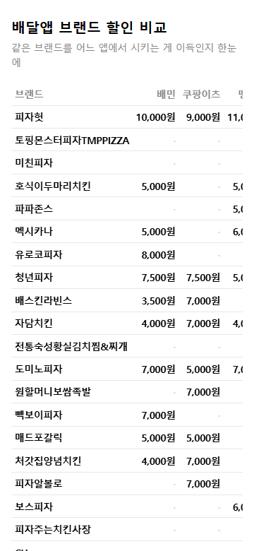 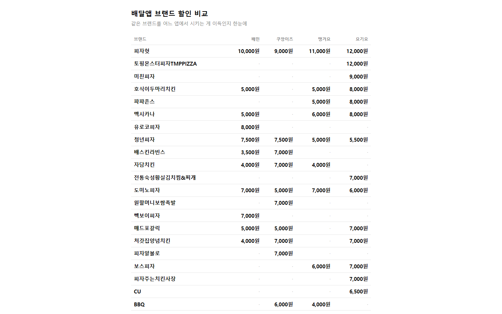

## 02. 2026-07-28 첫 배포, 카드형 화면으로 재설계

- 커밋: `321fc909` fix: 백엔드 주소를 고정값으로 하드코딩, 프록시/env var 제거
- 바뀐 것: 표를 걷고 브랜드 카드 그리드로 바꿨다. 카드마다 로고와 앱별 금액 칩. 오른쪽 위에 멤버십, 지역화폐 버튼(준비 중).
- 고른 근거: 첫 배포 시점. API가 14:43에 beggars-five.vercel.app 출처를 허용했고(`64b4e703`) 14:53 이 커밋이 운영 백엔드 주소를 박았다. 제목이 redesign인 커밋 3개(`f9335a49` 카드형 미니멀 UI로 전면 재설계 등). 01 대비 `web/src` +608 -56.
- 폰에서 카드가 오른쪽으로 넘친다. 금액 칩을 줄바꿈 없이 한 줄로 둔 그 시점 코드(`85c4f158`) 그대로다.
- 데이터: 운영 API `/api/brands`.

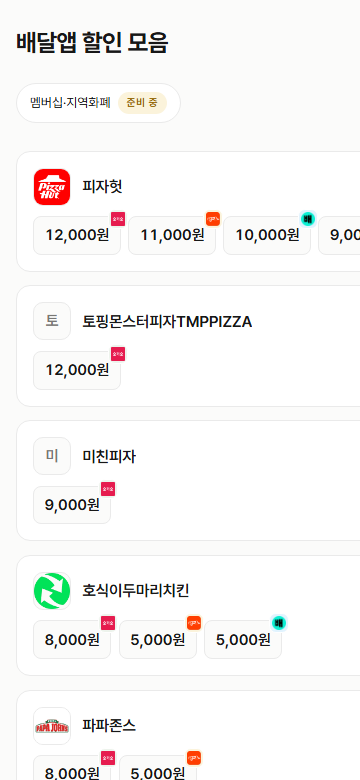 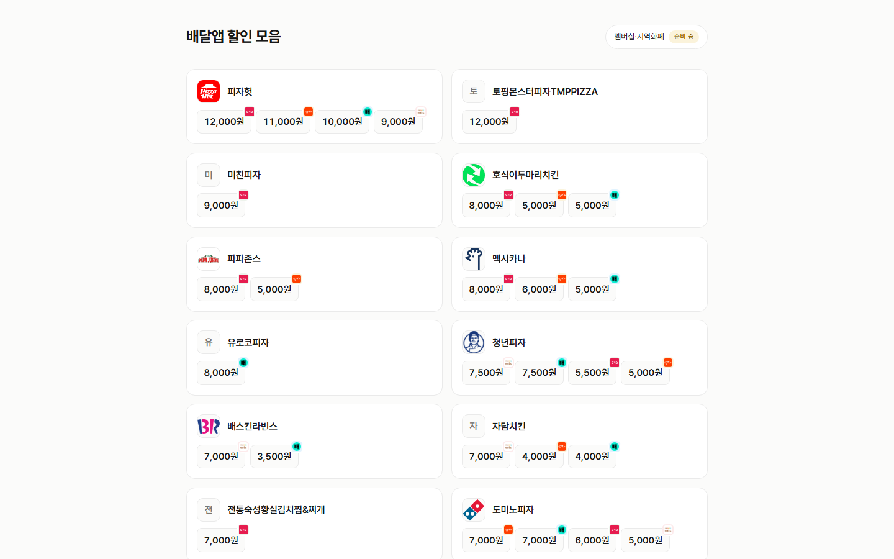

## 03. 2026-07-29 로고, 카테고리 바, 펼치는 브랜드 카드

- 커밋: `bb98bc31` fix: 상세에서 중복 금액과 원문 표시 제거
- 바뀐 것: 맨 위에 서비스 로고(딸깍)와 앱 아이콘 넷. 카테고리를 알약형 세그먼트로 두었다. 카드 오른쪽 위 화살표로 앱별 상세를 펼친다. 땡겨요 칩에 '지역' 배지.
- 고른 근거: 2026-07-28 1207줄, 2026-07-29 1319줄. 02 대비 +824 -218, 커밋 24개. 방문 측정(`analytics.js`)도 이때 들어왔다.
- 데이터: 운영 API `/api/brands`.

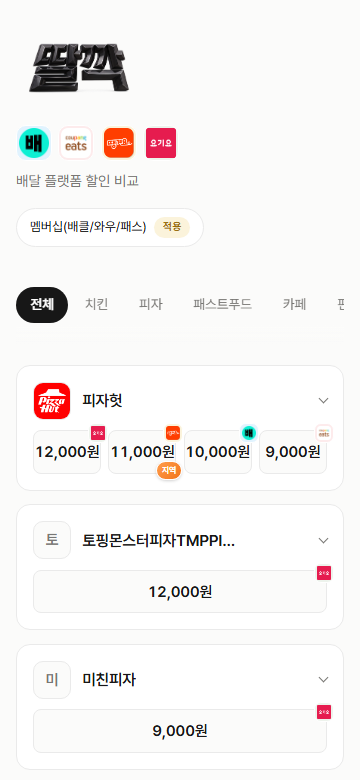 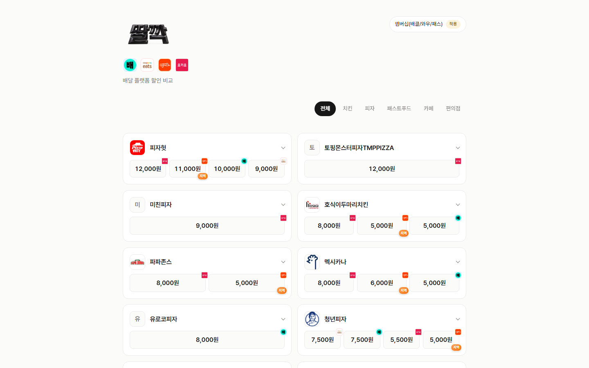

## 04. 2026-07-31 '오늘의 할인' 로고, 검색과 금액대 보기

- 커밋: `e31ff08d` fix: 브랜드 카드 딥링크로 들어오면 자동으로 펼친다
- 바뀐 것: 로고가 '오늘의 할인'으로 바뀌고 앱 아이콘을 2x2로 붙였다. 카테고리 줄 앞에 분류 기준 버튼(카테고리, 할인금액대, 최소주문금액대)과 도움말(?), 끝에 검색 버튼. 브랜드 딥링크(`#brand-이름`).
- 고른 근거: 2026-07-30 1169줄(검색, 금액대 슬라이더, 검색창 고정), 2026-07-31 385줄. 이틀을 07-31 마지막 커밋으로 묶었다. 03 대비 +825 -145, 커밋 25개.
- 데이터: 운영 API `/api/brands`.

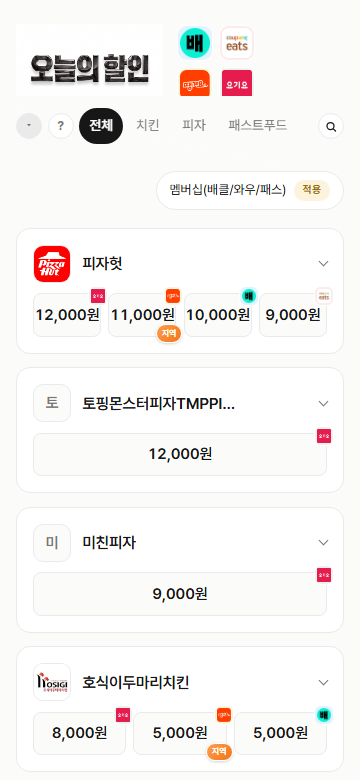 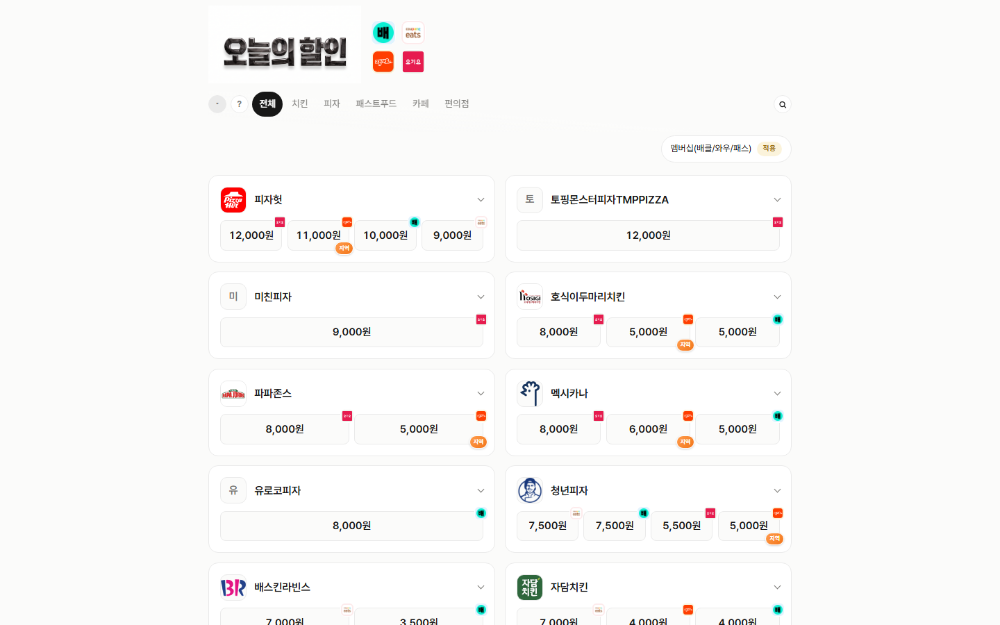

## 05. 2026-08-13 행사 배너와 한 줄 고정 타이틀바

- 커밋: `e1e46818` fix: 카테고리 판 사각형(아래만 둥글게) 복귀 + 당겨서 새로고침 복구
- 바뀐 것: 당일 행사 배너가 맨 위에 생겼다. 앱 아이콘과 카테고리 탭을 한 줄 타이틀바로 합쳐 화면 위에 고정했다. 금액 칩에 '최고', '최적' 표식과 멤버십 전용 배지.
- 고른 근거: 2026-08-12 2276줄, 2026-08-13 1835줄로 이틀 내리 컸다. 04 대비 +1663 -682, 커밋 69개. 새 파일 `EventBanner.jsx`, `logos.jsx`.
- 배너가 고정 타이틀바 밑에 깔리고 아래에 빈칸이 남는다. 배너를 타이틀바보다 먼저 그리는 그 시점 구조 그대로다. 이 무렵 배포는 별도 배포 저장소에서 나갔다. 그 저장소의 같은 시각 커밋과 `App.jsx`, `App.css`, `EventBanner.jsx`가 같음을 확인했다.
- 데이터: 운영 API `/api/brands`, `/api/banners`.

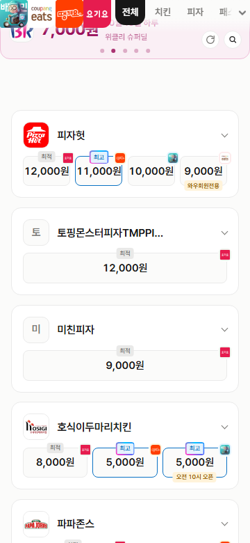 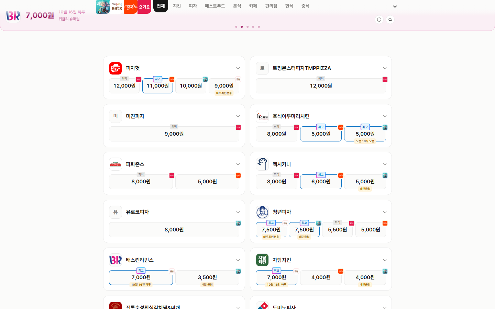

## 06. 2026-08-16 브랜드 카드 리워크, 최고 할인 단독 배치

- 커밋: `32f4ff74` feat: 프론트 API 호출을 같은 오리진으로 (vercel rewrites + vite 프록시)
- 바뀐 것: 카드 맨 위에 그 브랜드의 최고 할인 하나를 크게 두고 나머지 앱은 작은 칩으로 내렸다. 상세를 펼친 채로 시작한다. 앱 아이콘 아래 멤버십 이름(배민클럽, 쿠팡와우, 지역화폐, 요기패스), 카테고리는 'CATEGORY' 버튼 안으로.
- 고른 근거: 2026-08-16 하루 1825줄, 커밋 32개(`b7455801` 브랜드 카드 리워크). 05 대비 +841 -370.
- 배너가 타이틀바 밑에 깔리는 것은 05와 같다. 배포 저장소의 같은 시각 커밋과 세 파일이 같다.
- 데이터: 운영 API `/api/brands`, `/api/banners`. 이때부터 2026-09-11까지는 같은 오리진 `/api`를 Vercel이 넘겼다. 미리보기 프록시가 그 자리를 대신했다(주소 바꾸기 없음).

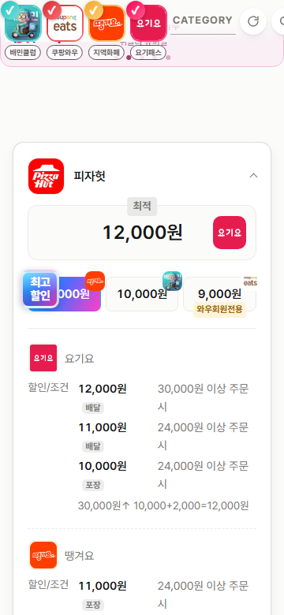 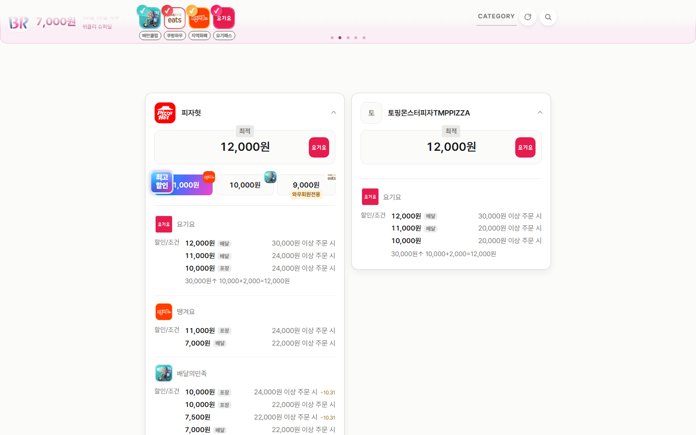

## 07. 2026-08-20 상단 바 A/B 시작

- 커밋: `2d514aa9` feat: 모노레포 web/을 배포본과 맞춘다 (A/B 런타임 분기)
- 바뀐 것: 방문자를 반반 나눠 상단 바 두 안을 보였다. A안은 앱 버튼과 분류 탭, B안은 검색창, 분류 메뉴 바, 필터 바텀시트 버튼. 배너가 타이틀바 아래로 내려왔고 카드 오른쪽 위에 담기(+) 버튼이 붙었다.
- 고른 근거: 2026-08-20 3337줄로 9월 말 전까지 하루 최대. 06 대비 +2649 -775. 새 파일 `TopBarA.jsx`, `MenuBar.jsx`, `FilterSheet.jsx`, `variant.js`.
- 데이터: 운영 API `/api/brands`, `/api/banners`. 두 안은 `?variant=a`, `?variant=b`로 찍었다.

A안 (`?variant=a`)

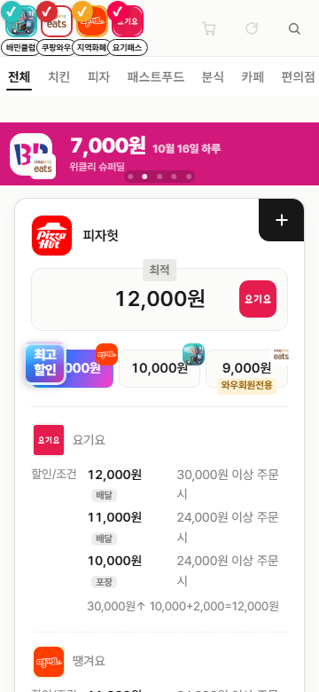 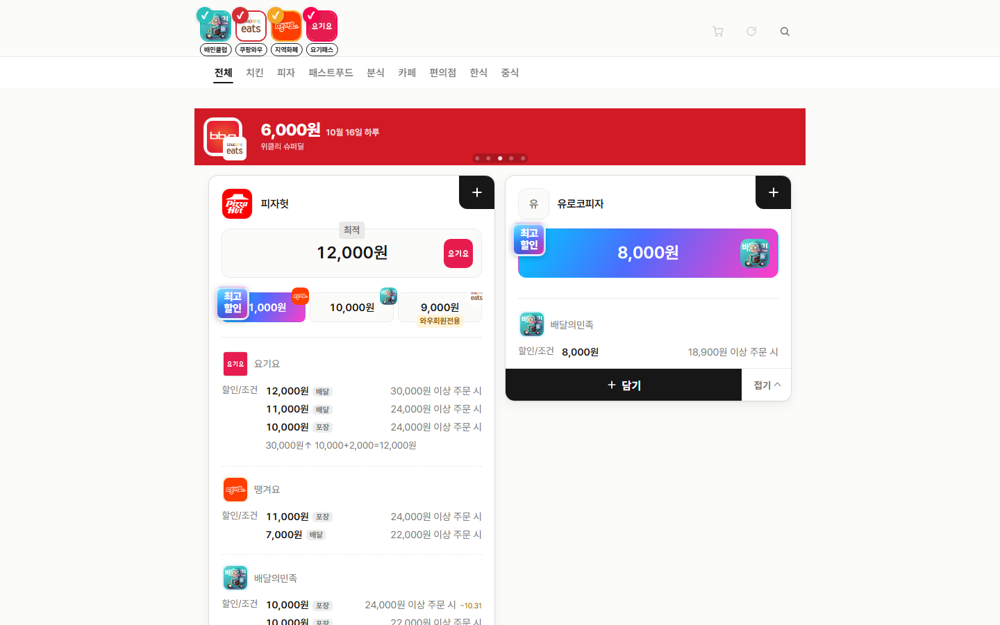

B안 (`?variant=b`)

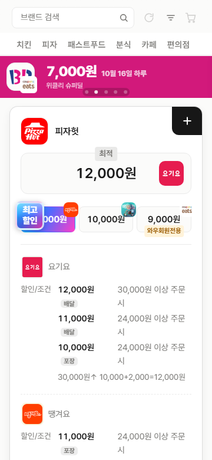 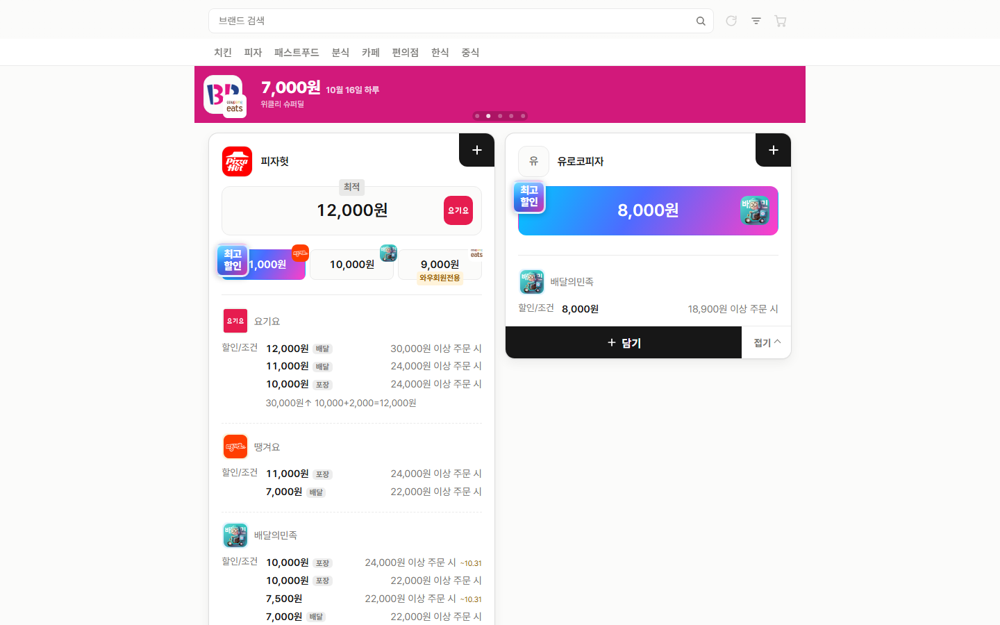

## 08. 2026-09-02 설문, 자동완성, 브랜드 페이지

- 커밋: `d94147e0` fix: 다음을 연타하다 마지막 탭이 제출로 들어가던 것 막는다
- 바뀐 것: 첫 화면 틀은 07과 같다. 담기 버튼이 빠지고 상세 조건이 '30,000원↑'처럼 짧아졌다. 그 사이 브랜드 자동완성(2026-08-25), 브랜드 페이지(2026-08-28), 보상 설문 카드와 캐러셀(2026-08-31~09-02)이 들어왔다.
- 고른 근거: 2026-08-31 828줄, 2026-09-02 1476줄. 07 대비 +2811 -231, 커밋 77개. 새 파일 `SurveyCard.jsx`, `SurveyDock.jsx`, `BrandSuggestions.jsx`.
- 설문은 대상 세션에만 떠서 이 화면에는 없다.
- 데이터: 운영 API `/api/brands`, `/api/banners`. 두 안은 `?variant=a`, `?variant=b`.

A안 (`?variant=a`)

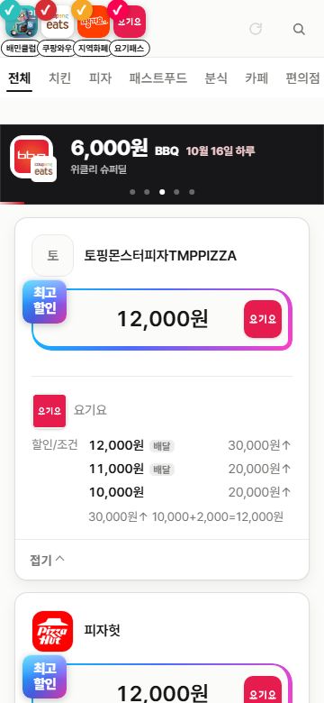 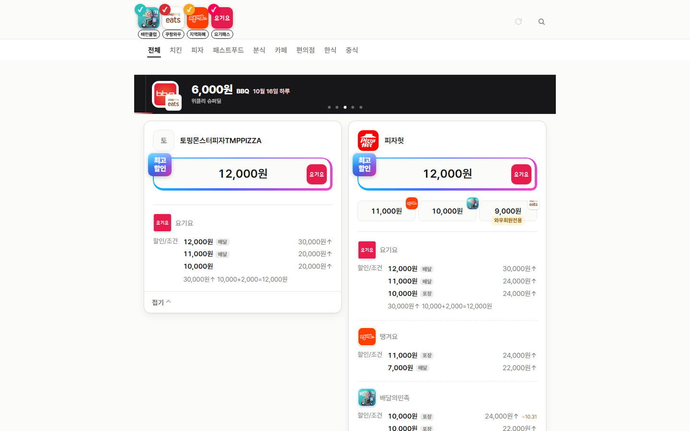

B안 (`?variant=b`)

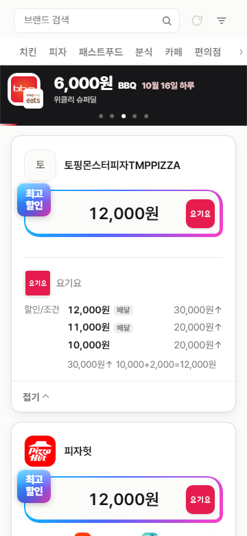 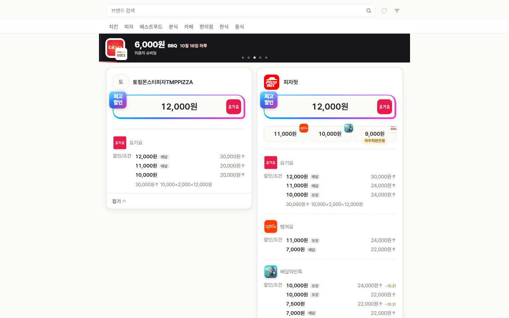

## 09. 2026-09-16 상단 바 A/B 종료, 배너 v3

- 커밋: `1bc19f05` merge: 배너 v3, transform 슬라이더, 앱 배지 우상단, 진행 링, 로고 192px (프리뷰 r1~r6 승인 2026-09-16)
- 바뀐 것: 상단 바를 A안 하나로 합치고(`1e9a40fc`, 2026-09-15) B안의 필터 바텀시트를 A 바 버튼으로 옮겼다. 홈 버튼이 생겼다. 배너는 큰 로고, 오른쪽 위 앱 배지, n/N 카운터와 멈춤 버튼, PC에서는 좌우 화살표.
- 고른 근거: 2026-09-15 1170줄(그중 삭제 1090줄, A/B 정리), 2026-09-16 2232줄. 08 대비 +1490 -1183, 커밋 53개.
- 데이터: 운영 API `/api/brands`, `/api/banners`.

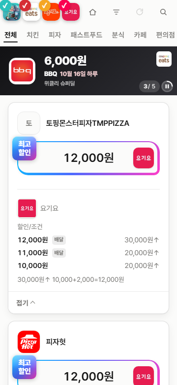 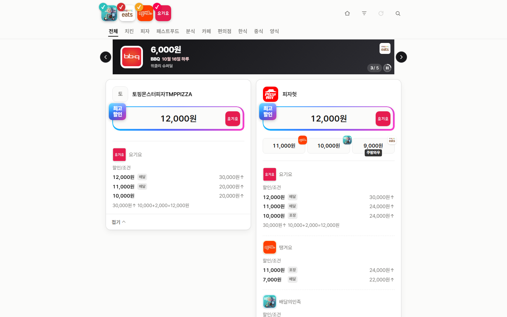

## 10. 2026-09-21 빠른 정렬 바, 스티키 탭 배지

- 커밋: `cf64f066` style(web): drop the random-coupon toggle from the quick bar
- 바뀐 것: 배너 아래 빠른 정렬 바(할인금액 높은순, 최소주문 낮은순). '최고' 같은 배지를 칸 모서리에 붙은 기울어진 탭으로 통일했다. 필터 시트 개편(플랫폼, 카테고리, 정렬, 멤버십)과 새벽 안내도 이때.
- 고른 근거: 2026-09-19 636줄, 09-20 251줄, 09-21 133줄. 09 대비 +640 -173, 커밋 55개.
- 데이터: 운영 API `/api/brands`, `/api/banners`.

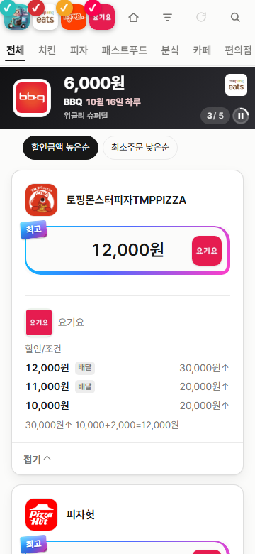 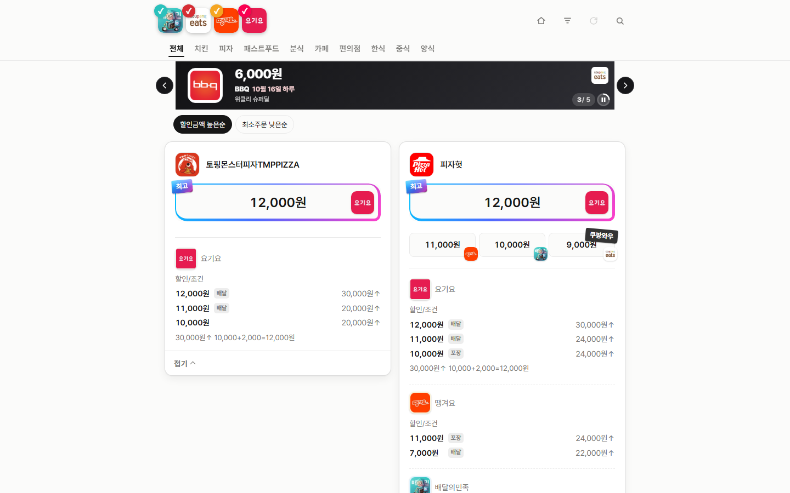

## 11. 2026-09-25 브랜드 숨기기, 알림 버튼

- 커밋: `8243c2a4` fix(web): 숨기기를 0.1초로, 확인 창은 바깥을 눌러 취소한다
- 바뀐 것: 카드 오른쪽 위 눈 가림 버튼으로 싫은 브랜드를 숨긴다. 상단 바에 알림(웹 푸시) 버튼. 정렬 바가 회색 판 스위치로 바뀌었고 자사앱 오퍼와 파비콘 교체도 이때.
- 고른 근거: 2026-09-23 1701줄, 2026-09-24 1430줄. 10 대비 +2552 -100, 커밋 31개. 새 파일 `HiddenBrandsSheet.jsx`, `HideBrandAsk.jsx`, `PushNotificationSetting.jsx`.
- 데이터: 운영 API `/api/brands`, `/api/banners`.

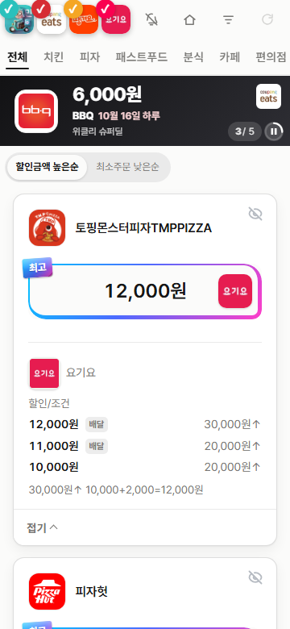 

## 12. 2026-10-02 파일 분리와 서버 렌더(화면은 그대로)

- 커밋: `ad6a5d59` perf(web): 카드는 첫 24장만 바로 채우고, 나머지는 목록 끝이 가까워질 때 채운다
- 바뀐 것: 화면은 11과 거의 같고 코드가 크게 바뀌었다. 2026-09-29 `App.jsx`, `App.css`를 컴포넌트와 영역별 파일로 나눴고(`cdbc1b12`), 2026-10-01 홈을 서버가 그리게 했다(`6d768d01` 홈 SSR 스파이크). 검색 노출 문구와 바닥글 브랜드 링크도 이때.
- 고른 근거: 2026-09-29 하루 9217줄로 전체 기간 최대. 11 대비 +4775 -4878, 커밋 42개.
- 데이터: 운영 API `/api/brands`, `/api/banners`. SSR 대신 템플릿으로 찍었다(찍은 방법 참고).

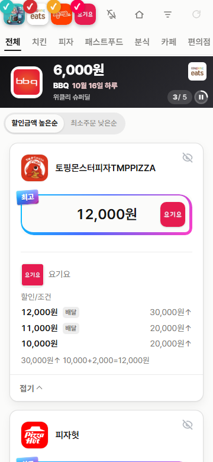 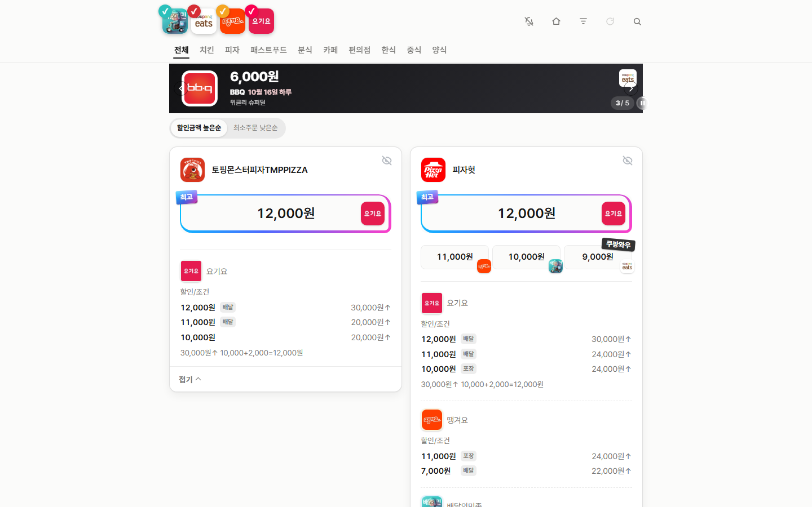

## 13. 2026-10-04 메인 화면 A/B 시작, 쿠폰 카드 안

- 커밋: `7fc8daf0` feat(web): 멤버십 필터 실제 동작, 배민클럽, 쿠팡와우(요기패스는 구현 예정)
- 바뀐 것: 쿠폰 카드 안이 생겼다. 카드마다 대표 쿠폰 한 장(금액, 최소주문, 앱으로 가는 꼭지), 동점 최고는 가로 캐러셀, 아래에 다른 앱 금액과 '자세히 보기'. 상단 바는 9월 B안(검색 + 분류 메뉴 바)을 되살렸다. 기존 안은 11과 같고 '5천원 이상만' 스위치가 붙었다. 2026-10-05 00:00부터 방문자 반반(`94be3db7`).
- 고른 근거: 2026-10-03 2134줄, 2026-10-04 1678줄. 12 대비 +1826 -224, 커밋 52개. 새 파일 `CouponCard.jsx`, `couponModel.js`, `homeExperiment.js`, `TopBarB.jsx`.
- 데이터: 운영 API `/api/brands`, `/api/banners`. 두 안은 `?home=a`, `?home=old`.

쿠폰 카드 안 (`?home=a`)

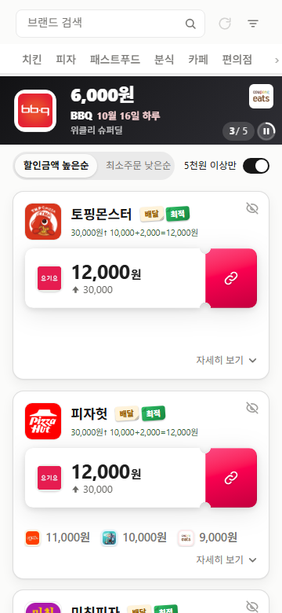 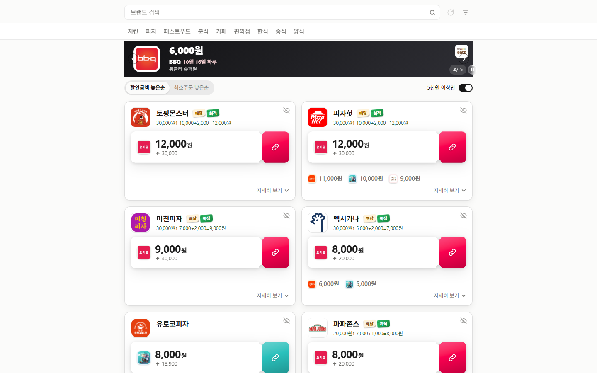

기존 안 (`?home=old`)

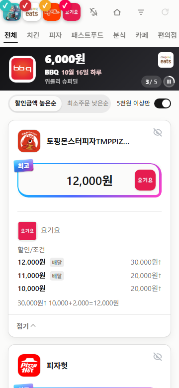 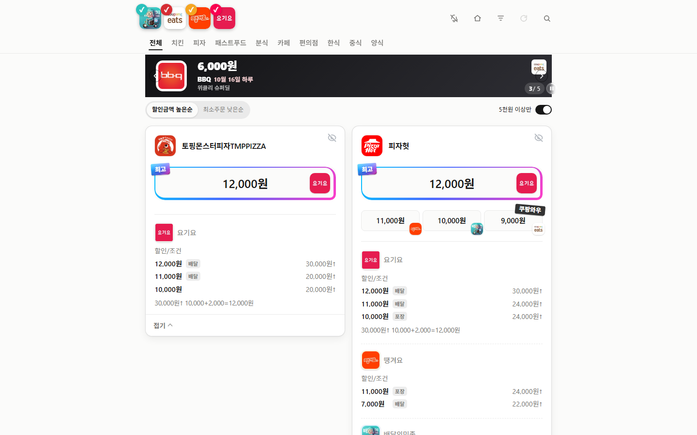

## 14. 2026-10-07 토스풍 손질, 하단 배너 도크, 신규 탭

- 커밋: `f9e72060` fix(web): 시트 '원 할인'은 기본 글자색, 쿠폰 위 배달/포장 배지를 상세 조건 칩 색으로
- 바뀐 것: 토스 요소를 들였다(영역별 바탕, 납작한 배지, 주황 금액, 테두리 대신 얕은 그림자, `c186d463`). 금액을 'n원 할인'으로 적는다. 두 안 모두 배너를 위 캐러셀 대신 하단 도크로 옮겼고(`e073bdda`, `8175b967`) 분류에 '신규 N' 탭이 생겼다. 쿠폰 카드 쪽도 서버가 처음부터 그린다(쿠키 dk_home, `768f839a`).
- 고른 근거: 2026-10-05 520줄, 10-06 507줄, 10-07 488줄로 사흘 내리 커밋 99개. 13 대비 +778 -137, 커밋 101개.
- 데이터: 운영 API `/api/brands`, `/api/banners`. 두 안은 `?home=a`, `?home=old`.

쿠폰 카드 안 (`?home=a`)

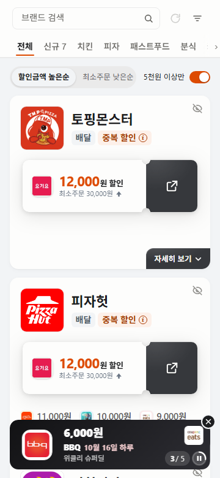 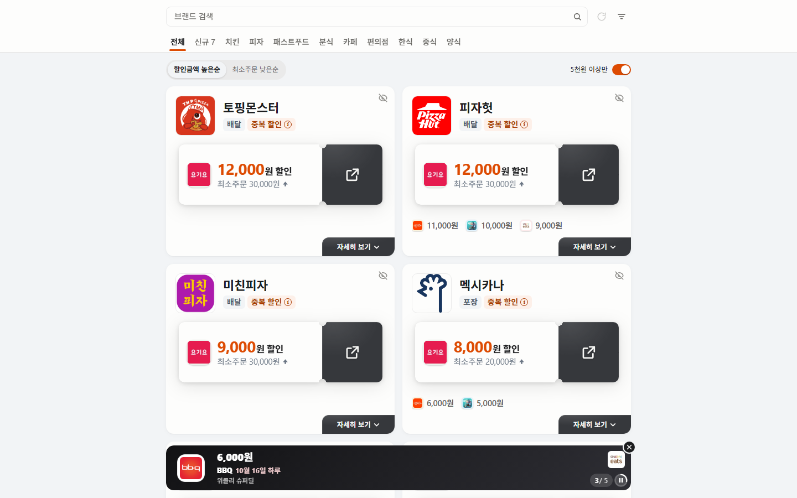

기존 안 (`?home=old`)

 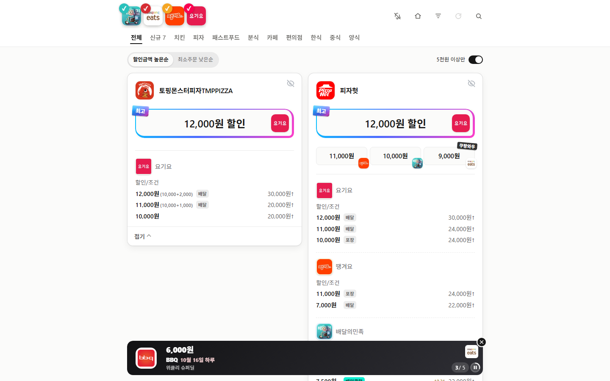

## 15. 2026-10-11 할인 그래프(시트), 신규 탭 강조

- 커밋: `3eb77a9b` fix(web): 이전 홈의 1+1 칩에도 최고 칸 테두리
- 바뀐 것: 첫 화면 차이는 작다. 쿠폰 카드 쪽 '신규 N' 탭에 강조 바탕. 화면 밖에서는 바텀시트에 할인 이력 그래프(`BestHistoryChart.jsx`), 대표 메뉴명 검색, 1+1 묶음 행사를 대표 쿠폰 위 한 줄로 세웠다.
- 고른 근거: 2026-10-08 529줄, 2026-10-09 793줄. 14 대비 +947 -87, 커밋 35개. 코드 변경(새 그래프 컴포넌트)이 커서 넣었다.
- 데이터: 운영 API `/api/brands`, `/api/banners`. 두 안은 `?home=a`, `?home=old`.

쿠폰 카드 안 (`?home=a`)

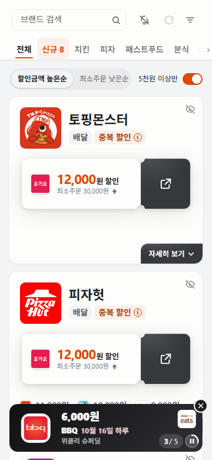 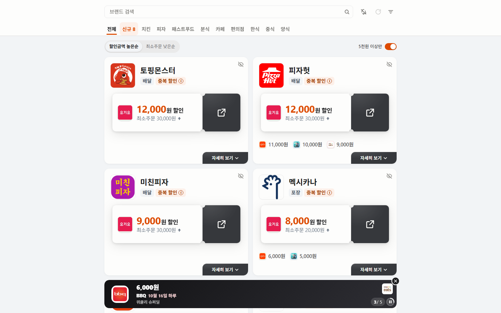

기존 안 (`?home=old`)

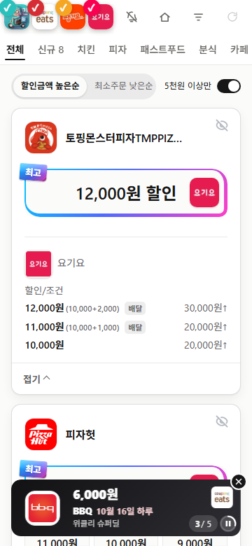 

## 16. 2026-10-13 첫 방문 안내

- 커밋: `9e73dfa4` web: 5천원 스위치는 운영 모양으로 되돌리고, 정렬 칩을 스위치 말투로
- 바뀐 것: 처음 온 사람에게 단계별 안내를 띄운다(`049341d7`, 두 안 모두). 새 프로필로 찍어 안내가 화면을 덮었다. 정렬 칩이 판 없는 글자형으로 바뀌고 기존 안 분류 탭이 커졌다. 바닥글 정리와 /about, /privacy 소개 페이지도 이때.
- 고른 근거: 2026-10-12 320줄, 2026-10-13 601줄. 15 대비 +374 -109, 커밋 27개. 새 파일 `FirstVisitGuide.jsx`.
- 데이터: 운영 API `/api/brands`, `/api/banners`. 두 안은 `?home=a`, `?home=old`.

쿠폰 카드 안 (`?home=a`)

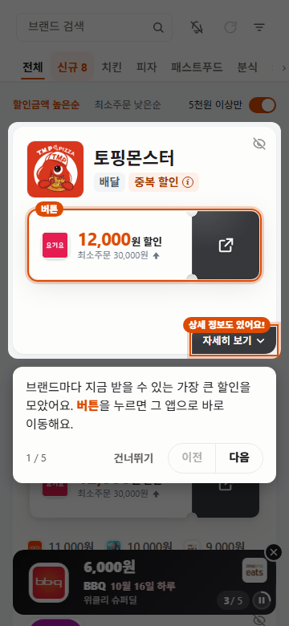 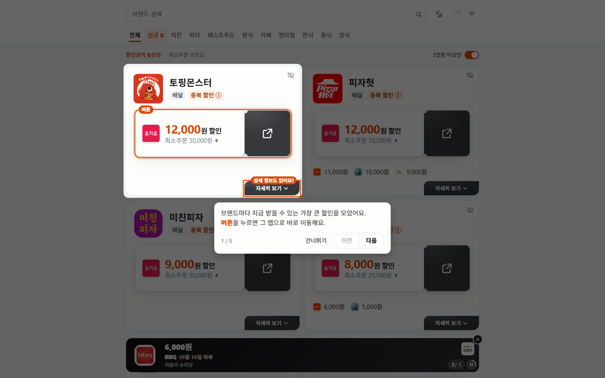

기존 안 (`?home=old`)

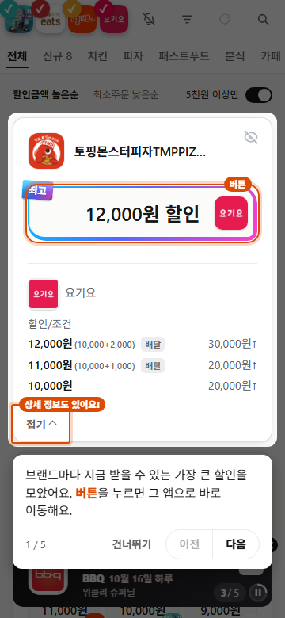 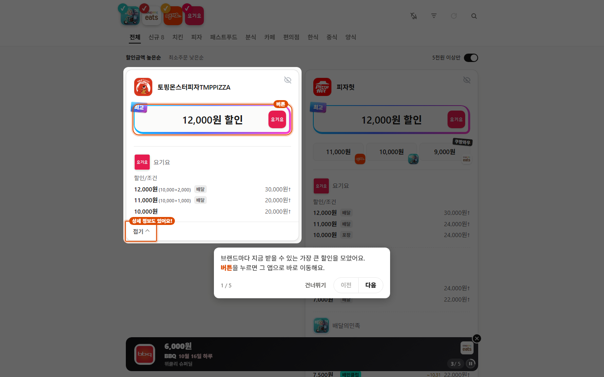

## 17. 2026-10-14 오늘 인기 띠, 첫 방문 안내 철회

- 커밋: `3b51a4c6` perf(web): 첫 목록 등장 애니메이션 제거, 로고 192px WebP
- 바뀐 것: 정렬 줄 아래 '오늘 인기' 띠(누른 사람 많은 순 다섯과 등락, `c6b56a1e`). 정렬 바가 주황 판 스위치로 바뀌었다. 첫 방문 안내는 신규 첫 세션 전환을 절반으로 깎아 뺐다(`a06d6557`). 필터 시트 한 줄 캐러셀과 할인 기록 그래프 개편도 이때.
- 고른 근거: 2026-10-14 하루 1388줄, 커밋 34개. 16 대비 +772 -270, 커밋 63개. 새 파일 `PopularStrip.jsx`, `ErrorBoundary.jsx`, `telemetry.js`.
- 데이터: 운영 API `/api/brands`(오늘 인기 순위 포함), `/api/banners`. 두 안은 `?home=a`, `?home=old`.

쿠폰 카드 안 (`?home=a`)

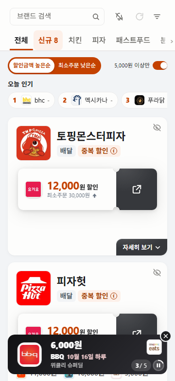 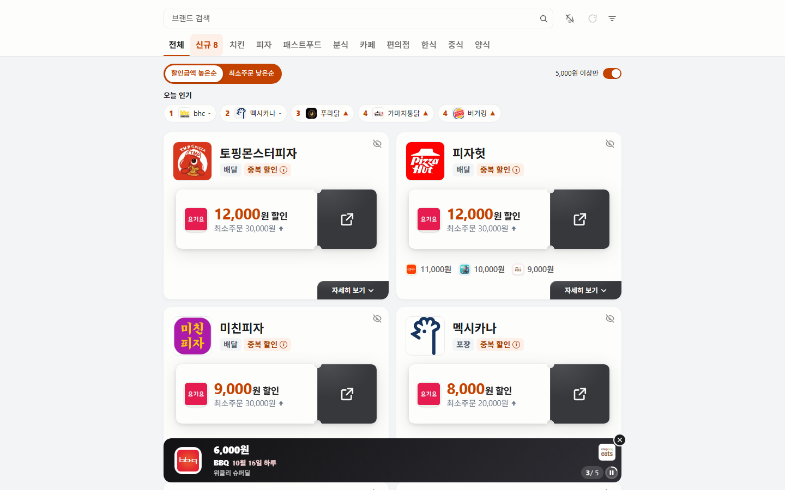

기존 안 (`?home=old`)

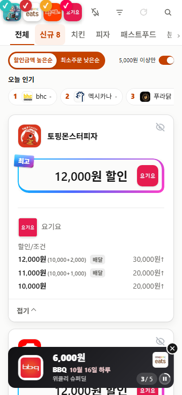 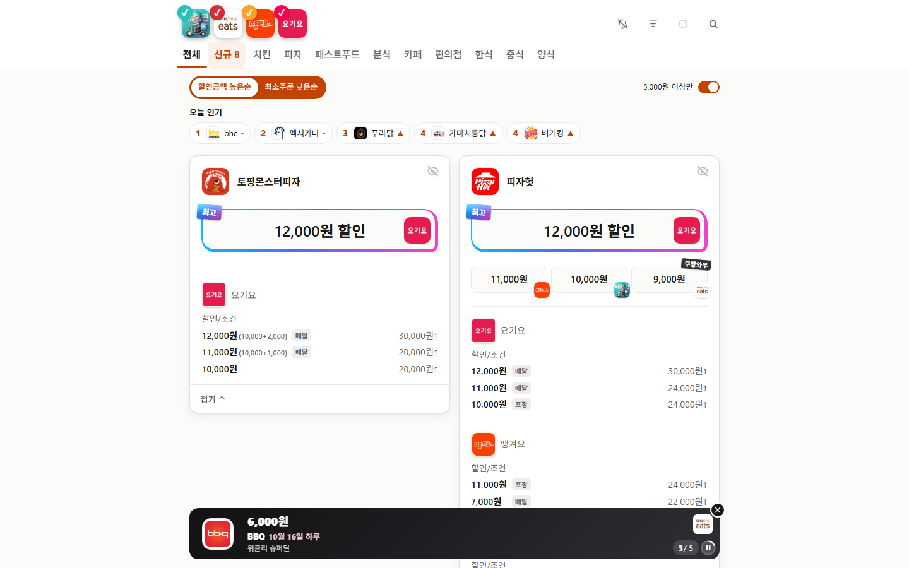

## 18. 2026-10-16 현재 main, 신규 탭 없애고 신규를 맨 위로

- 커밋: `c29c422d` [WEB][CI] fix: iOS 넘김 쿠폰 깨짐, web PR마다 iOS 배치 검사 (#86)
- 바뀐 것: '신규' 탭을 없애고 기본 정렬에서 신규 브랜드를 맨 위로 올렸다(`b73b466b`). 신규 쿠폰에 '신규 할인' 표시. 하단 배너 도크는 남기고 넘김을 8초로 늦췄다. 같은 앱의 선착순을 상시 오퍼 구간으로 합쳤다(#85).
- 고른 근거: 지금 운영 중인 main. 17 대비 +172 -47, 커밋 11개.
- 데이터: 운영 API `/api/brands`, `/api/banners`. 두 안은 `?home=a`, `?home=old`.

쿠폰 카드 안 (`?home=a`)

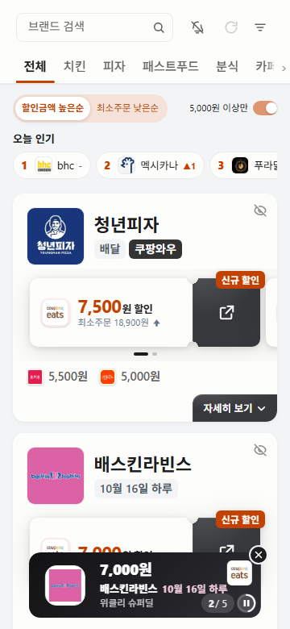 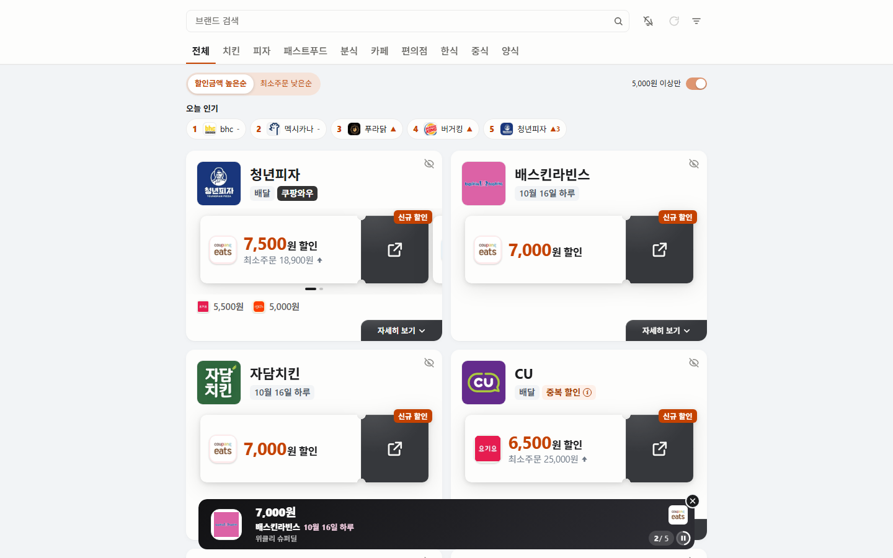

기존 안 (`?home=old`)

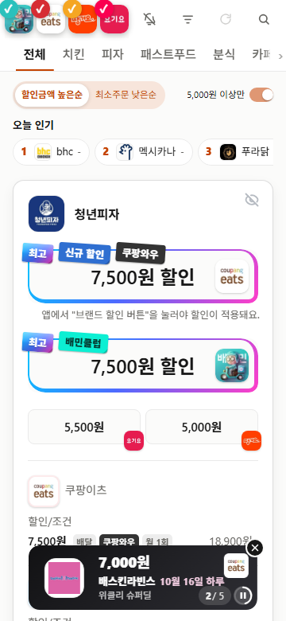 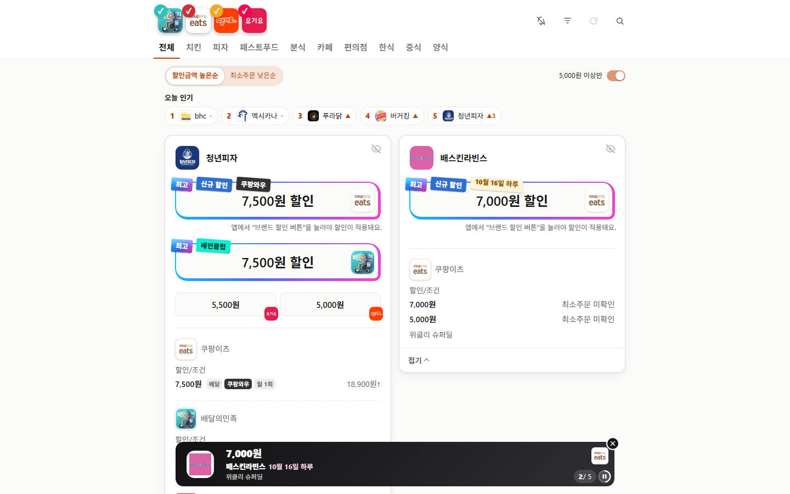
